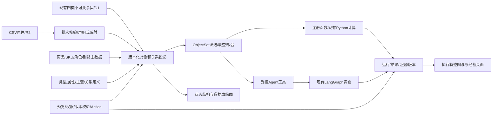
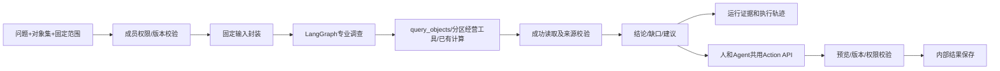

# NEO Ontology 后端平台

此实现以 Palantir Ontology 的业务结构为参考：Object Types、Properties、Link Types、ObjectSets、Functions、Actions，以及通过同一对象视图工作的 Agent。它是 NEO 自有 TypeScript/Python 平台，不依赖 Foundry 账号或复用其专有服务。

## 入口与结构

入口 `/data/ontology`，原 `/demo` 继续面向经营使用者。八个模块：总览、数据接入、Ontology、对象探索、函数与模型、Action 与反馈、Agent、运行与运维。

关系图来自后端定义和记录，节点、连线可点击读取详情；拖动只保存本机布局。实现成熟度与运行状态分别显示。空类型显示 `no_objects`；模型显示 `evaluation_pending`。

## 核心语义

默认定义 `neo-default-v1` 包含16种类型、17种关系：商品、SKU、角色、渠道、仓库、订单、支付明细、退款、事件、费用、库存、到货、预测、情景、老板选择、外部证据。主键为稳定业务键；多对多使用显式关联类型和两端键。源属性、计算属性、可编辑属性分别管理。

底层支持自由类型，管理员可通过定义 API 增加类型/关系，无需新增业务分支即可 CSV 导入、查询、联查和汇总；界面优先展示 NEO 固定配置。字段映射支持重命名、类型转换、比例/单位换算，禁止上传可执行脚本。函数和 Action 实现由代码注册。

八张增量表位于 `db/ontology-schema.ts`：定义、通用导入、投影、对象、关系、对象集、编辑、运行。迁移 `drizzle/0006_aberrant_stardust.sql` 只增加表和索引，不替换 D1/Drizzle/R2。

投影冻结完整定义、映射、输入、来源、企业、数据性质、经营截至时点 `asOf`、系统知识截止 `knownAt`。旧对象视图和结果可以回读。业务快照投影按快照的真实事实清单和生成时点取数；不能把后来导入、后来结论加入早期输入。到货计划允许未来业务日期，但须在知识截止时点已可知。晚到数据的知识时间来自系统记录，不能用手工业务日期倒填。

缺主数据时可生成带来源的引用对象，显示 `REFERENCE_ONLY`，不虚构名称、库存或业务结果。源事实不可变；编辑由 Action 独立记录，按 source/review/override 规则处理与后续源更新的冲突。并发编辑和发布使用版本校验，过期版本拒绝。

ObjectSet 支持 eq/in/gte/lte/isNull 筛选、单跳正反向联查、分页、count/sum；保存时绑定投影版本。企业成员权限和 demo/business 隔离沿用现有服务。新读取 GET 不会发起计算或 Agent 刷新。

## Agent 与计算

Agent 接收固定快照、对象定义、对象关系、请求对象集和版本引用，`query_objects` 与工作台遵循相同查询语义。成功读取才计为证据；经营读取失败不能放行带证据的结论。后续专业调查失败保留已完成结论、来源和读取轨迹；LangGraph 原有 checkpoint、专业分区和巡检逻辑继续保留。

当前 Agent 工具只读；Action API 已统一，写回由明确提交执行，未把自动业务写入权限授予 LLM。Ontology 条件自动触发仍关闭。现有项目独立巡检机制保持原行为。

count/sum 在 TypeScript 查询同一对象集；metrics 回读固定经营快照；forecast/scenario 适配现有 FastAPI 计算接口，保存原 `neo_artifacts` 并附 `ontologyRef`；保存老板选择只保存内部记录。当前 Python 预测以快照整体计算；不支持任意 ObjectSet 子集预测，传入子集会明确拒绝，避免范围错误。原产品页面保持既有组件；新结果通过原 artifact 接口回读，尚未将原所有业务页面改为通用对象查询。

较大视图使用 gzip/base64 无损传输，保留全部对象及关系；服务体预算1.9MB，解压上限16MiB。工具返回预算128KiB，超过时要求缩小范围或分页，不截断后伪称完整证据。单次专业调查沿用最多16次工具调用和600秒服务任务超时；记录 usage，尚无企业货币额度计费系统。

## 接口

统一前缀 `/api/v1/ontology`，所有请求携带 `businessId`，读取携带 `dataNature`；写入 JSON 同时携带 `dataNature`。

| 资源 | 方法和用途 |
|---|---|
| definitions | GET 读取；POST `{baseId,definition}` 保存草稿 |
| imports | multipart POST `{file,typeId,definitionId,sourceName,dataNature}` 校验/R2原件；GET 批次、详情、`/{id}/file` |
| actions/preview、actions/submit | POST 发布定义、提交导入、构建投影、编辑属性、保存选择 |
| builds、snapshots、quality | GET 读取记录；POST builds 明确发起投影 |
| objects/query、objects/{typeId}/{objectId} | POST 查询（只读操作）；GET 对象及关系 |
| object-sets | POST `{buildId,name,query,dataNature}` 保存；GET 列表与详情回读 |
| resources、graph | GET 资源目录，业务结构/血缘/执行轨迹 |
| functions、functions/{id}/runs | GET 目录；POST `{buildId,requestId,query,...}` 执行 |
| agents、agents/runs | GET 职责/允许工具；POST `{buildId,requestId,mode,question,query,dataNature}` |
| runs、runs/{id}、runs/{id}/trace | GET 已保存状态和证据；POST refresh/retry/recover 明确刷新、重试、中断恢复 |
| health、health/probe | GET 已保存探测记录；POST 探测现有服务，校验 `ontologyVersion=objectset-v1` |

Action 示例：`{action:'build_projection',snapshotId,definitionId:'neo-default-v1',dataNature:'demo',requestId:'stable-unique-id'}`。同一 requestId 同一内容重放返回原记录，内容不同返回冲突。POST `/actions/preview` 返回影响后，POST `/actions/submit` 提交。失败的副作用任务恢复先对账已有结果，不能简单重复创建。

自由类型示例：GET 当前定义，在 types 增加 `{id:'vendor',name:'供应商',primaryKey:'code',title:'name',properties:{code:{type:'string',required:true},name:{type:'string'}}}`，POST definitions 保存草稿，以 publish_definition Action 发布；CSV `code,name` 通过通用 imports 校验/提交后构建。查询 `{dataNature:'demo',buildId,query:{typeId:'vendor',limit:50}}`。关系通过 LinkType 定义新增，不依赖供应商专用代码。

## 本地启动与运维

安装已有依赖后 `npm run db:local` 执行本地增量迁移；已有运行实例应先备份 `.wrangler/state/v3/d1` 的一致 SQLite 副本。`npm run dev:neo` 沿用现有本地启动流程，凭证只放 `agent-service/.env` 和 `.dev.vars`，不得进入浏览器源码。已有服务运行时优先保留当前进程并热更新前端，Python 代码需确认队列空闲后重启服务。

工作台运行页支持失败原因、明确重试、超过15分钟运行中任务的对账恢复、显式刷新和服务健康探测。原件继续保存 R2，远端部署需使用现有 D1/R2 备份机制；本轮没有创建生产自动备份任务或部署。

上传上限1MiB/1000行/50列，JSON128KiB，投影事实与主数据各最多10000，查询单页最多100；目录最近100条。超过边界明确报错。这是当前可验收版本的规模限制，扩大数据量时须增加异步投影和增量分页。

## 验证及业务边界

`npm test` 包含83项 Node 测试、生产构建、20项渲染测试；`tsc --noEmit --incremental false`；Python tests44项。测试覆盖自由类型及关联、来源和时点、权限/企业隔离、幂等/冲突/恢复、Action、计算/Agent适配和无损大视图。模拟模型/检索的测试不等于真实模型生产验收。

浏览器实操通过 CSV 上传→校验→提交→构建→查对象→保存并重开对象集→数量计算→执行轨迹→刷新回读；节点拖动只保存布局。

现有 NEO demo 的935对象/1458关系验证影子投影能承接原数据。库存与渠道主档缺失产生引用警告，须补真实主数据才能消除。8周演示历史不足当前16周回测门槛，不能声称预测提升。正式评估须固定企业目标和时间切分，比较 Seasonal Naive、现有均值、候选模型与关系特征增量，报告 WAPE 等误差，不把 WAPE 写成准确率。
