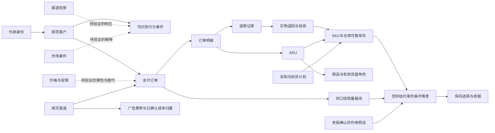

# NEO 成熟实践与业务知识补全报告

研究日期：2026-10-04。用于当前 NEO 的业务建模、开发取舍和后续验收；不是供应商采购结论，也不是产品完成验收。

## 推荐结论

NEO 的主线应继续围绕“可信资料 → 同范围判断 → 条件预测 → 方案比较 → 保存老板选择 → 回看依据”。优先补齐客户身份与同群转化、订单与退款语义、库存状态与时点、指标口径、版本一致性。这些会直接决定看板和智能体的结论是否可靠。

成熟实践值得借鉴的是机制：PostHog 的身份与窗口漏斗、Shopify 的交易和库存状态、dbt 的集中指标与历史版本、Palantir 的业务对象与受控变更、LangGraph 的持久化状态。它们分别解决不同问题，不能用一套平台名替代整个经营闭环。[PostHog](https://posthog.com/docs/product-analytics/funnels)、[Shopify库存](https://shopify.dev/docs/apps/build/orders-fulfillment/inventory-management-apps)、[dbt指标](https://docs.getdbt.com/docs/use-dbt-semantic-layer/dbt-sl?version=2)、[Palantir](https://www.palantir.com/docs/foundry/ontology/overview)、[LangGraph](https://docs.langchain.com/oss/python/langgraph/persistence)。

**建议保留现有 TypeScript/React、D1/Drizzle/R2、FastAPI/LangGraph 技术路线，先整合已有隔离工作线的可验证成果。**当前阶段不建议为了参考成熟产品而另购或重建大型平台。统一业务知识和契约的收益，比换框架更直接；这是一项结合项目规模和已有投入的研究判断。

预测能力与经营因果能力要分别验证。预测误差下降不能证明增加投放、降价或补货产生增量收益；外部案例的参数也不能直接当本企业参数。[Meridian方法说明](https://developers.google.com/meridian/docs/advanced-modeling/control-variables)、[Google增量与归因](https://support.google.com/google-ads/answer/14102450?hl=en-AU)。

本次已把研究补入项目下的新研究目录：50项模块/规则研究、30条业务关系知识，以及逐文件定位索引。后续开发可直接引用R编号和K编号；本次交付未将研究建议实施成产品代码、商户配置或真实业务数据。

## 范围、覆盖与检索方法

主项目：`/Users/majun/Desktop/NEO/NEO后端交接包2026-09-30/growthos-dashboard`。同时纳入`监督/`、`虚拟数据库_Demo/`、`并行优化/2026-10-04/`的资料、源码副本与交付记录。

源文件索引记录于 **2026-10-04 13:41（北京时间）**：1,102个文本文件，按内容Hash去重401份；主项目244个，隔离副本783个，资料/监督75个；索引3,912处函数/类型/类声明。文件数包含配置和交付JSON，不能换算为功能数或完成比例。脚本读取全文用于路径、符号、文档标题和指纹索引；业务判断来自关键源码与文档的语义核读，**没有把机器扫描冒充1,102个文件逐行人工审计**。

索引排除依赖、构建与运行缓存、凭证、数据库、二进制图片、压缩包、原始CSV行、日志/文本运行输出及依赖锁文件。CSV字段通过模板、字段字典和源码核读，本次未重新对174份CSV逐行对账，亦未重做276张截图的视觉验收。排除数量及目录边界保存在`项目检索索引.json`。并发开发可能继续改变文件，指纹是读取时点证据，不是原子整仓备份。

外部核查29个一手来源，包括产品/开发文档、开放规范、作者教材及2项原始研究摘要。使用官方来源确认机制，结合项目源码评估适用性；“成熟”在此指有成体系公开机制与明确边界，**未以客户数量、市场份额、供应商营收、营销成功案例推定效果**。本次没有供应商账号内实操、完整商业条款审查、客户访谈或独立市场份额统计。

检索围绕6个问题展开：

1. 每个页面和后端模块最终支持哪个经营决定，它依赖什么业务事实？
2. 成熟系统如何处理身份、粒度、时间、指标口径和业务关系？
3. NEO哪些地方已有机制、只有副本实现，哪些尚缺规则或商户资料？
4. 哪些关系能直接建模，哪些是待验证的因果假说？
5. 如何验证预测、情景、Agent结论和老板选择的一致性？
6. 哪些机制现在值得采用，哪些会增加不必要的平台和维护成本？

## 当前项目证据与已有工作

|已核读的内容|本次能得出的结论|不能延伸成的结论|
|---|---|---|
|主`server/templates.ts`/`contracts.ts`/`csv.ts`|四类事实、事件可有contact_id、订单模板缺客户字段；退款quantity须为正整数|不能认为客户漏斗或只有金额退款已有完整支持|
|主`server/snapshots.ts`|按来源/订单去重、同期金额公式、最新库存、null和覆盖声明已有实现|覆盖声明不证明资料完整或真实企业验收|
|主`server/ontology/model.ts`/`project.ts`|16类型17关系、自由类型、版本化投影与REFERENCE_ONLY机制；默认类型缺客户闭环|后台对象存在不证明原/demo已消费该关系|
|主`lib/operating-domain-data.ts`|覆盖天数以近期支付数量估计，供给角色/矩阵有动态适配|支付不证明出库；有记录不证明达标、健康或因果|
|主`agent-service/neo_agent/engine.py`|确定性28天模拟、显式假设、至少16周回测门槛；区间标记为假设敏感性|不是已校准概率区间，也不是已证实的企业预测提升|
|主`server/decision-readback.ts`与`lib/decision-history.ts`|两保存路径回读适配与范围/父基线校验代码已存在|不能照抄旧台账写“周报仍必然崩溃”，本轮也未重做浏览器复验|
|隔离`data-ingestion/docs/optimization-data-contract.md`|已形成v2客户、身份、供给规则、主数据有效版本与knownAt契约|副本契约不等于主线完成整合与独立验收|
|隔离`agent-reliability/outputs/optimization-handoff/handoff.md`|开发方自报优先队列、领取/恢复/取消、调用重放和预算边界|自报测试不等于本研究独立重跑，也不等于真实调用效果|
|隔离`synthetic-data/outputs/optimization-handoff/handoff.md`|已有24周合成资料和独立期望、主数据关系与正式导入缺口清单|SYNTHETIC_DEMO不等于真实客户资料和预测价值|
|`监督/forecast-acceptance-2026-10-04/验收结论.md`|存在库存无销量商品遗漏的独立缺陷记录、链路与时点验收前置条件|该历史被验版本的缺陷不能未经最新复验视为所有当前分支仍有|

本表依据可从[主项目模板](/Users/majun/Desktop/NEO/NEO后端交接包2026-09-30/growthos-dashboard/server/templates.ts)、[经营快照](/Users/majun/Desktop/NEO/NEO后端交接包2026-09-30/growthos-dashboard/server/snapshots.ts)、[默认对象关系](/Users/majun/Desktop/NEO/NEO后端交接包2026-09-30/growthos-dashboard/server/ontology/model.ts)、[副本v2契约](/Users/majun/Desktop/NEO/并行优化/2026-10-04/data-ingestion/docs/optimization-data-contract.md)、[预测独立验收](/Users/majun/Desktop/NEO/监督/forecast-acceptance-2026-10-04/验收结论.md)回读。其余源码位置在R01–R50逐项给出。

**交付前并发更新复核：**13:54文件校验发现5个文件相对13:41索引有更新，已重点回读最新数据契约和监督台账。最新监督记录称无销量新品库存遗漏的9项独立检查全部通过、原症状已消除；这属于监督方记录，本研究未亲自重跑，完整整合仍待验。因此库存遗漏在本文只作为必须保留的回归案例，不登记为当前未修复缺陷。最新v2明确身份或来源覆盖不足时转化率为null，单渠道快照不能使用any跨渠道漏斗；前端客户端若仍固定模板v1不能提交新资料kind。这些应成为整合关口，而非重写已有规则。监督台账另记其自动监督已经启用，本研究没有新建或修改该任务。

## 成熟方案的取舍与维护成本

|参考对象|值得吸收|NEO当前采用方式|长期成本及切换代价|
|---|---|---|---|
|PostHog|身份命名空间、有序漏斗、成熟窗口、可解释分母|在现有导入/快照实现语义；不自动安装分析平台|身份修订会改变历史群体，须留映射版本；迁移分析平台时仍需核对去重规则。[官方身份与漏斗](https://posthog.com/docs/data/anonymous-vs-identified-events)|
|Shopify/Odoo|交易状态、库存状态、补货目标/提前期|制定源系统映射与最小供给规则|状态越多，源映射和对账成本越高；不能直接复制商户阈值。[库存状态](https://shopify.dev/docs/apps/build/orders-fulfillment/inventory-management-apps)、[补货机制](https://www.odoo.com/documentation/17.0/applications/inventory_and_mrp/inventory/warehouses_storage/replenishment/reordering_rules.html)|
|dbt / DataWorks|指标集中定义、历史状态、声明式质量规则|现有TS/Python维护一个轻量指标和规则目录|全平台引入会增加调度、模型与权限运维；先保存可迁移的规则ID/版本。[dbt](https://docs.getdbt.com/docs/use-dbt-semantic-layer/dbt-sl?version=2)、[DataWorks](https://help.aliyun.com/zh/dataworks/developer-reference/data-quality-spec-configuration-guide/)|
|Palantir|对象、关系、计算与Action一致|延续已有NEO自有Ontology|继续做通用平台会扩大查询、兼容与规模成本；先补经营对象而非复制全套服务。[对象与业务语义](https://www.palantir.com/docs/foundry/ontology/overview)|
|LangGraph / OpenTelemetry|图状态恢复、跨服务轨迹|复用现有图与副本可靠性成果|状态结构版本、检查点保留和外部调用对账需要长期维护；换框架不会消除这些责任。[Persistence](https://docs.langchain.com/oss/python/langgraph/persistence)、[Trace](https://opentelemetry.io/docs/concepts/signals/traces/)|
|GrowthBook / Meridian|基线对照、护栏、因果条件和作用参数纪律|先指导小试点设计与假设记录|实验需真实业务样本和执行一致性；MMM有额外资料、建模与解释成本。[实验结果](https://docs.growthbook.io/app/experiment-results)、[控制变量](https://developers.google.com/meridian/docs/advanced-modeling/control-variables)|

以上是研究建议而非软件采购授权。当前推荐只吸收语义和机制，复用已有依赖与可导出的CSV/JSON契约；新增厂商计费与商业许可证在确需采用时再核查。

## 最关键的业务关系图

实线表示数据关联或处理依赖。投放、价格和市场变化的虚线表示待验证影响；Ontology中的数据关系本身不能证明因果。

退款记录连接实物退回，是可关联的业务链，**不是每次退款都会产生实物退回**；在途计划进入情景，是条件输入，**不是当前可售库存**。依据[Shopify销售与冲回](https://help.shopify.com/en/manual/reports-and-analytics/shopify-reports/report-types/default-reports/sales-report)、[库存状态](https://shopify.dev/docs/apps/build/orders-fulfillment/inventory-management-apps)。

## 五个可直接用于验收的解释案例

以下数字全部为手工教学例子，不是NEO经营数据，也不作为已发生效果。

1. **同群转化**：A客户咨询5次、B咨询1次，均已完成观察窗；C客户昨天才进入、窗口尚未结束；另有1次无身份咨询。A支付3笔、B未支付。成熟可识别队列的核对算式是1/2=50%，不是3/8，更不是3个成交客户；这仅是已识别子集的教学计算。按当前隔离v2契约，因还有身份缺口，正式客户转化字段应为partial/null，不能把50%显示为完整客群转化率。匿名事件和C分别报告身份缺口、未成熟。窗口长度及起点需商户配置。[漏斗机制](https://posthog.com/docs/product-analytics/funnels)
2. **库存状态**：实体在库50件，已承诺10件、不可售5件，则可售35件；在途20件当前不加入35。若输入系统已经报可售35件，计算中不得再扣10件。收货后是否增加20件，还取决于验收/占用状态。[库存状态](https://shopify.dev/docs/apps/build/orders-fulfillment/inventory-management-apps)
3. **金额口径**：同期支付100,000分、退款20,000分、净变动成本40,000分、广告10,000分，按NEO当前公式贡献为30,000分，即300元。不能写300万元、净利润300元或已到账300元。只有金额退款不应凭空减一件库存。[主公式](/Users/majun/Desktop/NEO/NEO后端交接包2026-09-30/growthos-dashboard/server/snapshots.ts)、[交易与支付区别](https://help.shopify.com/en/manual/reports-and-analytics/shopify-reports/report-types/default-reports/sales-report)
4. **补货与投放联动**：当前销量基线8件、可售12件；假设投放后需求16件，供给最多承接12件，模拟增量最多4件。若每新增件贡献200元、额外投放2,000元，则本例增量贡献为800−2,000=−1,200元。例子展示先验库存/成本约束；16件需求和每件200元均须有明确假设来源，不是模型已验证的因果收益。[归因与增量](https://support.google.com/google-ads/answer/14102450?hl=en-AU)
5. **迟到资料**：9月10日发生的退款，9月20日才入系统。9月15日历史预测不能读取该退款；9月20日新快照可纳入已知历史，同时保留旧快照。若只保留9月10日的事件日期、没有可靠知识时间，只能声称事件日回放，不能声称严格“当时可知”回测。[历史版本](https://docs.getdbt.com/docs/build/snapshots)、[滚动回测](https://otexts.com/fpp3/tscv.html)

## 反证、边界与仍需实际经营确认的内容

成熟平台公开文档也暴露了不能简单照搬的地方：

- Shopify某些“销售”统计包含未支付订单，NEO当前净成交按支付/退款，因此同名销售指标仍可能不同。必须先确定项目定义再映射。[Shopify销售报告](https://help.shopify.com/en/manual/reports-and-analytics/shopify-reports/report-types/default-reports/sales-report)
- 补货规则考虑供给而不能凭空创造需求。历史缺货会截断销量，直接以观察销量外推可能低估需求；本项目暂无足够资料证明已恢复潜在需求。[原始需求估计研究](https://pubsonline.informs.org/doi/10.1287/msom.2015.0520)
- 预测模型拟合得好仍可能估错广告效果；促销增长还可能来自商品替代或提前购买。应保留独立的条件参数及试点验证。[Meridian](https://developers.google.com/meridian/docs/advanced-modeling/control-variables)、[促销分解原始研究](https://pubsonline.informs.org/doi/pdf/10.1287/mksc.1040.0061)
- dbt历史快照可保存对象状态，但不自动替NEO解决历史资料“何时可知”、客户身份变化和跨仓库存共享规则。[dbt历史快照](https://docs.getdbt.com/docs/build/snapshots)
- D1 Time Travel恢复的是托管D1，不能自动恢复R2原件、Python任务/检查点或本地SQLite；免费计划7天与付费30天也不能混写。[D1限制](https://developers.cloudflare.com/d1/platform/limits/)

业务知识不能通过外部搜索自动确定的关键输入是：商户真实客户/订单映射、漏斗起点与观察窗、净成交和成本范围、占用库存与共享分配、采购提前期/备货目标、实际市场商品可比性、价格和投放响应。报告K条目逐一列出所需字段与待确认点；资料缺失时应保持unconfigured/partial/null，而不是填写市场平均值冒充该商户事实。

访问缺口：PostHog漏斗页独立打开失败，使用搜索工具返回的原文段落；Odoo17补货页独立打开超时，使用其搜索返回原文；Odoo19候选页未成功读取，未据此声称最新版能力。2项原始论文仅核读摘要，未检查全文模型或复现实验。Oracle/STR使用历史版本仅核对业务概念，不支持当前市场价格/份额或中国酒店效果结论。

## 建议的实施顺序与收束条件

|顺序|范围和依赖|可验收的经营结果|主要参考条目|
|---|---|---|---|
|1|统一事实、身份、退款、知识时间与指标契约；先核对隔离v2实现|同一客户、商品、时期的金额/数量/身份正确；跨企业和未来资料被拒绝|R04–R14、R18–R19；K01–K16、K27|
|2|原/demo消费客户与历史库存；同范围证据与规则达标|真实变化来自正式导入，可点击局部证据；没有资料明确缺项|R09–R10、R17–R24、R47；K15–K22|
|3|整合已交付Agent可靠性与专业工具|交互任务优先、可取消恢复、来源和预算可回读；失败保留有效部分|R37–R43；K25–K28|
|4|版本统一的预测/情景/选择与周报；重验最新库存修复|不混基线/版本；全部已知库存保留；刷新能回看选择与条件|R31–R36、R45–R46；K10、K17–K24、K28|
|5|真实商户影子试点，再验证作用参数和经营价值|预测与对照同切分，参数效果单独检验，业务反馈有实际观察证据|R32–R34、R36、R44；K23–K28|
|后续|确需酒店/画廊适配再核对对象与指标|行业语义和真实资料一致，不将零售件数当酒店房晚或寄售收入|R49–R50；K29–K30|

阶段1–4可以继续使用隔离合成企业完成工程和业务规则验收；阶段5必须有经授权、可对账的真实商户资料。没有真实资料时先交付可运行规则与明确缺口，不凭模拟通过宣布真实经营价值通过。

## 如何逐处使用本报告

`逐文件实践映射.csv`给每个纳入索引的文本文件附模块与R编号，重复副本按Hash去重定位；该映射是目录/主题定位，不是逐文件独立裁决。下文R01–R50给出具体源码位置、成熟来源、补充建议和验收条件；K01–K30是业务关系、字段及待确认口径。`成熟实践与补全项.json`和`业务关系与规则.json`可供后续开发读取，它们尚未接入在线Agent或自动触发器。

后续新增/修订一处功能时，可在其任务说明附“对应R/K编号 → 当前输入资料 → 采用的成熟机制 → 商户确认规则 → 需要通过的业务反例”，不必把研究文本散贴进每个源码文件。

本轮完成的是静态源码/文档研究、公开来源核查、关联建议和研究文件校验。没有重跑全项目测试、真实模型收费调用、数据库迁移、线上部署或客户效果验证；历史测试结果均注明来源，不计为本轮新证据。

## 业务知识反补：30条关系与规则

以下是补入项目研究资料的业务知识条目，不是已写入生产数据库的规则。通用定义可以直接采用；目标值、观察窗、利润口径和来源映射仍需对应商户确认。字段名是推荐语义，不能据此认定当前接口都支持。

|编号与业务关系|补回的规则|建议资料字段|仍需确认|依据|
|---|---|---|---|---|
|K01 企业→来源→业务主键|对象键由企业、资料性质、来源命名空间和外部ID决定；同外部ID跨来源可能不是同对象。|businessId, dataNature, sourceNamespace, externalId, canonicalId|跨来源订单和客户的可靠匹配方法；适用：全部|[S01](https://www.palantir.com/docs/foundry/ontology/overview)；[S07](https://posthog.com/docs/data/anonymous-vs-identified-events)|
|K02 客户↔外部身份|多个身份可指向一客户；一外部身份在同一有效时点应只指一客户，姓名相同不能作为自动合并依据。|customerId, identityNamespace, externalId, effectiveFrom, effectiveTo, availableAt|共享账号、家庭账户、误合并后的拆分处理；适用：客户|[S07](https://posthog.com/docs/data/anonymous-vs-identified-events)；[S04](https://docs.getdbt.com/docs/build/snapshots)|
|K03 客户→事件→订单|聚合事件数量不能还原独立客户；可识别事件与订单在可信身份映射后才进入同群转化。|eventId, contactId, orderId, occurredAt, productId, channelId|匿名覆盖比例、订单身份缺失如何标partial；适用：客户|[S07](https://posthog.com/docs/data/anonymous-vs-identified-events)；[S08](https://posthog.com/docs/product-analytics/funnels)|
|K04 订单→明细→SKU|一订单可有多明细、同明细多件；订单笔数、明细数、件数、客户数四种指标不可互换。|orderId, lineId, skuId, quantity, customerId|组合装、赠品、套装拆分及企业订单；适用：销售|[S09](https://help.shopify.com/en/manual/reports-and-analytics/shopify-reports/report-types/default-reports/sales-report)；[S03](https://docs.getdbt.com/docs/use-dbt-semantic-layer/dbt-sl?version=2)|
|K05 漏斗步骤→同群体|依首次进入起点形成队列，后续阶段按顺序在固定观察窗完成；未成熟客户不是失败客户。|cohortStage, entryTime, windowDays, orderedSteps, asOf|起点A1/A2/A3、是否严格有序、观察窗长短；适用：客户|[S08](https://posthog.com/docs/product-analytics/funnels)|
|K06 漏斗↔渠道和商品|同渠道转化与跨渠道转化是两种问题；漏斗各步过滤规则须保持可解释，不能任意换分母。|channelPolicy, productPolicy, stepFilters, attributionPolicy|跨商品成交是否计入该商品转化；适用：客户/渠道|[S08](https://posthog.com/docs/product-analytics/funnels)|
|K07 支付→退款→净留存客户|支付转化与最终保留购买不同。发生过支付的客户不会因后续退款自动从支付历史消失。|paidAt, refundAt, refundAmount, fullyRefunded, observationWindow|全退款是否排除、截至时点及新客/老客口径；适用：客户/退款|[S09](https://help.shopify.com/en/manual/reports-and-analytics/shopify-reports/report-types/default-reports/sales-report)；[S08](https://posthog.com/docs/product-analytics/funnels)|
|K08 A5→复购/评价/推荐|复购、评价、推荐分开度量；统一归到A5是产品分类，不能因此认为都是同一种忠诚或获客。|repeatOrderId, reviewEvent, referralId, cohortId|复购窗口、推荐是否需验证新客成交；适用：客户|[S26](https://posthog.com/docs/product-analytics/retention)；[S08](https://posthog.com/docs/product-analytics/funnels)|
|K09 上游事件→成交滞后|不同业务的咨询至支付时长不同；旧原型固定滞后一周不应变成通用经营规律。|eventAt, paidAt, conversionLagDistribution|观察期与行业周期，是否有时间完整的身份链；适用：客户/预测|[S08](https://posthog.com/docs/product-analytics/funnels)；[S14](https://otexts.com/fpp3/tscv.html)|
|K10 支付→履约/出库|paid证明支付记录，不能独立证明实物出库；支付件数预测和履约需求预测需单独命名。|paymentId, paidAt, fulfillmentId, shippedAt, shippedQuantity|预售、延迟发货、拆单和取消是否影响预测目标；适用：销售/库存|[S09](https://help.shopify.com/en/manual/reports-and-analytics/shopify-reports/report-types/default-reports/sales-report)；[S10](https://shopify.dev/docs/apps/build/orders-fulfillment/inventory-management-apps)|
|K11 销售额→退款→净成交|当前NEO净成交是同期支付金额减同期退款金额；不是自动等同税务收入、Shopify净销售或现金到账。|amountCents, discount, tax, shipping, refundAt, settlementAt|amount是否含税、运费、折扣；采用哪一经营口径；适用：金额|[S09](https://help.shopify.com/en/manual/reports-and-analytics/shopify-reports/report-types/default-reports/sales-report)|
|K12 净成交→成本→广告→贡献|本项目贡献口径为净成交减变动成本减广告费用；未包含的固定费用和成本使其不能称净利润。|variableCostCents, spendCents, costCoverage, allocationRule|平台佣金/履约费是否已含成本，是否存在重复扣减；适用：金额|[S09](https://help.shopify.com/en/manual/reports-and-analytics/shopify-reports/report-types/default-reports/sales-report)；[S03](https://docs.getdbt.com/docs/use-dbt-semantic-layer/dbt-sl?version=2)|
|K13 退款金额↔退货件数↔返库|退款可无退货、退货可未退款，返库还取决于验收和是否可售；三个量不可绑成必然同步。|refundType, refundAmount, returnedUnits, restockedSellableUnits|主模板quantity>0需兼容金额型退款，破损如何计价；适用：退款/库存|[S09](https://help.shopify.com/en/manual/reports-and-analytics/shopify-reports/report-types/default-reports/sales-report)；[S10](https://shopify.dev/docs/apps/build/orders-fulfillment/inventory-management-apps)|
|K14 费用→渠道/商品分摊|费用有成交、触点、成本三种关联；未归属商品的费用不能忽略后称该商品完整贡献。|costChannel, campaignId, productId, allocatedAmount, allocationVersion|采用直接关联还是已确认分摊；余项如何保留；适用：费用|[S03](https://docs.getdbt.com/docs/use-dbt-semantic-layer/dbt-sl?version=2)；[S12](https://support.google.com/google-ads/answer/14102450?hl=en-AU)|
|K15 SKU→仓库→库存观测|库存是状态而非流水；按SKU×仓库取时点最新可用观测，不能把连续多天库存相加。|skuId, warehouseId, observedAt, availableAt, state, units|盘点与系统库存不一致时优先级和新鲜度要求；适用：库存|[S10](https://shopify.dev/docs/apps/build/orders-fulfillment/inventory-management-apps)；[S04](https://docs.getdbt.com/docs/build/snapshots)|
|K16 在库→可售/承诺占用/不可售|可售不含在途；输入可售若已扣占用，推演不能再扣同一占用一次。|onHand, available, committed, reserved, damaged, incoming|源系统的sellable定义及安全库存是否已预留；适用：库存|[S10](https://shopify.dev/docs/apps/build/orders-fulfillment/inventory-management-apps)|
|K17 渠道↔共享仓库库存|两个渠道可以竞争同一SKU库存；筛一个渠道时不能假定其他渠道不占用库存。|skuId, warehouseId, channelAllocation, reservations, priority|分配规则、共享/专属库存、其他渠道占用量；适用：库存/渠道|[S10](https://shopify.dev/docs/apps/build/orders-fulfillment/inventory-management-apps)；[S01](https://www.palantir.com/docs/foundry/ontology/overview)|
|K18 到货计划→实际收货→可售|ETA是计划，收货是事实，质检后才可能可售；取消和改ETA应留版本，不能把计划当已收货。|planId, status, plannedEta, receivedAt, acceptedUnits, knownAt|运输、采购、收货、质检的提前期与状态转移；适用：供给|[S10](https://shopify.dev/docs/apps/build/orders-fulfillment/inventory-management-apps)；[S11](https://www.odoo.com/documentation/17.0/applications/inventory_and_mrp/inventory/warehouses_storage/replenishment/reordering_rules.html)|
|K19 仓间调拨→数量/成本守恒|同批调拨减少源仓、增加目的仓，总件数不凭空增加；运输中另有在途状态与费用。|transferId, sourceWarehouse, destWarehouse, units, cost, receivedAt|起运与入库是否跨日，损耗及费用归属；适用：供给|[S10](https://shopify.dev/docs/apps/build/orders-fulfillment/inventory-management-apps)|
|K20 备货目标→安全库存/Min-Max|人工目标和统计安全库存不同；先维护目标、提前期和来源，数据充分后再估需求波动。|minimumUnits, maximumUnits, leadTime, serviceLevel, ruleVersion|实际服务水平、MOQ/包装倍数、采购与资金约束；适用：供给|[S11](https://www.odoo.com/documentation/17.0/applications/inventory_and_mrp/inventory/warehouses_storage/replenishment/reordering_rules.html)|
|K21 货盘角色→达标分子/分母|按SKU还是SKU×仓评价必须先定；跨仓同SKU若按SKU口径只能计一次；无观测不是零库存。|roleId, eligibleSkuIds, threshold, observedCoverage, ruleEffectiveFrom|新SKU是否进入分母，角色多重归属及货盘目标；适用：供给|[S03](https://docs.getdbt.com/docs/use-dbt-semantic-layer/dbt-sl?version=2)；[S10](https://shopify.dev/docs/apps/build/orders-fulfillment/inventory-management-apps)|
|K22 历史销量→潜在需求/缺货|缺货可能截断销量，替代品销量也可能上升；零销量不能直接解释为零需求。|stockoutAt, lostDemandAttempt, substituteSku, availabilityHistory|有没有缺货时段或尝试购买数据；不能无证据恢复需求；适用：预测/供给|[S28](https://pubsonline.informs.org/doi/10.1287/msom.2015.0520)|
|K23 广告归因→增量成交|归因回答触点如何获得记账贡献，增量回答没有广告时会不会发生；ROAS与iROAS分开。|attributionWindow, exposure, controlAssignment, incrementalValue|试点对照设计、足够样本、转换滞后和观察范围；适用：渠道/情景|[S12](https://support.google.com/google-ads/answer/14102450?hl=en-AU)；[S22](https://docs.growthbook.io/app/experiment-results)|
|K24 价格/促销→销量/商品替代|价格变化需固定规格和净价；短期增长可能是跨商品替代或提前购买，不能一项增加就算企业净增加。|netPrice, promoPeriod, comparableSku, otherSkuSales, postPeriod|本企业价格弹性、促销后期、库存/费用和交叉替代；适用：情景|[S13](https://developers.google.com/meridian/docs/advanced-modeling/control-variables)；[S29](https://pubsonline.informs.org/doi/pdf/10.1287/mksc.1040.0061)|
|K25 外部事件→日期/适用范围|发布日、发生日和抓取日不同；能读原文只证明取得资料，事实及适用性仍须核查。|eventDate, publishedAt, retrievedAt, region, entity, quoteLocation, status|政策/价格事件生效日、来源可靠性及是否重复转载；适用：市场|[S23](https://support.google.com/trends/answer/4365533?hl=en)；[S13](https://developers.google.com/meridian/docs/advanced-modeling/control-variables)|
|K26 指标同期变化→因果假说|渠道热度、促销、销量与库存可能共同受季节等影响；外部变化应先形成假说与反证。|candidateCause, temporalOrder, confounders, alternatives, testPlan|哪些变量影响投放决策、是否控制了中介变量；适用：市场/诊断|[S13](https://developers.google.com/meridian/docs/advanced-modeling/control-variables)|
|K27 业务发生时间↔系统可知时间|当时可知的未来计划可用，当时未知的历史资料不能加入当时回测；源历史时间不能替代系统入库时间。|effectiveFrom, effectiveTo, occurredAt, availableAt, asOf, knownAt|客户提供的历史知悉记录能否核验；没有时只能事件日回放；适用：数据/回测|[S04](https://docs.getdbt.com/docs/build/snapshots)；[S14](https://otexts.com/fpp3/tscv.html)|
|K28 预测→情景→选择→实际结果|点预测、假设范围、概率区间、老板选择、实际观察五类记录分开；比较固定输入与计算版本。|forecastId, scenarioId, decisionId, inputHash, calculationVersion, actualWindow|作用参数证据与观察设计，保存选择不意味着执行；适用：决策|[S14](https://otexts.com/fpp3/tscv.html)；[S15](https://otexts.com/fpp3/prediction-intervals.html)；[S22](https://docs.growthbook.io/app/experiment-results)|
|K29 酒店预订→入住日×房型房晚|预订日决定何时收到消息，入住日决定库存到期；pickup、取消、未到店、维修停用房需分别记录。|bookedAt, stayDate, roomType, onBooks, pickup, cancellations, outOfOrder|售房与入住分母、ADR收入范围、渠道佣金与房晚成本；适用：酒店原型；非当前零售主线|[S24](https://docs.oracle.com/cd/E81346_01/doc.183/e81527/c_reports_forecast.htm)；[S25](https://str.com/sites/default/files/us_hotel_forecast_review_sample.pdf)|
|K30 画廊作品→所有权/寄售→成交|作品可为单件或限量版；保管位置不等于所有权；寄售全成交额与画廊佣金收入不可直接混同。|artworkId, edition, ownerId, consignmentContract, location, commissionRule|合同与收入口径需业务材料确认；此项为行业适配假设；适用：画廊旧原型；未建立真实业务规则|[S01](https://www.palantir.com/docs/foundry/ontology/overview)；[S09](https://help.shopify.com/en/manual/reports-and-analytics/shopify-reports/report-types/default-reports/sales-report)|

## 一、产品、接入与统一口径

### R01 · 产品定位与首页（P1）

**项目位置：** [components/neo-demo/prototype.tsx](/Users/majun/Desktop/NEO/NEO后端交接包2026-09-30/growthos-dashboard/components/neo-demo/prototype.tsx)；[docs/NEO_商业增长智能体_产品框架与阶段总览.md](/Users/majun/Desktop/NEO/NEO后端交接包2026-09-30/growthos-dashboard/docs/NEO_商业增长智能体_产品框架与阶段总览.md)。

**当前证据：** 原/demo为主界面；母文档还包含更广远期设想。

**成熟做法：** 用统一事实与指标组织业务应用。 [S01 Palantir Ontology](https://www.palantir.com/docs/foundry/ontology/overview)；[S03 dbt Semantic Layer](https://docs.getdbt.com/docs/use-dbt-semantic-layer/dbt-sl?version=2)。

**补入NEO的建议：** 首页收敛为一个待决定问题、关键数、受影响范围和下一核查；其他议题进入详情。

**验收结果应是：** 同一快照下首页与专业页数字一致，空数据不生成经营结论。

### R02 · 身份与企业隔离（P0）

**项目位置：** [server/auth.ts](/Users/majun/Desktop/NEO/NEO后端交接包2026-09-30/growthos-dashboard/server/auth.ts)；[server/api.ts](/Users/majun/Desktop/NEO/NEO后端交接包2026-09-30/growthos-dashboard/server/api.ts)；[app/api/data/route.ts](/Users/majun/Desktop/NEO/NEO后端交接包2026-09-30/growthos-dashboard/app/api/data/route.ts)。

**当前证据：** 主项目已有成员校验；旧/api/data已返回410。

**成熟做法：** 每个资源请求独立授权。 [S27 OWASP Authorization](https://cheatsheetseries.owasp.org/cheatsheets/Authorization_Cheat_Sheet.html)。

**补入NEO的建议：** 延续businessId+成员授权，正式身份、原件下载、证据及子资源都走同一校验。

**验收结果应是：** 跨企业快照/对象/原件/方案ID均拒绝；部署身份另行验收。

### R03 · 权限与数据性质（P0）

**项目位置：** [server/auth.ts](/Users/majun/Desktop/NEO/NEO后端交接包2026-09-30/growthos-dashboard/server/auth.ts)；[server/contracts.ts](/Users/majun/Desktop/NEO/NEO后端交接包2026-09-30/growthos-dashboard/server/contracts.ts)；[server/ontology/operations.ts](/Users/majun/Desktop/NEO/NEO后端交接包2026-09-30/growthos-dashboard/server/ontology/operations.ts)。

**当前证据：** admin/importer/reader；demo/business隔离已有契约。

**成熟做法：** 最小权限与显式写操作。 [S27 OWASP Authorization](https://cheatsheetseries.owasp.org/cheatsheets/Authorization_Cheat_Sheet.html)；[S02 Palantir Action types](https://www.palantir.com/docs/foundry/action-types/overview/index.html)。

**补入NEO的建议：** 记录操作类别与操作者，LLM只读工具继续受限；编辑定义、提交导入与保存选择分别校验。

**验收结果应是：** reader不能写，模拟输入不能借改标签进入真实经营结论。

### R04 · 导入模板与映射（P0）

**项目位置：** [server/templates.ts](/Users/majun/Desktop/NEO/NEO后端交接包2026-09-30/growthos-dashboard/server/templates.ts)；[server/csv.ts](/Users/majun/Desktop/NEO/NEO后端交接包2026-09-30/growthos-dashboard/server/csv.ts)；[server/ingestion.ts](/Users/majun/Desktop/NEO/NEO后端交接包2026-09-30/growthos-dashboard/server/ingestion.ts)。

**当前证据：** 主项目四类CSV模板；v2接入契约在隔离副本。

**成熟做法：** 声明式规则和固定结构减少隐含假设。 [S06 阿里云 DataWorks 质量规则](https://help.aliyun.com/zh/dataworks/developer-reference/data-quality-spec-configuration-guide/)；[S03 dbt Semantic Layer](https://docs.getdbt.com/docs/use-dbt-semantic-layer/dbt-sl?version=2)。

**补入NEO的建议：** 版本化模板包含单位、日期、唯一键、业务对象引用、覆盖声明；通用导入映射到原看板需独立桥接。

**验收结果应是：** 客户/角色/到货资料正常提交后在原页面出数；后台存在对象不算通过。

### R05 · 去重、修订、幂等（P0）

**项目位置：** [db/schema.ts](/Users/majun/Desktop/NEO/NEO后端交接包2026-09-30/growthos-dashboard/db/schema.ts)；[server/ingestion.ts](/Users/majun/Desktop/NEO/NEO后端交接包2026-09-30/growthos-dashboard/server/ingestion.ts)；[server/ontology/operations.ts](/Users/majun/Desktop/NEO/NEO后端交接包2026-09-30/growthos-dashboard/server/ontology/operations.ts)。

**当前证据：** 事实键和内容Hash、批次Hash已持久化。

**成熟做法：** 重复请求回读同一结果，键复用参数不一致拒绝。 [S17 Stripe Idempotent requests](https://docs.stripe.com/api/idempotent_requests?api-version=2025-12-15.preview)；[S04 dbt Snapshots](https://docs.getdbt.com/docs/build/snapshots)。

**补入NEO的建议：** 区分文件重复、同业务记录重复、主数据新版本和订单修订；跨来源重复订单需映射表。

**验收结果应是：** 重叠批次不加倍，同键内容变化有冲突或修订路径；超时后先回读。

### R06 · 主数据和关系校验（P0）

**项目位置：** [server/ontology/model.ts](/Users/majun/Desktop/NEO/NEO后端交接包2026-09-30/growthos-dashboard/server/ontology/model.ts)；[server/ontology/project.ts](/Users/majun/Desktop/NEO/NEO后端交接包2026-09-30/growthos-dashboard/server/ontology/project.ts)；[server/csv.ts](/Users/majun/Desktop/NEO/NEO后端交接包2026-09-30/growthos-dashboard/server/csv.ts)。

**当前证据：** 默认Ontology缺客户类型；主投影读取4类领域资料；v2已描述客户、仓库等。

**成熟做法：** 业务对象与关系有稳定键和约束。 [S01 Palantir Ontology](https://www.palantir.com/docs/foundry/ontology/overview)；[S05 Great Expectations 数据质量](https://docs.greatexpectations.io/docs/reference/learn/data_quality_use_cases/dq_use_cases_lp/)。

**补入NEO的建议：** 校验企业+性质+有效时点内SKU→商品、订单→客户、库存→仓库；引用对象只提示缺主档。

**验收结果应是：** 错商品SKU、跨企业引用、有效期外引用不能进入可信指标。

### R07 · 质量状态与缺失（P0）

**项目位置：** [server/contracts.ts](/Users/majun/Desktop/NEO/NEO后端交接包2026-09-30/growthos-dashboard/server/contracts.ts)；[server/ingestion.ts](/Users/majun/Desktop/NEO/NEO后端交接包2026-09-30/growthos-dashboard/server/ingestion.ts)；[server/snapshots.ts](/Users/majun/Desktop/NEO/NEO后端交接包2026-09-30/growthos-dashboard/server/snapshots.ts)。

**当前证据：** 已区分null/0、行级问题和partial；完整度仍依赖覆盖声明。

**成熟做法：** 多维质量规则配套warn/fail与问题资料。 [S05 Great Expectations 数据质量](https://docs.greatexpectations.io/docs/reference/learn/data_quality_use_cases/dq_use_cases_lp/)；[S06 阿里云 DataWorks 质量规则](https://help.aliyun.com/zh/dataworks/developer-reference/data-quality-spec-configuration-guide/)。

**补入NEO的建议：** 增加来源登记、预期更新日、缺报周期、关联完整率；质量状态附指标范围。

**验收结果应是：** 缺报、真实零、无定义、缺身份分别显示；质量修复影响新快照而非旧原件。

### R08 · 时点和有效版本（P0）

**项目位置：** [server/snapshots.ts](/Users/majun/Desktop/NEO/NEO后端交接包2026-09-30/growthos-dashboard/server/snapshots.ts)；[server/ontology/store.ts](/Users/majun/Desktop/NEO/NEO后端交接包2026-09-30/growthos-dashboard/server/ontology/store.ts)；[server/ontology/project.ts](/Users/majun/Desktop/NEO/NEO后端交接包2026-09-30/growthos-dashboard/server/ontology/project.ts)。

**当前证据：** Ontology冻结asOf/knownAt；主经营快照契约尚未统一knownAt；v2规划双时点。

**成熟做法：** 可变对象历史状态应保留。 [S04 dbt Snapshots](https://docs.getdbt.com/docs/build/snapshots)；[S14 FPP3 时间序列交叉验证](https://otexts.com/fpp3/tscv.html)。

**补入NEO的建议：** 同时保存业务发生/有效时间与实际系统可知时间；晚到历史只能生成新版本。

**验收结果应是：** 未来或迟到记录不进入当时预测；历史回读不混入新商品角色或新ETA。

### R09 · 范围和可比周期（P0）

**项目位置：** [components/neo-demo/operating-scope.tsx](/Users/majun/Desktop/NEO/NEO后端交接包2026-09-30/growthos-dashboard/components/neo-demo/operating-scope.tsx)；[components/neo-demo/operating-context.tsx](/Users/majun/Desktop/NEO/NEO后端交接包2026-09-30/growthos-dashboard/components/neo-demo/operating-context.tsx)。

**当前证据：** 已有范围组件和快照路由；不能以它们的存在认定全页联测通过。

**成熟做法：** 统一指标定义和维度。 [S03 dbt Semantic Layer](https://docs.getdbt.com/docs/use-dbt-semantic-layer/dbt-sl?version=2)。

**补入NEO的建议：** 企业/商品/渠道/期间/快照为同一上下文；环比同时限定完整度和规则版本。

**验收结果应是：** 切换范围后卡片、图、对话、周报、证据共同变化；前期缺失不显示增长率。

### R10 · 指标字典（P0）

**项目位置：** [server/snapshots.ts](/Users/majun/Desktop/NEO/NEO后端交接包2026-09-30/growthos-dashboard/server/snapshots.ts)；[lib/operating-demo-data.ts](/Users/majun/Desktop/NEO/NEO后端交接包2026-09-30/growthos-dashboard/lib/operating-demo-data.ts)；[agent-service/neo_agent/business_tools.py](/Users/majun/Desktop/NEO/NEO后端交接包2026-09-30/growthos-dashboard/agent-service/neo_agent/business_tools.py)。

**当前证据：** 公式分散在快照、适配、Python和历史growth-data。

**成熟做法：** 集中指标语义，供人和工具共享。 [S03 dbt Semantic Layer](https://docs.getdbt.com/docs/use-dbt-semantic-layer/dbt-sl?version=2)。

**补入NEO的建议：** 定义metricId、粒度、分子/分母、单位、时间、缺失策略、版本和证据查询；沿用现栈。

**验收结果应是：** 同指标在UI/Agent/周报一致；区分支付订单数、支付件数、客户人数。

### R11 · 净成交、成本和贡献（P0）

**项目位置：** [server/snapshots.ts](/Users/majun/Desktop/NEO/NEO后端交接包2026-09-30/growthos-dashboard/server/snapshots.ts)；[server/contracts.ts](/Users/majun/Desktop/NEO/NEO后端交接包2026-09-30/growthos-dashboard/server/contracts.ts)；[agent-service/neo_agent/engine.py](/Users/majun/Desktop/NEO/NEO后端交接包2026-09-30/growthos-dashboard/agent-service/neo_agent/engine.py)。

**当前证据：** 主公式为同期支付−同期退款；贡献减成本和广告；不是净利润。

**成熟做法：** 销售、支付与到账分开，净销售有明确扣减项。 [S09 Shopify Sales reports](https://help.shopify.com/en/manual/reports-and-analytics/shopify-reports/report-types/default-reports/sales-report)。

**补入NEO的建议：** 保留现口径并说明amount是否含税运费折扣；成本缺失时贡献为null；不自动改成会计收入。

**验收结果应是：** 手算跨期退款、成本缺失、未分摊费用、零值；界面名称与公式相符。

### R12 · 退款、实体退货和返库（P0）

**项目位置：** [server/csv.ts](/Users/majun/Desktop/NEO/NEO后端交接包2026-09-30/growthos-dashboard/server/csv.ts)；[server/ingestion.ts](/Users/majun/Desktop/NEO/NEO后端交接包2026-09-30/growthos-dashboard/server/ingestion.ts)；[agent-service/neo_agent/engine.py](/Users/majun/Desktop/NEO/NEO后端交接包2026-09-30/growthos-dashboard/agent-service/neo_agent/engine.py)。

**当前证据：** 主模板退款quantity要求正整数；引擎未建退款返库。

**成熟做法：** 资金退款与实物返回可独立发生。 [S09 Shopify Sales reports](https://help.shopify.com/en/manual/reports-and-analytics/shopify-reports/report-types/default-reports/sales-report)；[S10 Shopify Inventory states](https://shopify.dev/docs/apps/build/orders-fulfillment/inventory-management-apps)。

**补入NEO的建议：** 扩展金额型退款、退货/验收/可售返库事件及原订单关联；金额/成本/数量分别回转。

**验收结果应是：** 只有金额退款不扣实物，破损退货不加可售，跨期退款保留发生日。

## 二、客户与人货场业务关系

### R13 · 客户身份与订单关联（P0）

**项目位置：** [server/templates.ts](/Users/majun/Desktop/NEO/NEO后端交接包2026-09-30/growthos-dashboard/server/templates.ts)；[server/contracts.ts](/Users/majun/Desktop/NEO/NEO后端交接包2026-09-30/growthos-dashboard/server/contracts.ts)；[server/ontology/model.ts](/Users/majun/Desktop/NEO/NEO后端交接包2026-09-30/growthos-dashboard/server/ontology/model.ts)。

**当前证据：** 主events可含contact_id，主订单模板缺客户字段；隔离v2已有映射。

**成熟做法：** 身份ID稳定且防止误合并。 [S07 PostHog 身份识别](https://posthog.com/docs/data/anonymous-vs-identified-events)。

**补入NEO的建议：** Customer+CustomerIdentity，以企业/来源命名空间/externalId映射匿名键；订单必须关联规范客户才能做客户漏斗。

**验收结果应是：** 同人跨来源映射后去重，两人同显示名不合并；缺身份只报覆盖不足。

### R14 · 客户漏斗与同群转化（P0）

**项目位置：** [server/snapshots.ts](/Users/majun/Desktop/NEO/NEO后端交接包2026-09-30/growthos-dashboard/server/snapshots.ts)；[lib/operating-demo-data.ts](/Users/majun/Desktop/NEO/NEO后端交接包2026-09-30/growthos-dashboard/lib/operating-demo-data.ts)；[components/neo-demo/prototype.tsx](/Users/majun/Desktop/NEO/NEO后端交接包2026-09-30/growthos-dashboard/components/neo-demo/prototype.tsx)。

**当前证据：** 主页面行为量次与订单笔分开；最新v2规定身份或来源覆盖不足时partial/null，单渠道拒绝any策略。

**成熟做法：** 漏斗依据有序步骤、同一主体与转换窗口。 [S08 PostHog Funnels](https://posthog.com/docs/product-analytics/funnels)。

**补入NEO的建议：** 复用v2队列契约；窗口成熟后算转化，缺身份/覆盖为null，渠道锁定与跨周规则配置化。

**验收结果应是：** 重复咨询/多次下单只计一人；未到期者不算失败；单渠道不猜跨渠道转化，不取不同群体阶段量相除。

### R15 · 成交渠道与营销归因（P1）

**项目位置：** [server/contracts.ts](/Users/majun/Desktop/NEO/NEO后端交接包2026-09-30/growthos-dashboard/server/contracts.ts)；[server/snapshots.ts](/Users/majun/Desktop/NEO/NEO后端交接包2026-09-30/growthos-dashboard/server/snapshots.ts)；[lib/operating-domain-data.ts](/Users/majun/Desktop/NEO/NEO后端交接包2026-09-30/growthos-dashboard/lib/operating-domain-data.ts)。

**当前证据：** 目前channel连接订单、事件、费用，缺触点历史。

**成熟做法：** 漏斗归因可选首/末触点，归因不等于因果增量。 [S08 PostHog Funnels](https://posthog.com/docs/product-analytics/funnels)；[S12 Google Ads 归因与增量](https://support.google.com/google-ads/answer/14102450?hl=en-AU)。

**补入NEO的建议：** 区分成交渠道、触点渠道和成本渠道；初期显示同范围经营效率，跨渠道贡献待触点资料。

**验收结果应是：** 一单多触点不重复汇总企业收入；缺触点不猜来源。

### R16 · 5A与复购/推荐（P1）

**项目位置：** [server/templates.ts](/Users/majun/Desktop/NEO/NEO后端交接包2026-09-30/growthos-dashboard/server/templates.ts)；[lib/growth-data.ts](/Users/majun/Desktop/NEO/NEO后端交接包2026-09-30/growthos-dashboard/lib/growth-data.ts)；[lib/neo-core.ts](/Users/majun/Desktop/NEO/NEO后端交接包2026-09-30/growthos-dashboard/lib/neo-core.ts)。

**当前证据：** review/referral/repeat_purchase都映射A5；这不能证明推荐意愿。

**成熟做法：** 留存/回访依行为定义与进入时期分群。 [S26 PostHog Retention](https://posthog.com/docs/product-analytics/retention)；[S08 PostHog Funnels](https://posthog.com/docs/product-analytics/funnels)。

**补入NEO的建议：** 保留5A为解释框架；复购客户、推荐行为、评价分开展示，不预置行业转化阈值。

**验收结果应是：** 同人两笔订单与同单多明细区分；评价不自动成为新获客或高忠诚。

### R17 · 商品、SKU和货盘角色（P1）

**项目位置：** [lib/operating-domain-data.ts](/Users/majun/Desktop/NEO/NEO后端交接包2026-09-30/growthos-dashboard/lib/operating-domain-data.ts)；[server/ontology/model.ts](/Users/majun/Desktop/NEO/NEO后端交接包2026-09-30/growthos-dashboard/server/ontology/model.ts)；[db/schema.ts](/Users/majun/Desktop/NEO/NEO后端交接包2026-09-30/growthos-dashboard/db/schema.ts)。

**当前证据：** 有商品/SKU/角色主资料，角色可在SKU或商品层。

**成熟做法：** 实体与关系为业务含义服务。 [S01 Palantir Ontology](https://www.palantir.com/docs/foundry/ontology/overview)；[S04 dbt Snapshots](https://docs.getdbt.com/docs/build/snapshots)。

**补入NEO的建议：** 角色明确用途和有效期；若一个SKU同时引流和利润，可新增角色关联记录及配置主角色。

**验收结果应是：** 按历史时点角色看历史，SKU跨仓不重复计入SKU分母。

### R18 · 当前/历史库存（P0）

**项目位置：** [server/snapshots.ts](/Users/majun/Desktop/NEO/NEO后端交接包2026-09-30/growthos-dashboard/server/snapshots.ts)；[lib/operating-domain-data.ts](/Users/majun/Desktop/NEO/NEO后端交接包2026-09-30/growthos-dashboard/lib/operating-domain-data.ts)。

**当前证据：** 取SKU×仓库截至前最新观测，历史达标仍需定义。

**成熟做法：** 库存状态分层；观测日期影响可用性。 [S10 Shopify Inventory states](https://shopify.dev/docs/apps/build/orders-fulfillment/inventory-management-apps)；[S04 dbt Snapshots](https://docs.getdbt.com/docs/build/snapshots)。

**补入NEO的建议：** 记录快照观测与导入时点、覆盖仓库和新鲜度；按时点取值不累计历史库存。

**验收结果应是：** 历史周按当时记录计算；迟到观测不污染已保存旧版本。

### R19 · 可售、占用与在途（P0）

**项目位置：** [server/templates.ts](/Users/majun/Desktop/NEO/NEO后端交接包2026-09-30/growthos-dashboard/server/templates.ts)；[agent-service/neo_agent/engine.py](/Users/majun/Desktop/NEO/NEO后端交接包2026-09-30/growthos-dashboard/agent-service/neo_agent/engine.py)；[lib/operating-domain-data.ts](/Users/majun/Desktop/NEO/NEO后端交接包2026-09-30/growthos-dashboard/lib/operating-domain-data.ts)。

**当前证据：** 主模板只有可售、在途、安全线及库存成本。

**成熟做法：** 可售/占用/保留/质检/在途不同状态。 [S10 Shopify Inventory states](https://shopify.dev/docs/apps/build/orders-fulfillment/inventory-management-apps)。

**补入NEO的建议：** 先固化输入sellable是否已扣占用；在途凭到货/收货状态进入未来可售，禁止二次扣减。

**验收结果应是：** 同一计划不同时作为在途及新到货加两次；冻结/破损库存不销售。

### R20 · 安全库存与补货目标（P1）

**项目位置：** [lib/operating-domain-data.ts](/Users/majun/Desktop/NEO/NEO后端交接包2026-09-30/growthos-dashboard/lib/operating-domain-data.ts)；[server/templates.ts](/Users/majun/Desktop/NEO/NEO后端交接包2026-09-30/growthos-dashboard/server/templates.ts)；[agent-service/neo_agent/contracts.py](/Users/majun/Desktop/NEO/NEO后端交接包2026-09-30/growthos-dashboard/agent-service/neo_agent/contracts.py)。

**当前证据：** 存在人工safety_units；适配称目标待确认；隔离v2有供给规则。

**成熟做法：** 按产品设Min/Max及提前期约束。 [S11 Odoo 补货规则（17.0）](https://www.odoo.com/documentation/17.0/applications/inventory_and_mrp/inventory/warehouses_storage/replenishment/reordering_rules.html)。

**补入NEO的建议：** 先用商户确认目标和采购/入库提前期；统计安全库存等数据积累后再估。

**验收结果应是：** 阈值变化有版本；无阈值不画达标线；缺货与资金占用同时比较。

### R21 · 覆盖天数、缺货与未满足需求（P1）

**项目位置：** [lib/operating-domain-data.ts](/Users/majun/Desktop/NEO/NEO后端交接包2026-09-30/growthos-dashboard/lib/operating-domain-data.ts)；[agent-service/neo_agent/engine.py](/Users/majun/Desktop/NEO/NEO后端交接包2026-09-30/growthos-dashboard/agent-service/neo_agent/engine.py)。

**当前证据：** 主coverageDays用近4周支付量/28；引擎unmet为模型假设下缺口。

**成熟做法：** 缺货会截断可观察销量，供给与潜在需求需分清。 [S28 缺货条件下的需求估计研究](https://pubsonline.informs.org/doi/10.1287/msom.2015.0520)；[S11 Odoo 补货规则（17.0）](https://www.odoo.com/documentation/17.0/applications/inventory_and_mrp/inventory/warehouses_storage/replenishment/reordering_rules.html)。

**补入NEO的建议：** 标为按观察销量估算的覆盖天数；缺货抑制需求时补缺货时段/缺货尝试/替代行为。

**验收结果应是：** 零销量不等于无限覆盖；不能将未满足模拟需求直接写成已损失收入。

### R22 · 到货、采购与调拨（P0）

**项目位置：** [agent-service/neo_agent/engine.py](/Users/majun/Desktop/NEO/NEO后端交接包2026-09-30/growthos-dashboard/agent-service/neo_agent/engine.py)；[server/ontology/model.ts](/Users/majun/Desktop/NEO/NEO后端交接包2026-09-30/growthos-dashboard/server/ontology/model.ts)。

**当前证据：** 引擎支持ETA和调拨，现计划未完整含采购、收货、质检链。

**成熟做法：** 在途收到后才可售；补货考虑提前期。 [S10 Shopify Inventory states](https://shopify.dev/docs/apps/build/orders-fulfillment/inventory-management-apps)；[S11 Odoo 补货规则（17.0）](https://www.odoo.com/documentation/17.0/applications/inventory_and_mrp/inventory/warehouses_storage/replenishment/reordering_rules.html)。

**补入NEO的建议：** Arrival关联采购/调拨/收货，区分计划ETA与实际收货；取消/变更增版本，仓间守恒。

**验收结果应是：** 到货延期影响缺口；源仓超量拒绝；新品无销量仍保留已知库存。

### R23 · 货盘供给达标（P1）

**项目位置：** [lib/operating-domain-data.ts](/Users/majun/Desktop/NEO/NEO后端交接包2026-09-30/growthos-dashboard/lib/operating-domain-data.ts)；[components/neo-demo/charts.tsx](/Users/majun/Desktop/NEO/NEO后端交接包2026-09-30/growthos-dashboard/components/neo-demo/charts.tsx)。

**当前证据：** 当前SKU数与角色库存存在；隔离线提出唯一SKU分母及规则。

**成熟做法：** 定义指标先固定粒度、分母与目标。 [S03 dbt Semantic Layer](https://docs.getdbt.com/docs/use-dbt-semantic-layer/dbt-sl?version=2)；[S10 Shopify Inventory states](https://shopify.dev/docs/apps/build/orders-fulfillment/inventory-management-apps)。

**补入NEO的建议：** 写明跨仓汇总SKU或仓库SKU口径；合格SKU数/应评价SKU数，与事前角色目标比较。

**验收结果应是：** 同SKU两个仓不变成两SKU；缺观测为覆盖不足，不能判全库存不达标。

### R24 · 渠道×角色矩阵（P1）

**项目位置：** [lib/operating-domain-data.ts](/Users/majun/Desktop/NEO/NEO后端交接包2026-09-30/growthos-dashboard/lib/operating-domain-data.ts)；[server/scoped-evidence.ts](/Users/majun/Desktop/NEO/NEO后端交接包2026-09-30/growthos-dashboard/server/scoped-evidence.ts)；[components/neo-demo/prototype.tsx](/Users/majun/Desktop/NEO/NEO后端交接包2026-09-30/growthos-dashboard/components/neo-demo/prototype.tsx)。

**当前证据：** 现展示observed/记录；尚无通用状态判定契约。

**成熟做法：** 指标状态由确定规则和证据支持。 [S03 dbt Semantic Layer](https://docs.getdbt.com/docs/use-dbt-semantic-layer/dbt-sl?version=2)；[S05 Great Expectations 数据质量](https://docs.greatexpectations.io/docs/reference/learn/data_quality_use_cases/dq_use_cases_lp/)。

**补入NEO的建议：** 每个单元同商品角色/渠道/期间，记录量、效率、样本与质量；不足时unknown。

**验收结果应是：** 点某单元返回局部事实；阈值版本在详情，不能把有记录涂成健康。

## 三、市场、Ontology与业务变更

### R25 · 市场来源、时间和声明（P1）

**项目位置：** [agent-service/neo_agent/providers.py](/Users/majun/Desktop/NEO/NEO后端交接包2026-09-30/growthos-dashboard/agent-service/neo_agent/providers.py)；[server/agent-contracts.ts](/Users/majun/Desktop/NEO/NEO后端交接包2026-09-30/growthos-dashboard/server/agent-contracts.ts)；[server/agents.ts](/Users/majun/Desktop/NEO/NEO后端交接包2026-09-30/growthos-dashboard/server/agents.ts)。

**当前证据：** 已有publishedAt/retrievedAt/历史可用标记、正文读取检查。

**成熟做法：** 外部指标及资料有自身采样和口径限制。 [S23 Google Trends 数据定义](https://support.google.com/trends/answer/4365533?hl=en)；[S13 Google Meridian 控制变量](https://developers.google.com/meridian/docs/advanced-modeling/control-variables)。

**补入NEO的建议：** 市场事件保存发生日、发布日期、抓取日、适用地区/商品、原文位置、冲突来源与审核状态。

**验收结果应是：** 旧政策新抓取不能列为新变化；转发不能算独立证实；缺发布日期不用于历史回测。

### R26 · 竞品价格和需求信号（P1）

**项目位置：** [components/neo-demo/today-briefing.tsx](/Users/majun/Desktop/NEO/NEO后端交接包2026-09-30/growthos-dashboard/components/neo-demo/today-briefing.tsx)；[server/agent-contracts.ts](/Users/majun/Desktop/NEO/NEO后端交接包2026-09-30/growthos-dashboard/server/agent-contracts.ts)。

**当前证据：** 原演示有事件；真实竞品的可比SKU/价格状态仍需资料。

**成熟做法：** 搜索兴趣是相对指标，不能代替成交需求。 [S23 Google Trends 数据定义](https://support.google.com/trends/answer/4365533?hl=en)；[S09 Shopify Sales reports](https://help.shopify.com/en/manual/reports-and-analytics/shopify-reports/report-types/default-reports/sales-report)。

**补入NEO的建议：** 分开挂牌/券后/实际成交价；统一规格、币种、地区、渠道、有效日；用至少两次观察判断变价。

**验收结果应是：** 不同规格不直接比价；单条降价消息不推出市场萎缩；指数不转成销量。

### R27 · 市场变化与内部原因（P1）

**项目位置：** [agent-service/neo_agent/agent.py](/Users/majun/Desktop/NEO/NEO后端交接包2026-09-30/growthos-dashboard/agent-service/neo_agent/agent.py)；[agent-service/neo_agent/providers.py](/Users/majun/Desktop/NEO/NEO后端交接包2026-09-30/growthos-dashboard/agent-service/neo_agent/providers.py)。

**当前证据：** 专业输出已有alternatives/gaps及无因果提醒。

**成熟做法：** 混杂、中介和时间顺序决定因果解释。 [S13 Google Meridian 控制变量](https://developers.google.com/meridian/docs/advanced-modeling/control-variables)；[S12 Google Ads 归因与增量](https://support.google.com/google-ads/answer/14102450?hl=en-AU)。

**补入NEO的建议：** 区分已观察变化/解释假说/可验证信号；列库存、价格、投放和季节等竞争解释。

**验收结果应是：** 同期订单下降+竞品促销仅提出假说；工具未计算损失不得模型手算。

### R28 · Ontology定义与业务投影（P1）

**项目位置：** [server/ontology/model.ts](/Users/majun/Desktop/NEO/NEO后端交接包2026-09-30/growthos-dashboard/server/ontology/model.ts)；[server/ontology/project.ts](/Users/majun/Desktop/NEO/NEO后端交接包2026-09-30/growthos-dashboard/server/ontology/project.ts)；[db/ontology-schema.ts](/Users/majun/Desktop/NEO/NEO后端交接包2026-09-30/growthos-dashboard/db/ontology-schema.ts)。

**当前证据：** 16种17关系、自由类型与REFERENCE_ONLY；主默认定义缺客户闭环。

**成熟做法：** 实体、属性、关系与Action统一业务操作。 [S01 Palantir Ontology](https://www.palantir.com/docs/foundry/ontology/overview)；[S02 Palantir Action types](https://www.palantir.com/docs/foundry/action-types/overview/index.html)。

**补入NEO的建议：** 保留固定NEO配置；补客户身份、触点及真实库存关系按闭环扩展；定义发布做兼容性判断。

**验收结果应是：** 新定义不使旧投影失读；引用占位不伪造主数据；导入客户后真正生成客户关系。

### R29 · 对象集、关联与聚合（P1）

**项目位置：** [server/ontology/model.ts](/Users/majun/Desktop/NEO/NEO后端交接包2026-09-30/growthos-dashboard/server/ontology/model.ts)；[agent-service/neo_agent/ontology.py](/Users/majun/Desktop/NEO/NEO后端交接包2026-09-30/growthos-dashboard/agent-service/neo_agent/ontology.py)。

**当前证据：** 单跳查询/count/sum已实现；预测不支持任意对象子集。

**成熟做法：** 统一语义层避免关联后错误聚合。 [S01 Palantir Ontology](https://www.palantir.com/docs/foundry/ontology/overview)；[S03 dbt Semantic Layer](https://docs.getdbt.com/docs/use-dbt-semantic-layer/dbt-sl?version=2)。

**补入NEO的建议：** 查询声明输入/输出粒度和关系基数；重用已实现分页，不将后台筛选误当预测筛选。

**验收结果应是：** 多对多展开不能重复收入；空集与缺属性分开；不支持预测子集明确拒绝。

### R30 · 人工编辑和来源冲突（P1）

**项目位置：** [server/ontology/operations.ts](/Users/majun/Desktop/NEO/NEO后端交接包2026-09-30/growthos-dashboard/server/ontology/operations.ts)；[server/ontology/project.ts](/Users/majun/Desktop/NEO/NEO后端交接包2026-09-30/growthos-dashboard/server/ontology/project.ts)。

**当前证据：** 有source/override/review及并发版本校验。

**成熟做法：** 受控Action以规则约束事务变更。 [S02 Palantir Action types](https://www.palantir.com/docs/foundry/action-types/overview/index.html)；[S04 dbt Snapshots](https://docs.getdbt.com/docs/build/snapshots)。

**补入NEO的建议：** 人工覆盖保留理由、有效期和原值；源更新触发review，不默默永久覆盖事实。

**验收结果应是：** 过期版本409；源更新和人工更改都可追溯；编辑原件不被改写。

## 四、预测、情景与老板决策

### R31 · 预测目标和基线（P0）

**项目位置：** [agent-service/neo_agent/engine.py](/Users/majun/Desktop/NEO/NEO后端交接包2026-09-30/growthos-dashboard/agent-service/neo_agent/engine.py)；[agent-service/neo_agent/contracts.py](/Users/majun/Desktop/NEO/NEO后端交接包2026-09-30/growthos-dashboard/agent-service/neo_agent/contracts.py)。

**当前证据：** 主引擎28天、近4完整周均值；回测含均值与上周；v1.1在隔离线。

**成熟做法：** 按滚动起点和业务步长评价。 [S14 FPP3 时间序列交叉验证](https://otexts.com/fpp3/tscv.html)。

**补入NEO的建议：** 明确目标为支付件数还是履约件数；只用可知资料，均值/上周/合理季节对照同切分。

**验收结果应是：** 不给支付记录自动贴实际出库；每个cutoff只读取当时可得特征。

### R32 · 回测、误差和模型晋级（P0）

**项目位置：** [agent-service/neo_agent/engine.py](/Users/majun/Desktop/NEO/NEO后端交接包2026-09-30/growthos-dashboard/agent-service/neo_agent/engine.py)；[agent-service/tests/test_engine.py](/Users/majun/Desktop/NEO/NEO后端交接包2026-09-30/growthos-dashboard/agent-service/tests/test_engine.py)。

**当前证据：** 主16周门槛；监督已独立检查隔离样本，但未证明真实效果。

**成熟做法：** 训练/测试按时间隔离，多步误差按目标。 [S14 FPP3 时间序列交叉验证](https://otexts.com/fpp3/tscv.html)。

**补入NEO的建议：** 同时报WAPE/MAE/bias、SKU及总量误差、冷启动和缺货区段；16周是本项目最低门槛。

**验收结果应是：** 未来销量变化不改变旧预测；WAPE不写准确率；稳定胜出才采用挑战者。

### R33 · 概率区间和敏感性（P1）

**项目位置：** [agent-service/neo_agent/engine.py](/Users/majun/Desktop/NEO/NEO后端交接包2026-09-30/growthos-dashboard/agent-service/neo_agent/engine.py)；[components/neo-demo/charts.tsx](/Users/majun/Desktop/NEO/NEO后端交接包2026-09-30/growthos-dashboard/components/neo-demo/charts.tsx)。

**当前证据：** 主引擎已明确assumption_sensitivity_not_confidence_interval。

**成熟做法：** 预测区间来自未来分布，不是随意低中高范围。 [S15 FPP3 预测区间](https://otexts.com/fpp3/prediction-intervals.html)。

**补入NEO的建议：** 先保持假设范围名称；积累真实误差后校准分位区间，分期限报覆盖与宽度。

**验收结果应是：** P10-P90的目标覆盖为80%而非90%；短期和远期分别核验，缺样本不标已校准。

### R34 · 投放/价格/转化的作用参数（P0）

**项目位置：** [server/agent-contracts.ts](/Users/majun/Desktop/NEO/NEO后端交接包2026-09-30/growthos-dashboard/server/agent-contracts.ts)；[agent-service/neo_agent/contracts.py](/Users/majun/Desktop/NEO/NEO后端交接包2026-09-30/growthos-dashboard/agent-service/neo_agent/contracts.py)；[agent-service/neo_agent/engine.py](/Users/majun/Desktop/NEO/NEO后端交接包2026-09-30/growthos-dashboard/agent-service/neo_agent/engine.py)。

**当前证据：** 预算响应和价格弹性要求显式假设；未校准本企业效应。

**成熟做法：** 因果参数不能凭预测拟合或归因替代。 [S13 Google Meridian 控制变量](https://developers.google.com/meridian/docs/advanced-modeling/control-variables)；[S12 Google Ads 归因与增量](https://support.google.com/google-ads/answer/14102450?hl=en-AU)；[S22 GrowthBook Experiment Results](https://docs.growthbook.io/app/experiment-results)。

**补入NEO的建议：** 保存参数source/note/evidence/范围/有效期；用小试点或合适对照估计，合成只验链路。

**验收结果应是：** 外部弹性不可直接视为本企业真值；加投放不固定同比例增单；不重复扣成本。

### R35 · 基线、情景和老板选择（P0）

**项目位置：** [lib/decision-history.ts](/Users/majun/Desktop/NEO/NEO后端交接包2026-09-30/growthos-dashboard/lib/decision-history.ts)；[server/decision-readback.ts](/Users/majun/Desktop/NEO/NEO后端交接包2026-09-30/growthos-dashboard/server/decision-readback.ts)；[server/agents.ts](/Users/majun/Desktop/NEO/NEO后端交接包2026-09-30/growthos-dashboard/server/agents.ts)；[server/ontology/operations.ts](/Users/majun/Desktop/NEO/NEO后端交接包2026-09-30/growthos-dashboard/server/ontology/operations.ts)。

**当前证据：** 有artifact、parentId和历史范围函数；回读适配已有代码。

**成熟做法：** 对照比较固定同一基准；幂等保存。 [S22 GrowthBook Experiment Results](https://docs.growthbook.io/app/experiment-results)；[S17 Stripe Idempotent requests](https://docs.stripe.com/api/idempotent_requests?api-version=2025-12-15.preview)。

**补入NEO的建议：** 比较绑定企业/性质/快照/输入Hash/计算版本/基线ID；选择只记理由与待验证条件。

**验收结果应是：** 跨版本或跨基线不混比；刷新重开读出原选择；损坏单条不拖垮全页。

### R36 · 周报与决策反馈（P0）

**项目位置：** [components/neo-demo/weekly-report.tsx](/Users/majun/Desktop/NEO/NEO后端交接包2026-09-30/growthos-dashboard/components/neo-demo/weekly-report.tsx)；[components/neo-demo/live-agents.tsx](/Users/majun/Desktop/NEO/NEO后端交接包2026-09-30/growthos-dashboard/components/neo-demo/live-agents.tsx)；[server/decision-readback.ts](/Users/majun/Desktop/NEO/NEO后端交接包2026-09-30/growthos-dashboard/server/decision-readback.ts)。

**当前证据：** 两种决策读取路径已新增适配；今日文档曾记录崩溃，现不能据旧记录断言仍复现。

**成熟做法：** 比较数据、统计证据与判定分开。 [S22 GrowthBook Experiment Results](https://docs.growthbook.io/app/experiment-results)；[S12 Google Ads 归因与增量](https://support.google.com/google-ads/answer/14102450?hl=en-AU)。

**补入NEO的建议：** 周报列本周事实、调查、方案、已保存选择、未验证条件；实际结果另记录观察窗/执行证据。

**验收结果应是：** 混合普通/Ontology记录可读；未执行不写收益，观察结果不自动作为行动因果收益。

## 五、智能体、可靠性与交付

### R37 · 专业职责和综合研判（P1）

**项目位置：** [agent-service/neo_agent/agent.py](/Users/majun/Desktop/NEO/NEO后端交接包2026-09-30/growthos-dashboard/agent-service/neo_agent/agent.py)；[lib/agent-missions.ts](/Users/majun/Desktop/NEO/NEO后端交接包2026-09-30/growthos-dashboard/lib/agent-missions.ts)；[server/agents.ts](/Users/majun/Desktop/NEO/NEO后端交接包2026-09-30/growthos-dashboard/server/agents.ts)。

**当前证据：** 三专业+joint/orchestrator，已有结构输出与专业读工具。

**成熟做法：** 统一状态保存与同一指标语义。 [S16 LangGraph Persistence](https://docs.langchain.com/oss/python/langgraph/persistence)；[S03 dbt Semantic Layer](https://docs.getdbt.com/docs/use-dbt-semantic-layer/dbt-sl?version=2)。

**补入NEO的建议：** 转化看同群客户，供需看库存/履约，市场看来源/可比变化；综合只汇总分歧与核查优先级。

**验收结果应是：** 各结论能由本专业证据重建；三个重复全企业总结不算专业完成。

### R38 · 业务查询工具与引用（P0）

**项目位置：** [agent-service/neo_agent/business_tools.py](/Users/majun/Desktop/NEO/NEO后端交接包2026-09-30/growthos-dashboard/agent-service/neo_agent/business_tools.py)；[agent-service/neo_agent/ontology.py](/Users/majun/Desktop/NEO/NEO后端交接包2026-09-30/growthos-dashboard/agent-service/neo_agent/ontology.py)；[server/scoped-evidence.ts](/Users/majun/Desktop/NEO/NEO后端交接包2026-09-30/growthos-dashboard/server/scoped-evidence.ts)。

**当前证据：** 主已有产品/渠道/分周读取；隔离可靠性线增加完整聚合。

**成熟做法：** 固定语义查询可减少LLM猜指标。 [S03 dbt Semantic Layer](https://docs.getdbt.com/docs/use-dbt-semantic-layer/dbt-sl?version=2)；[S18 OpenLineage Object Model](https://openlineage.io/docs/spec/object-model/)。

**补入NEO的建议：** 工具返回范围、单位、总量/样本、分页与证据；引用存在之外检查其支持当前声明。

**验收结果应是：** 片段20行不能冒充总量；每个局部数对应局部证据；读取失败不生成带证据断言。

### R39 · 队列优先级、领取与取消（P1）

**项目位置：** [agent-service/neo_agent/app.py](/Users/majun/Desktop/NEO/NEO后端交接包2026-09-30/growthos-dashboard/agent-service/neo_agent/app.py)；[agent-service/neo_agent/patrol.py](/Users/majun/Desktop/NEO/NEO后端交接包2026-09-30/growthos-dashboard/agent-service/neo_agent/patrol.py)。

**当前证据：** 主SQLite worker；隔离线已有租约、优先级等交接，自报待独立验收。

**成熟做法：** 持久化状态与执行轨迹支持恢复。 [S16 LangGraph Persistence](https://docs.langchain.com/oss/python/langgraph/persistence)；[S19 OpenTelemetry Traces](https://opentelemetry.io/docs/concepts/signals/traces/)。

**补入NEO的建议：** 优先整合可靠性线已有方案；显式领取/心跳/租约/旧worker隔离，交互优先巡检。

**验收结果应是：** 两个worker不能重复处理；取消后旧worker不得写完成；恢复保留部分成果。

### R40 · 恢复与外部调用重放（P1）

**项目位置：** [agent-service/neo_agent/app.py](/Users/majun/Desktop/NEO/NEO后端交接包2026-09-30/growthos-dashboard/agent-service/neo_agent/app.py)；[agent-service/neo_agent/providers.py](/Users/majun/Desktop/NEO/NEO后端交接包2026-09-30/growthos-dashboard/agent-service/neo_agent/providers.py)。

**当前证据：** 已有checkpoint；主节点恢复仍需避免重复外部调用；副本已做调用级日志。

**成熟做法：** 图状态持久化和请求幂等互补。 [S16 LangGraph Persistence](https://docs.langchain.com/oss/python/langgraph/persistence)；[S17 Stripe Idempotent requests](https://docs.stripe.com/api/idempotent_requests?api-version=2025-12-15.preview)。

**补入NEO的建议：** 外部调用保存输入Hash/状态/响应；已完成复用，状态不明先对账，禁止声称exactly-once。

**验收结果应是：** 断网/进程中断/401/402/429分别处理；未知结果不盲目重新收费或重复副作用。

### R41 · 巡检触发和新鲜度（P1）

**项目位置：** [server/agents.ts](/Users/majun/Desktop/NEO/NEO后端交接包2026-09-30/growthos-dashboard/server/agents.ts)；[agent-service/neo_agent/patrol.py](/Users/majun/Desktop/NEO/NEO后端交接包2026-09-30/growthos-dashboard/agent-service/neo_agent/patrol.py)。

**当前证据：** 主保存快照会登记巡检；隔离样本使用测试守卫，可靠性线补产品开关。

**成熟做法：** 运行状态区别于任务定义。 [S18 OpenLineage Object Model](https://openlineage.io/docs/spec/object-model/)；[S16 LangGraph Persistence](https://docs.langchain.com/oss/python/langgraph/persistence)。

**补入NEO的建议：** 触发键包含快照/范围/规则版本，显式开关和交互优先级；先数据质量再经营异常。

**验收结果应是：** 默认隔离验收不外呼；相同输入不重复；缺资料仅产生缺口，不形成伪经营告警。

### R42 · 模型服务、来源及成本（P1）

**项目位置：** [agent-service/neo_agent/providers.py](/Users/majun/Desktop/NEO/NEO后端交接包2026-09-30/growthos-dashboard/agent-service/neo_agent/providers.py)；[agent-service/neo_agent/agent.py](/Users/majun/Desktop/NEO/NEO后端交接包2026-09-30/growthos-dashboard/agent-service/neo_agent/agent.py)；[server/agent-contracts.ts](/Users/majun/Desktop/NEO/NEO后端交接包2026-09-30/growthos-dashboard/server/agent-contracts.ts)。

**当前证据：** 主记录usage，已有超时重试；隔离线RunBudget和响应重放自报。

**成熟做法：** 调用轨迹和受限重试可定位问题。 [S19 OpenTelemetry Traces](https://opentelemetry.io/docs/concepts/signals/traces/)；[S17 Stripe Idempotent requests](https://docs.stripe.com/api/idempotent_requests?api-version=2025-12-15.preview)。

**补入NEO的建议：** 单任务设工具/搜索/token/时间边界；usage缺失记未知，不记零；费用由实际模型价格版本换算。

**验收结果应是：** 402不反复重试；429退避；预算超限保留部分结论；真实调用小样本另验。

### R43 · 运行观测与血缘（P1）

**项目位置：** [server/ontology/api.ts](/Users/majun/Desktop/NEO/NEO后端交接包2026-09-30/growthos-dashboard/server/ontology/api.ts)；[server/ontology/operations.ts](/Users/majun/Desktop/NEO/NEO后端交接包2026-09-30/growthos-dashboard/server/ontology/operations.ts)；[agent-service/neo_agent/app.py](/Users/majun/Desktop/NEO/NEO后端交接包2026-09-30/growthos-dashboard/agent-service/neo_agent/app.py)。

**当前证据：** 已有步骤、运行、输入Hash、source与Ontology图。

**成熟做法：** 定义血缘和运行血缘分开；跨服务Trace关联。 [S18 OpenLineage Object Model](https://openlineage.io/docs/spec/object-model/)；[S19 OpenTelemetry Traces](https://opentelemetry.io/docs/concepts/signals/traces/)。

**补入NEO的建议：** 统一correlationId：导入→快照→投影→调查→计算→选择；显示实际成功读/写。

**验收结果应是：** 能从错误结论找输入版本和失败工具；连线存在不标运行成功。

### R44 · 运行容量、迁移、恢复（P1）

**项目位置：** [db/schema.ts](/Users/majun/Desktop/NEO/NEO后端交接包2026-09-30/growthos-dashboard/db/schema.ts)；[scripts/setup-local.mjs](/Users/majun/Desktop/NEO/NEO后端交接包2026-09-30/growthos-dashboard/scripts/setup-local.mjs)；[server/runtime.ts](/Users/majun/Desktop/NEO/NEO后端交接包2026-09-30/growthos-dashboard/server/runtime.ts)；[agent-service/neo_agent/app.py](/Users/majun/Desktop/NEO/NEO后端交接包2026-09-30/growthos-dashboard/agent-service/neo_agent/app.py)。

**当前证据：** D1/R2/Drizzle；项目还有1MiB/1000行/10000事实等自身限制。

**成熟做法：** 托管存储有容量与恢复窗口。 [S20 Cloudflare D1 Limits](https://developers.cloudflare.com/d1/platform/limits/)；[S21 Cloudflare D1 Time Travel](https://developers.cloudflare.com/d1/reference/time-travel/)；[S16 LangGraph Persistence](https://docs.langchain.com/oss/python/langgraph/persistence)。

**补入NEO的建议：** 保留现栈；按项目限制先验证分页/增量/异步，再扩大；备份覆盖D1、R2原件、Python任务/检查点。

**验收结果应是：** 迁移先备份；各存储恢复后Hash/版本/引用完整；托管D1备份不当成本地全系统恢复。

### R45 · 合成数据、公开基准与真商户（P0）

**项目位置：** [scripts/prepare-agent-demo.py](/Users/majun/Desktop/NEO/NEO后端交接包2026-09-30/growthos-dashboard/scripts/prepare-agent-demo.py)；[tests/ingestion.test.mjs](/Users/majun/Desktop/NEO/NEO后端交接包2026-09-30/growthos-dashboard/tests/ingestion.test.mjs)。

**当前证据：** 8周主样例，24周新隔离资料与独立oracle；副本自报不是最终主线验收。

**成熟做法：** 质量规则与时间回测需要独立期望。 [S05 Great Expectations 数据质量](https://docs.greatexpectations.io/docs/reference/learn/data_quality_use_cases/dq_use_cases_lp/)；[S14 FPP3 时间序列交叉验证](https://otexts.com/fpp3/tscv.html)。

**补入NEO的建议：** 复用已有24周正常/反例包，手算oracle独立于产品；正式导入后再导出预测输入。

**验收结果应是：** 身份/金额/守恒/时点反例验证；不从实际结果反填期望，不把合成误差写真实精度。

### R46 · 测试和整合证据（P0）

**项目位置：** [tests/ontology.test.mjs](/Users/majun/Desktop/NEO/NEO后端交接包2026-09-30/growthos-dashboard/tests/ontology.test.mjs)；[tests/agents.test.mjs](/Users/majun/Desktop/NEO/NEO后端交接包2026-09-30/growthos-dashboard/tests/agents.test.mjs)；[tests/rendered-html.test.mjs](/Users/majun/Desktop/NEO/NEO后端交接包2026-09-30/growthos-dashboard/tests/rendered-html.test.mjs)；[agent-service/tests/test_engine.py](/Users/majun/Desktop/NEO/NEO后端交接包2026-09-30/growthos-dashboard/agent-service/tests/test_engine.py)。

**当前证据：** 现有Node/Python/构建/渲染；多个工作线成果尚有整合前置条件。

**成熟做法：** 运行事实和设计说明区别明确。 [S18 OpenLineage Object Model](https://openlineage.io/docs/spec/object-model/)；[S22 GrowthBook Experiment Results](https://docs.growthbook.io/app/experiment-results)。

**补入NEO的建议：** 复用有效证据，按业务闭环做少量关键反例和原/demo联测；版本变化失效对应旧证据。

**验收结果应是：** 确认正式导入→客户/库存→调查→预测→选择→刷新回读；构建不替代经营验收。

### R47 · 老板表达、证据抽屉和图表（P1）

**项目位置：** [lib/business-presentation.ts](/Users/majun/Desktop/NEO/NEO后端交接包2026-09-30/growthos-dashboard/lib/business-presentation.ts)；[components/neo-demo/evidence-drawer.tsx](/Users/majun/Desktop/NEO/NEO后端交接包2026-09-30/growthos-dashboard/components/neo-demo/evidence-drawer.tsx)；[components/neo-demo/charts.tsx](/Users/majun/Desktop/NEO/NEO后端交接包2026-09-30/growthos-dashboard/components/neo-demo/charts.tsx)；[server/scoped-evidence.ts](/Users/majun/Desktop/NEO/NEO后端交接包2026-09-30/growthos-dashboard/server/scoped-evidence.ts)。

**当前证据：** 已有business-presentation和局部证据函数；手机/全页业务效果本轮未重验。

**成熟做法：** 指标可下钻范围与分子分母。 [S03 dbt Semantic Layer](https://docs.getdbt.com/docs/use-dbt-semantic-layer/dbt-sl?version=2)；[S22 GrowthBook Experiment Results](https://docs.growthbook.io/app/experiment-results)。

**补入NEO的建议：** 标题经营现象、原因待核、下一步一项；证据附范围、公式、日期、来源与限制；统一日期/元/分/件。

**验收结果应是：** 点击M1只看M1；同周点只看同周；缺数据与0可辨；键盘和手机另做相关验证。

### R48 · 历史文档、基线与工作线（P1）

**项目位置：** [README.md](/Users/majun/Desktop/NEO/NEO后端交接包2026-09-30/growthos-dashboard/README.md)；[docs/NEO-经营表达与功能验收.md](/Users/majun/Desktop/NEO/NEO后端交接包2026-09-30/growthos-dashboard/docs/NEO-经营表达与功能验收.md)。

**当前证据：** README和台账保存旧状态；本轮读到的新代码已包含若干旧缺口修复。

**成熟做法：** 任务/数据/运行元信息各有版本。 [S18 OpenLineage Object Model](https://openlineage.io/docs/spec/object-model/)。

**补入NEO的建议：** 汇总按源码存在/开发自报/独立验收/真实经营验证四档；并行副本逐差异整合。

**验收结果应是：** 不能把旧未实现当今天未实现，也不能把副本实现当主线已上线。

## 六、既有行业原型的适配边界

### R49 · 酒店场景（P2）

**项目位置：** [lib/hotel-demo.ts](/Users/majun/Desktop/NEO/NEO后端交接包2026-09-30/growthos-dashboard/lib/hotel-demo.ts)；[app/neo-v2/hotel/page.tsx](/Users/majun/Desktop/NEO/NEO后端交接包2026-09-30/growthos-dashboard/app/neo-v2/hotel/page.tsx)；[docs/hotel-product-plan.md](/Users/majun/Desktop/NEO/NEO后端交接包2026-09-30/growthos-dashboard/docs/hotel-product-plan.md)。

**当前证据：** neo-v2/hotel为合成原型，不纳入主/demo成熟度。

**成熟做法：** OPERA按入住日期和房型整理预订/库存/节奏；STR指标分母明确。 [S24 Oracle OPERA Forecast reports](https://docs.oracle.com/cd/E81346_01/doc.183/e81527/c_reports_forecast.htm)；[S25 STR 酒店指标定义](https://str.com/sites/default/files/us_hotel_forecast_review_sample.pdf)。

**补入NEO的建议：** 酒店另定义预订日×入住日×房型、在手/新增/取消/未到店、房晚与渠道成本；只复用数据和版本底板。

**验收结果应是：** 未来房晚不能用商品支付件数引擎直接推；过期房晚不能调拨到后天。

### R50 · 画廊/通用增长旧原型（P2）

**项目位置：** [lib/growth-data.ts](/Users/majun/Desktop/NEO/NEO后端交接包2026-09-30/growthos-dashboard/lib/growth-data.ts)；[lib/neo-core.ts](/Users/majun/Desktop/NEO/NEO后端交接包2026-09-30/growthos-dashboard/lib/neo-core.ts)；[app/neo-v2/core/page.tsx](/Users/majun/Desktop/NEO/NEO后端交接包2026-09-30/growthos-dashboard/app/neo-v2/core/page.tsx)。

**当前证据：** growth-data/neo-core保存5A与规则预测，非主经营结果的统一口径。

**成熟做法：** 实体关系与指标语义需匹配场景。 [S01 Palantir Ontology](https://www.palantir.com/docs/foundry/ontology/overview)；[S09 Shopify Sales reports](https://help.shopify.com/en/manual/reports-and-analytics/shopify-reports/report-types/default-reports/sales-report)。

**补入NEO的建议：** 作品按单件/版次、所有权/寄售与位置建模；佣金口径、收藏者身份等须由业务资料确认。

**验收结果应是：** 作品销售不直接用零售销售额当画廊收入；无业务资料不自动迁移行业模板。

## 来源核验登记

均于2026-10-04查询。A代表一手定义/文档；产品文档中的机制是供应商公开声明，未在供应商产品内实操，也未核验市场份额、商户成功率或完整商业条款。

|编号|来源与直接链接|实际支持的结论|访问及日期边界|
|---|---|---|---|
|S01|[PalantirOntology](https://www.palantir.com/docs/foundry/ontology/overview)|业务对象、属性、关系、函数与应用共同组织业务语义。|正文读取；官方产品文档|
|S02|[Palantir Action types](https://www.palantir.com/docs/foundry/action-types/overview/index.html)|Action 将对象、属性和关系变更组织为事务，带参数、规则及提交条件。|搜索返回原文；官方产品文档|
|S03|[dbt Semantic Layer](https://docs.getdbt.com/docs/use-dbt-semantic-layer/dbt-sl?version=2)|集中定义指标，供下游工具一致使用，避免多处重复计算口径。|搜索返回原文；官方产品文档|
|S04|[dbt Snapshots](https://docs.getdbt.com/docs/build/snapshots)|通过 SCD Type 2 保留可变源表的历史状态；这种历史保存本身不等于完整双时态。|正文及关键段落读取；官方产品文档|
|S05|[Great Expectations 数据质量](https://docs.greatexpectations.io/docs/reference/learn/data_quality_use_cases/dq_use_cases_lp/)|质量维度包括结构、缺失、唯一性、有效性、完整关系、新鲜度、数量和分布。|搜索返回原文；官方项目文档|
|S06|[阿里云 DataWorks 质量规则](https://help.aliyun.com/zh/dataworks/developer-reference/data-quality-spec-configuration-guide/)|以声明式规则、期望阈值和 warn/fail 结果组织数据质量，可保存问题数据。|搜索返回原文；官方产品文档|
|S07|[PostHog 身份识别](https://posthog.com/docs/data/anonymous-vs-identified-events)|同一 distinct ID 会合并为同一人，ID碰撞和通用占位ID会造成错误合并。|搜索返回原文；官方产品文档|
|S08|[PostHog Funnels](https://posthog.com/docs/product-analytics/funnels)|漏斗明确步骤、转换窗口、首次发生规则和归因选择；未完成观察期影响趋势。|搜索返回原文；独立open失败；官方产品文档|
|S09|[Shopify Sales reports](https://help.shopify.com/en/manual/reports-and-analytics/shopify-reports/report-types/default-reports/sales-report)|销量、销售额、销售冲回、实体退货和支付不是同一概念；销售报表不是资金到账报表。|正文读取并核读搜索原文；官方产品文档|
|S10|[Shopify Inventory states](https://shopify.dev/docs/apps/build/orders-fulfillment/inventory-management-apps)|区分可售、承诺占用、保留、质检、损坏和在途；在途收货前不能当可售。|正文读取并核读搜索原文；官方技术文档|
|S11|[Odoo 补货规则（17.0）](https://www.odoo.com/documentation/17.0/applications/inventory_and_mrp/inventory/warehouses_storage/replenishment/reordering_rules.html)|补货用最小/最大数量与采购提前期、需求日期等约束；阈值依产品设置。|搜索返回原文；独立open超时；官方版本文档；不是最新版本核验|
|S12|[Google Ads 归因与增量](https://support.google.com/google-ads/answer/14102450?hl=en-AU)|归因转化与对照实验中的增量转化不同，普通ROAS与增量ROAS不同。|搜索返回原文；官方产品文档|
|S13|[Google Meridian 控制变量](https://developers.google.com/meridian/docs/advanced-modeling/control-variables)|因果评估需处理混杂并谨慎对待中介变量，预测拟合改进不保证因果估计改进。|正文及关键段落读取；官方方法文档|
|S14|[FPP3 时间序列交叉验证](https://otexts.com/fpp3/tscv.html)|滚动预测起点只用测试时点之前的训练资料，按目标预测步长评价。|搜索返回原文；作者公开教材|
|S15|[FPP3 预测区间](https://otexts.com/fpp3/prediction-intervals.html)|点预测之外需要未来结果分布与预测区间；误差分布与假设决定区间解释。|正文读取；作者公开教材|
|S16|[LangGraph Persistence](https://docs.langchain.com/oss/python/langgraph/persistence)|Checkpointer 保存会话图状态，Store 保存跨会话资料；持久化支持继续和故障恢复。|正文读取；官方技术文档|
|S17|[Stripe Idempotent requests](https://docs.stripe.com/api/idempotent_requests?api-version=2025-12-15.preview)|幂等键重放已有结果；相同键但不同参数应报错；保存和清理条件须明确。|搜索返回原文；官方API文档；参考其机制|
|S18|[OpenLineage Object Model](https://openlineage.io/docs/spec/object-model/)|区分任务定义、运行和数据集；设计血缘与实际运行事件不同。|正文及关键段落读取；官方开放规范|
|S19|[OpenTelemetry Traces](https://opentelemetry.io/docs/concepts/signals/traces/)|Trace/Span 可以连接跨服务操作，异步工作可通过 Span Links 关联。|正文及关键段落读取；官方开放规范|
|S20|[Cloudflare D1 Limits](https://developers.cloudflare.com/d1/platform/limits/)|数据库、单行、SQL及请求存在明确容量限制；Time Travel 免费7天、付费30天。|正文及限制表读取；官方平台文档；2026-04-21更新|
|S21|[Cloudflare D1 Time Travel](https://developers.cloudflare.com/d1/reference/time-travel/)|托管D1提供时间点恢复机制，其适用范围与计划限制需结合Limits确认。|搜索返回原文；官方平台文档|
|S22|[GrowthBook Experiment Results](https://docs.growthbook.io/app/experiment-results)|实验结果区分基线/变体、目标与护栏指标，并检查样本分配异常。|正文及SRM段落读取；官方产品文档|
|S23|[Google Trends 数据定义](https://support.google.com/trends/answer/4365533?hl=en)|趋势为采样并标准化的搜索兴趣指数；0可能是数据不足，不是绝对需求量。|正文读取；官方产品文档|
|S24|[Oracle OPERA Forecast reports](https://docs.oracle.com/cd/E81346_01/doc.183/e81527/c_reports_forecast.htm)|房型、在手预订、预订节奏和日期级房晚构成酒店预测资料。|搜索返回原文；官方历史版本文档；仅参考语义|
|S25|[STR 酒店指标定义](https://str.com/sites/default/files/us_hotel_forecast_review_sample.pdf)|ADR、入住率、RevPAR采用不同的房晚分母和客房收入定义。|搜索返回PDF原文；指标原定义；历史样本非当前市场数据|
|S26|[PostHog Retention](https://posthog.com/docs/product-analytics/retention)|按进入时期分群衡量后续行为，独立客户计数与群组口径须明确。|搜索返回原文；官方产品文档|
|S27|[OWASP Authorization](https://cheatsheetseries.owasp.org/cheatsheets/Authorization_Cheat_Sheet.html)|身份验证与资源授权不同；最小权限、默认拒绝与逐请求授权。|正文读取；官方项目指南|
|S28|[缺货条件下的需求估计研究](https://pubsonline.informs.org/doi/10.1287/msom.2015.0520)|缺货限制可观察销量，销量不是完整需求；库存记录不准使需求识别进一步受限。|搜索返回原论文摘要；2015年原始研究；仅核读摘要|
|S29|[促销增长分解研究](https://pubsonline.informs.org/doi/pdf/10.1287/mksc.1040.0061)|促销短期增长可以包含跨商品替代、跨期购买提前和品类扩张；单期增加不直接代表净增量。|搜索返回原论文摘要；2004年原始研究；仅核读摘要|
