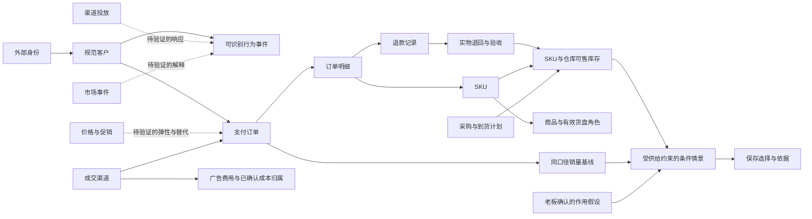

# NEO 成熟实践与业务知识补全报告

研究日期：2026-10-04。用于当前 NEO 的业务建模、开发取舍和后续验收；不是供应商采购结论，也不是产品完成验收。

## 推荐结论

NEO 的主线应继续围绕“可信资料 → 同范围判断 → 条件预测 → 方案比较 → 保存老板选择 → 回看依据”。优先补齐客户身份与同群转化、订单与退款语义、库存状态与时点、指标口径、版本一致性。这些会直接决定看板和智能体的结论是否可靠。

成熟实践值得借鉴的是机制：PostHog 的身份与窗口漏斗、Shopify 的交易和库存状态、dbt 的集中指标与历史版本、Palantir 的业务对象与受控变更、LangGraph 的持久化状态。它们分别解决不同问题，不能用一套平台名替代整个经营闭环。[PostHog](https://posthog.com/docs/product-analytics/funnels)、[Shopify库存](https://shopify.dev/docs/apps/build/orders-fulfillment/inventory-management-apps)、[dbt指标](https://docs.getdbt.com/docs/use-dbt-semantic-layer/dbt-sl?version=2)、[Palantir](https://www.palantir.com/docs/foundry/ontology/overview)、[LangGraph](https://docs.langchain.com/oss/python/langgraph/persistence)。

**建议保留现有 TypeScript/React、D1/Drizzle/R2、FastAPI/LangGraph 技术路线，先整合已有隔离工作线的可验证成果。**当前阶段不建议为了参考成熟产品而另购或重建大型平台。统一业务知识和契约的收益，比换框架更直接；这是一项结合项目规模和已有投入的研究判断。

预测能力与经营因果能力要分别验证。预测误差下降不能证明增加投放、降价或补货产生增量收益；外部案例的参数也不能直接当本企业参数。[Meridian方法说明](https://developers.google.com/meridian/docs/advanced-modeling/control-variables)、[Google增量与归因](https://support.google.com/google-ads/answer/14102450?hl=en-AU)。

本次已把研究补入项目下的新研究目录：50项模块/规则研究、30条业务关系知识，以及逐文件定位索引。后续开发可直接引用R编号和K编号；本次交付未将研究建议实施成产品代码、商户配置或真实业务数据。

## 范围、覆盖与检索方法

主项目：`/Users/majun/Desktop/NEO/NEO后端交接包2026-09-30/growthos-dashboard`。同时纳入`监督/`、`虚拟数据库_Demo/`、`并行优化/2026-10-04/`的资料、源码副本与交付记录。

源文件索引记录于 **2026-10-04 13:41（北京时间）**：1,102个文本文件，按内容Hash去重401份；主项目244个，隔离副本783个，资料/监督75个；索引3,912处函数/类型/类声明。文件数包含配置和交付JSON，不能换算为功能数或完成比例。脚本读取全文用于路径、符号、文档标题和指纹索引；业务判断来自关键源码与文档的语义核读，**没有把机器扫描冒充1,102个文件逐行人工审计**。

索引排除依赖、构建与运行缓存、凭证、数据库、二进制图片、压缩包、原始CSV行、日志/文本运行输出及依赖锁文件。CSV字段通过模板、字段字典和源码核读，本次未重新对174份CSV逐行对账，亦未重做276张截图的视觉验收。排除数量及目录边界保存在`项目检索索引.json`。并发开发可能继续改变文件，指纹是读取时点证据，不是原子整仓备份。

外部核查29个一手来源，包括产品/开发文档、开放规范、作者教材及2项原始研究摘要。使用官方来源确认机制，结合项目源码评估适用性；“成熟”在此指有成体系公开机制与明确边界，**未以客户数量、市场份额、供应商营收、营销成功案例推定效果**。本次没有供应商账号内实操、完整商业条款审查、客户访谈或独立市场份额统计。

检索围绕6个问题展开：

1. 每个页面和后端模块最终支持哪个经营决定，它依赖什么业务事实？
2. 成熟系统如何处理身份、粒度、时间、指标口径和业务关系？
3. NEO哪些地方已有机制、只有副本实现，哪些尚缺规则或商户资料？
4. 哪些关系能直接建模，哪些是待验证的因果假说？
5. 如何验证预测、情景、Agent结论和老板选择的一致性？
6. 哪些机制现在值得采用，哪些会增加不必要的平台和维护成本？

## 当前项目证据与已有工作

|已核读的内容|本次能得出的结论|不能延伸成的结论|
|---|---|---|
|主`server/templates.ts`/`contracts.ts`/`csv.ts`|四类事实、事件可有contact_id、订单模板缺客户字段；退款quantity须为正整数|不能认为客户漏斗或只有金额退款已有完整支持|
|主`server/snapshots.ts`|按来源/订单去重、同期金额公式、最新库存、null和覆盖声明已有实现|覆盖声明不证明资料完整或真实企业验收|
|主`server/ontology/model.ts`/`project.ts`|16类型17关系、自由类型、版本化投影与REFERENCE_ONLY机制；默认类型缺客户闭环|后台对象存在不证明原/demo已消费该关系|
|主`lib/operating-domain-data.ts`|覆盖天数以近期支付数量估计，供给角色/矩阵有动态适配|支付不证明出库；有记录不证明达标、健康或因果|
|主`agent-service/neo_agent/engine.py`|确定性28天模拟、显式假设、至少16周回测门槛；区间标记为假设敏感性|不是已校准概率区间，也不是已证实的企业预测提升|
|主`server/decision-readback.ts`与`lib/decision-history.ts`|两保存路径回读适配与范围/父基线校验代码已存在|不能照抄旧台账写“周报仍必然崩溃”，本轮也未重做浏览器复验|
|隔离`data-ingestion/docs/optimization-data-contract.md`|已形成v2客户、身份、供给规则、主数据有效版本与knownAt契约|副本契约不等于主线完成整合与独立验收|
|隔离`agent-reliability/outputs/optimization-handoff/handoff.md`|开发方自报优先队列、领取/恢复/取消、调用重放和预算边界|自报测试不等于本研究独立重跑，也不等于真实调用效果|
|隔离`synthetic-data/outputs/optimization-handoff/handoff.md`|已有24周合成资料和独立期望、主数据关系与正式导入缺口清单|SYNTHETIC_DEMO不等于真实客户资料和预测价值|
|`监督/forecast-acceptance-2026-10-04/验收结论.md`|存在库存无销量商品遗漏的独立缺陷记录、链路与时点验收前置条件|该历史被验版本的缺陷不能未经最新复验视为所有当前分支仍有|

本表依据可从[主项目模板](/Users/majun/Desktop/NEO/NEO后端交接包2026-09-30/growthos-dashboard/server/templates.ts)、[经营快照](/Users/majun/Desktop/NEO/NEO后端交接包2026-09-30/growthos-dashboard/server/snapshots.ts)、[默认对象关系](/Users/majun/Desktop/NEO/NEO后端交接包2026-09-30/growthos-dashboard/server/ontology/model.ts)、[副本v2契约](/Users/majun/Desktop/NEO/并行优化/2026-10-04/data-ingestion/docs/optimization-data-contract.md)、[预测独立验收](/Users/majun/Desktop/NEO/监督/forecast-acceptance-2026-10-04/验收结论.md)回读。其余源码位置在R01–R50逐项给出。

**交付前并发更新复核：**13:54文件校验发现5个文件相对13:41索引有更新，已重点回读最新数据契约和监督台账。最新监督记录称无销量新品库存遗漏的9项独立检查全部通过、原症状已消除；这属于监督方记录，本研究未亲自重跑，完整整合仍待验。因此库存遗漏在本文只作为必须保留的回归案例，不登记为当前未修复缺陷。最新v2明确身份或来源覆盖不足时转化率为null，单渠道快照不能使用any跨渠道漏斗；前端客户端若仍固定模板v1不能提交新资料kind。这些应成为整合关口，而非重写已有规则。监督台账另记其自动监督已经启用，本研究没有新建或修改该任务。

## 成熟方案的取舍与维护成本

|参考对象|值得吸收|NEO当前采用方式|长期成本及切换代价|
|---|---|---|---|
|PostHog|身份命名空间、有序漏斗、成熟窗口、可解释分母|在现有导入/快照实现语义；不自动安装分析平台|身份修订会改变历史群体，须留映射版本；迁移分析平台时仍需核对去重规则。[官方身份与漏斗](https://posthog.com/docs/data/anonymous-vs-identified-events)|
|Shopify/Odoo|交易状态、库存状态、补货目标/提前期|制定源系统映射与最小供给规则|状态越多，源映射和对账成本越高；不能直接复制商户阈值。[库存状态](https://shopify.dev/docs/apps/build/orders-fulfillment/inventory-management-apps)、[补货机制](https://www.odoo.com/documentation/17.0/applications/inventory_and_mrp/inventory/warehouses_storage/replenishment/reordering_rules.html)|
|dbt / DataWorks|指标集中定义、历史状态、声明式质量规则|现有TS/Python维护一个轻量指标和规则目录|全平台引入会增加调度、模型与权限运维；先保存可迁移的规则ID/版本。[dbt](https://docs.getdbt.com/docs/use-dbt-semantic-layer/dbt-sl?version=2)、[DataWorks](https://help.aliyun.com/zh/dataworks/developer-reference/data-quality-spec-configuration-guide/)|
|Palantir|对象、关系、计算与Action一致|延续已有NEO自有Ontology|继续做通用平台会扩大查询、兼容与规模成本；先补经营对象而非复制全套服务。[对象与业务语义](https://www.palantir.com/docs/foundry/ontology/overview)|
|LangGraph / OpenTelemetry|图状态恢复、跨服务轨迹|复用现有图与副本可靠性成果|状态结构版本、检查点保留和外部调用对账需要长期维护；换框架不会消除这些责任。[Persistence](https://docs.langchain.com/oss/python/langgraph/persistence)、[Trace](https://opentelemetry.io/docs/concepts/signals/traces/)|
|GrowthBook / Meridian|基线对照、护栏、因果条件和作用参数纪律|先指导小试点设计与假设记录|实验需真实业务样本和执行一致性；MMM有额外资料、建模与解释成本。[实验结果](https://docs.growthbook.io/app/experiment-results)、[控制变量](https://developers.google.com/meridian/docs/advanced-modeling/control-variables)|

以上是研究建议而非软件采购授权。当前推荐只吸收语义和机制，复用已有依赖与可导出的CSV/JSON契约；新增厂商计费与商业许可证在确需采用时再核查。

## 最关键的业务关系图

实线表示数据关联或处理依赖。投放、价格和市场变化的虚线表示待验证影响；Ontology中的数据关系本身不能证明因果。

退款记录连接实物退回，是可关联的业务链，**不是每次退款都会产生实物退回**；在途计划进入情景，是条件输入，**不是当前可售库存**。依据[Shopify销售与冲回](https://help.shopify.com/en/manual/reports-and-analytics/shopify-reports/report-types/default-reports/sales-report)、[库存状态](https://shopify.dev/docs/apps/build/orders-fulfillment/inventory-management-apps)。

## 五个可直接用于验收的解释案例

以下数字全部为手工教学例子，不是NEO经营数据，也不作为已发生效果。

1. **同群转化**：A客户咨询5次、B咨询1次，均已完成观察窗；C客户昨天才进入、窗口尚未结束；另有1次无身份咨询。A支付3笔、B未支付。成熟可识别队列的核对算式是1/2=50%，不是3/8，更不是3个成交客户；这仅是已识别子集的教学计算。按当前隔离v2契约，因还有身份缺口，正式客户转化字段应为partial/null，不能把50%显示为完整客群转化率。匿名事件和C分别报告身份缺口、未成熟。窗口长度及起点需商户配置。[漏斗机制](https://posthog.com/docs/product-analytics/funnels)
2. **库存状态**：实体在库50件，已承诺10件、不可售5件，则可售35件；在途20件当前不加入35。若输入系统已经报可售35件，计算中不得再扣10件。收货后是否增加20件，还取决于验收/占用状态。[库存状态](https://shopify.dev/docs/apps/build/orders-fulfillment/inventory-management-apps)
3. **金额口径**：同期支付100,000分、退款20,000分、净变动成本40,000分、广告10,000分，按NEO当前公式贡献为30,000分，即300元。不能写300万元、净利润300元或已到账300元。只有金额退款不应凭空减一件库存。[主公式](/Users/majun/Desktop/NEO/NEO后端交接包2026-09-30/growthos-dashboard/server/snapshots.ts)、[交易与支付区别](https://help.shopify.com/en/manual/reports-and-analytics/shopify-reports/report-types/default-reports/sales-report)
4. **补货与投放联动**：当前销量基线8件、可售12件；假设投放后需求16件，供给最多承接12件，模拟增量最多4件。若每新增件贡献200元、额外投放2,000元，则本例增量贡献为800−2,000=−1,200元。例子展示先验库存/成本约束；16件需求和每件200元均须有明确假设来源，不是模型已验证的因果收益。[归因与增量](https://support.google.com/google-ads/answer/14102450?hl=en-AU)
5. **迟到资料**：9月10日发生的退款，9月20日才入系统。9月15日历史预测不能读取该退款；9月20日新快照可纳入已知历史，同时保留旧快照。若只保留9月10日的事件日期、没有可靠知识时间，只能声称事件日回放，不能声称严格“当时可知”回测。[历史版本](https://docs.getdbt.com/docs/build/snapshots)、[滚动回测](https://otexts.com/fpp3/tscv.html)

## 反证、边界与仍需实际经营确认的内容

成熟平台公开文档也暴露了不能简单照搬的地方：

- Shopify某些“销售”统计包含未支付订单，NEO当前净成交按支付/退款，因此同名销售指标仍可能不同。必须先确定项目定义再映射。[Shopify销售报告](https://help.shopify.com/en/manual/reports-and-analytics/shopify-reports/report-types/default-reports/sales-report)
- 补货规则考虑供给而不能凭空创造需求。历史缺货会截断销量，直接以观察销量外推可能低估需求；本项目暂无足够资料证明已恢复潜在需求。[原始需求估计研究](https://pubsonline.informs.org/doi/10.1287/msom.2015.0520)
- 预测模型拟合得好仍可能估错广告效果；促销增长还可能来自商品替代或提前购买。应保留独立的条件参数及试点验证。[Meridian](https://developers.google.com/meridian/docs/advanced-modeling/control-variables)、[促销分解原始研究](https://pubsonline.informs.org/doi/pdf/10.1287/mksc.1040.0061)
- dbt历史快照可保存对象状态，但不自动替NEO解决历史资料“何时可知”、客户身份变化和跨仓库存共享规则。[dbt历史快照](https://docs.getdbt.com/docs/build/snapshots)
- D1 Time Travel恢复的是托管D1，不能自动恢复R2原件、Python任务/检查点或本地SQLite；免费计划7天与付费30天也不能混写。[D1限制](https://developers.cloudflare.com/d1/platform/limits/)

业务知识不能通过外部搜索自动确定的关键输入是：商户真实客户/订单映射、漏斗起点与观察窗、净成交和成本范围、占用库存与共享分配、采购提前期/备货目标、实际市场商品可比性、价格和投放响应。报告K条目逐一列出所需字段与待确认点；资料缺失时应保持unconfigured/partial/null，而不是填写市场平均值冒充该商户事实。

访问缺口：PostHog漏斗页独立打开失败，使用搜索工具返回的原文段落；Odoo17补货页独立打开超时，使用其搜索返回原文；Odoo19候选页未成功读取，未据此声称最新版能力。2项原始论文仅核读摘要，未检查全文模型或复现实验。Oracle/STR使用历史版本仅核对业务概念，不支持当前市场价格/份额或中国酒店效果结论。

## 建议的实施顺序与收束条件

|顺序|范围和依赖|可验收的经营结果|主要参考条目|
|---|---|---|---|
|1|统一事实、身份、退款、知识时间与指标契约；先核对隔离v2实现|同一客户、商品、时期的金额/数量/身份正确；跨企业和未来资料被拒绝|R04–R14、R18–R19；K01–K16、K27|
|2|原/demo消费客户与历史库存；同范围证据与规则达标|真实变化来自正式导入，可点击局部证据；没有资料明确缺项|R09–R10、R17–R24、R47；K15–K22|
|3|整合已交付Agent可靠性与专业工具|交互任务优先、可取消恢复、来源和预算可回读；失败保留有效部分|R37–R43；K25–K28|
|4|版本统一的预测/情景/选择与周报；重验最新库存修复|不混基线/版本；全部已知库存保留；刷新能回看选择与条件|R31–R36、R45–R46；K10、K17–K24、K28|
|5|真实商户影子试点，再验证作用参数和经营价值|预测与对照同切分，参数效果单独检验，业务反馈有实际观察证据|R32–R34、R36、R44；K23–K28|
|后续|确需酒店/画廊适配再核对对象与指标|行业语义和真实资料一致，不将零售件数当酒店房晚或寄售收入|R49–R50；K29–K30|

阶段1–4可以继续使用隔离合成企业完成工程和业务规则验收；阶段5必须有经授权、可对账的真实商户资料。没有真实资料时先交付可运行规则与明确缺口，不凭模拟通过宣布真实经营价值通过。

## 如何逐处使用本报告

`逐文件实践映射.csv`给每个纳入索引的文本文件附模块与R编号，重复副本按Hash去重定位；该映射是目录/主题定位，不是逐文件独立裁决。下文R01–R50给出具体源码位置、成熟来源、补充建议和验收条件；K01–K30是业务关系、字段及待确认口径。`成熟实践与补全项.json`和`业务关系与规则.json`可供后续开发读取，它们尚未接入在线Agent或自动触发器。

后续新增/修订一处功能时，可在其任务说明附“对应R/K编号 → 当前输入资料 → 采用的成熟机制 → 商户确认规则 → 需要通过的业务反例”，不必把研究文本散贴进每个源码文件。

本轮完成的是静态源码/文档研究、公开来源核查、关联建议和研究文件校验。没有重跑全项目测试、真实模型收费调用、数据库迁移、线上部署或客户效果验证；历史测试结果均注明来源，不计为本轮新证据。
