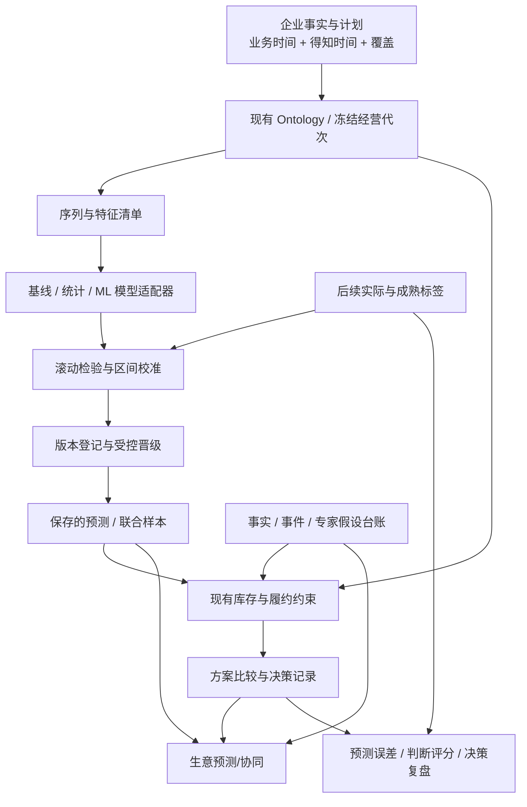

# NEO 预测优化与「生意预测/协同」调整方案

日期：2026-10-08。状态：路线规划；首个实施切片已完成，其余阶段待实施。

实施更新（2026-10-08）：用户已授权执行。文档推荐的首个“阶段0＋阶段1最小闭环”已落地，见[实施与验收记录](./forecast-enterprise-implementation-2026-10-08.md)。下文保留制定方案时的核查与边界；其“尚未实施”等陈述是当时状态，不能代替最新验收。模型竞争、区间与真实企业精度验收仍未完成。

本次已确认范围：先做电商/零售 SKU×渠道预测；制造、酒店保留行业适配接口。先交付完整规划与 tab 调整方案，确认后再修改代码。本文件是本次主交付物。

## 1. 推荐与取舍

建议把 NEO 的预测从「历史均值＋约束推演」升级成「可验证的销量预测＋经营约束＋可追溯假设＋结果反馈」。第一阶段以未来 7 天、28 天的 SKU×渠道已支付件数为主目标，先把真实企业的可靠基线、回测和误差闭环做成，再逐步扩大模型复杂度。

推荐组合：

| 层次 | NEO 采用的路径 | 业务价值 |
|---|---|---|
| 业务对象与版本 | 借鉴 Palantir：统一商品、渠道、库存、到货、计划、预测、决策的关系，冻结输入与结果版本 | 每个数字能解释来自什么资料、在什么条件下成立 |
| 数值预测 | StatsForecast＋MLForecast/LightGBM 为首批候选；AutoGluon 为统一协议下的受限预算候选 | 用同一回测比较简单模型、统计模型与机器学习，胜出的才晋级 |
| 不确定性 | 经检验的预测区间、按场景传播的联合样本；HierarchicalForecast 按需要加入 | 同时看规模、误差与缺货/积压风险 |
| 外部事件判断 | 借鉴 Mantic：明确可结算问题、时间、基准概率、来源与更新理由 | 管理活动、供货、竞争与市场变化的判断 |
| 假设与协同 | 借鉴 Radiant：参数、事件、分布、公式、版本和模拟记录 | 老板与智能体能看到分歧来自哪个假设 |
| 决策反馈 | 比较模型原始预测、人工修订、最终方案及后续实际 | 判断模型和人工判断是否带来增量价值 |

“企业级精度”在本项目中应定义为：**在明确的业务、SKU 分组、预测期限和数据条件下，持续优于有效基线，偏差受控，区间经过检验，并能改善缺货与库存决策。**不能先承诺统一的“90%/95%准确率”；不同销量规模、促销密度和缺货程度的可预测性不同。

第一阶段不要求购买 Palantir、Mantic 或 Radiant。先借鉴方法，使用已有 D1/R2、Python 服务和 Ontology；外部预测服务以后通过适配器接入。Chronos-2 留作挑战模型，不预设它优于业务数据上的统计/树模型。

## 2. 当前实现及真正的缺口

### 2.1 两条现有链路

| 当前链路 | 已有能力 | 当前边界 |
|---|---|---|
| Python `scenario-v1.3` / `four-week-mean` | 近四完整周均值；SKU×渠道；未来 28 天逐日库存、到货、调拨和方案推演；保存输入指纹、预测与后续销量评估 | 没有学习季节、价格、活动或外部变量；参数上下浮动是敏感性分析，不是概率区间 |
| TS `constrained-operating-v1.4` | 冻结经营代次；选定历史窗口日均；电商履约规则、制造材料/产能、酒店逐日房量约束；同代次方案比较 | 当前投影明确为 `historical_daily_mean_with_registered_constraints`，误差评估为 `not_evaluated`；不能继承旧回测 |
| Python `asof-backtest-v2` | 按当时资料可见性划分回测；四周均值/上周/四周周期朴素基线；WAPE、Bias、MAE | 尚无挑战模型自动晋级、经校准区间或长期真实经营质量监测 |

新链路默认统计窗口为 8 周，但窗口可配置。旧链路按已支付件数建立销量基线，退款影响金额损失；新 TS 默认经营量含净支付数量语义。两者不能在未统一目标定义时直接比误差。四周周期朴素模型也不是年度季节模型。

当前样例运行核验中，一个演示企业有已保存的旧预测，回测为 `no_paid_series`，原因是历史事实在各个回测时点尚不可见。这个结果正确；不能为了出误差指标把后来导入时间改成历史日期。该演示核验不代表所有企业，更不代表真实客户预测精度。

### 2.2 应保留的资产

保留现有事实可见时间、资料覆盖、冻结代次、结果归属、证据引用、行业约束和决策记录。预测引擎接到这些能力上，而不是再建一套与当前系统平行的数据中台。

优先修补六个缺口：目标口径不一致；缺货造成的销量截断未识别；模型只有均值基线；新链路缺质量评估；敏感性区间容易被误读；模型结果、专家假设与决策结果尚未形成统一反馈。

代码定位（均为当前 checkout，包含用户已有未提交改动）：

- [旧预测引擎](../agent-service/neo_agent/engine.py)、[旧回测](../agent-service/neo_agent/backtesting.py)。
- [新经营约束](../lib/business-scenarios.ts)、[代次生成](../server/business-generations.ts)、[工作台投影](../server/workbench-projection.ts)。
- [预测与决策页面](../components/neo-demo/live-overview.tsx)、[展示口径](../components/neo-demo/forecast-presentation.ts)、[tab 外壳](../components/neo-demo/shell.tsx)。

## 3. 企业路径：哪些有证据，哪些应借鉴

### 3.1 Palantir：模型与经营对象连起来

Palantir 官方文档说明，时间序列训练器基于 AutoGluon `TimeSeriesPredictor`，比较多个模型，也可比较加权集成；支持未来已知变量、静态属性、训练预算和分位数输出。这是可核验的产品实现说明，但不能据此断言喜力部署用了同一训练器。[官方时间序列训练器](https://www.palantir.com/docs/foundry/model-studio/trainers-timeseries-forecasting)

其模型集成体系支持内部或外部模型，通过版本、评估、发布及 Ontology 连接业务流程。NEO 最值得借鉴的是：模型与数据版本一起管理，经过评估才进入经营应用，预测结果绑定业务对象和后续结果。[官方模型集成说明](https://www.palantir.com/docs/foundry/model-integration/overview/index.html)

NEO 对应实施：以 SKU×渠道为预测对象，以模型版本、预测运行、假设集、经营方案、决策记录为结果对象；一条决策必须能追溯到当时的资料和预测。大模型负责解释与提出待核假设，数值模型与约束引擎负责计算。

### 3.2 喜力：供应链收益不能当作预测误差

Palantir 公布的 HEINEKEN USA 案例强调整合酒厂、仓库、客户与船运信息，发现缺货风险并调整配送；页面自述由缺货预防释放 490 万美元价值。它没有公开可复现的 SKU 回测、WAPE 或具体训练算法。这属于供应商发布的客户案例自述，不能转化成 NEO 的精度保证。[Palantir 客户案例](https://www.palantir.com/impact/#heineken-usa)

同时，Blue Yonder 在 2025 年官方客户奖项说明中，介绍 HEINEKEN 采用其需求与供应规划方案、统一数据及定制 ML，改善预测与偏差。这说明不能把喜力整个需求预测体系归因于 Palantir；该来源也没有给出可复现的误差数据。[Blue Yonder 官方案例说明](https://media.blueyonder.com/blue-yonder-announces-winners-of-2025-iconic-customer-awards/)

NEO 应借鉴的完整链条是：**销量信号 → 供货可见性 → 缺货/积压风险 → 可执行方案 → 实际反馈**。销售预测只是其中一环；预测改善与库存改善需要分别验证。

### 3.3 Mantic：事件预测层

Mantic 当前官方定位包括针对商业与世界事件的判断型预测研究。适合参考其问题拆解、证据更新和概率判断方法；未找到足以证明它适合作为 NEO SKU 需求预测核心的公开企业回测。[Mantic 官方网站](https://www.mantic.com/)

NEO 示例问题应可结算：“供应商是否在约定日期前交付至少约定数量？”“平台是否在活动开始前确认补贴政策？”每个问题保存截止时间、结果判定规则、基准概率、证据时间、判断者及修订。结果揭晓后用 Brier score 等评价事件概率；销量仍用销量指标，不能混为一个准确率。

活动有效、供货到期和竞争冲击不能仅靠智能体给一个百分比就自动改销量。必须有影响公式或已验证的统计关系；没有时作为方案条件展示。多个智能体共享同一来源时，不应当作独立投票来增加确信程度。

### 3.4 Radiant：假设表达与模拟层

Radiant 官方支持参数、二元概率、分布、基准率和公式节点；模拟传播输入的不确定性，保存运行时的地图状态。[节点](https://radiant.metaculus.com/docs/forecasting/node-types)、[模拟运行](https://radiant.metaculus.com/docs/forecasting/running)

特别要注意：图上的连线和强弱标签本身不改变计算，真正的依赖来自公式引用。NEO 也必须把“认为有关联”与“已经进入计算”分开。[连线含义](https://radiant.metaculus.com/docs/maps/edge-labels)

NEO 对应为可审阅的假设台账：事实/模型输出/专家判断/待核条件，逐项说明来源与时效。先做清晰的列表与公式依赖，复杂假设再提供图视图。专家假设产生的方案范围与经过实际误差检验的销量预测区间分别标注。

## 4. 第一阶段预测目标与数据契约

### 4.1 目标、粒度与期限

| 项目 | 第一阶段定义 |
|---|---|
| 叶子序列 | `businessId × dataNature × SKU × channel × businessDate`；同一商品别名映射到稳定 SKU |
| 主目标 | `paid_units`：按支付事件日期的已支付商品件数。支付后的退款/取消单独记录，不能回写成负需求 |
| 首批期限 | 未来 7 天与 28 天；按日预测，按周/期汇总。14/56 天留接口，验证后启用 |
| 首批输出 | 销量信号、可履约规模、销售净额估计、贡献毛利估计、期末可售库存、限制条件 |
| 区间输出 | 仅在有对应方法和评估时输出；分位数/均值分开，标明区间目标覆盖率与实测覆盖率 |
| 保留行业接口 | 不同目标单位、日历、容量和约束适配；制造与酒店不参与首批 SKU 模型晋级 |

目前没有完整发货事实时，不把支付件数叫作实际发货件数。退款金额不自动等于退货数量或已入库数量。销售净额和贡献毛利也不等于净利润。

“未施加未来供货约束的销量信号”不自动等于真实潜在需求。历史缺货、下架、限购会截断已观察销量；未掌握这些状态时，无法证明缺货期间真正损失了多少需求。先显式标记截断与不可识别范围，后续再用库存可用性、曝光/加购或相似商品等信息研究潜在需求。

### 4.2 必须区分的数据状态

已确认零销量、资料缺失、渠道未营业、商品未上架、库存不足、新品无历史必须分别记录。只有资料完整且商品处于可销售状态时，零才可作为真实销量观测。不能把缺资料补成零，也不能把渠道在未来才上线的 SKU 补到过去。

最低输入：逐日支付明细、商品/渠道映射、资料覆盖记录。扩展输入：价格与促销版本、取消/退款事件、每日可售库存与缺货区间、到货/调拨计划及实际、履约规则、成本、活动日历。资金回笼需要结算事实，不用销售额冒充现金流。

每条资料保留业务发生时间与系统得知时间，修订保留历史版本。预测运行记录：实际生成时间 `issuedAt`、预测起点 `forecastOrigin`、资料截止 `dataCutoff`、标签观察截止 `labelKnownAt`。使用晚导入的历史资料进行回顾性研究可以，但必须标为“历史重建”，不能声称当年就能做出同样预测。

未来变量只允许使用预测时已知的计划或可得预测版本：日历可知；促销/价格以当时有效计划为准；未来真实曝光、实际广告消耗、实际天气不能偷渡到回测。落后变量与滚动统计必须先移位，再计算，不能含预测当天或未来标签。

### 4.3 数据就绪分级

- 历史短：保留朴素基线，明显显示“历史不足，结果仅供初步推演”；新品走品类/相似 SKU 的借力预测并单独评估。
- 可做多折检验：需要足够训练期和独立测试期。举例，约 3 个月训练加六个不重叠的 28 天测试期，需要约 9 个月数据；窗口应按业务确定，不能把现有 16 周门槛当作企业验收标准。
- 学习年度季节与大促：优先准备至少两个完整周期；春节等移动节日按真实日历特征处理，不能只用去年同日复制。
- 有完整缺货与供货事实：才进一步评估潜在需求修正及供货风险概率。

首先统计真实企业的序列数量、历史长度、缺失率、缺货率、促销覆盖和修订频率，据此冻结首批验收范围。此处尚未对真实商户全量资料做质量审计。

## 5. 模型路线与开源选型

### 5.1 模型按数据特征竞争

| 类型 | 首批候选 | 使用方式 |
|---|---|---|
| 必保基线 | 当前四周均值、上周值、日序列每周季节朴素模型 | 每次新模型都必须与相同口径的有效基线比较 |
| 稳定/季节销量 | StatsForecast 的 ETS/AutoETS、Theta 等 | CPU 批量预测，透明、低成本；按验证结果选择 |
| 间歇/低销量 | Croston 类、TSB 等候选，或品类借力模型 | 单独评估零销量与发生频率；不按高销量规则机械晋级 |
| 多 SKU 与活动变量 | MLForecast＋LightGBM 的全局模型 | 共享学习滞后、滚动、日历、SKU/渠道属性和已知活动变量 |
| 自动模型比较 | AutoGluon TimeSeriesPredictor | 通过同一适配协议运行，限制模型范围、训练预算和并发 |
| 基础模型挑战者 | Chronos-2 | 隔离运行、先测资源与真实外层回测；优于现有方案才启用 |
| 层级一致性 | HierarchicalForecast，或先采用叶子预测后汇总 | 商品/渠道/全店总量一致；分布需联合样本再汇总 |

推荐第一条实现路径是 StatsForecast＋MLForecast/LightGBM。理由是和当前 Python 服务衔接直接、CPU 预算容易控制、对 SKU 活动特征可解释；AutoGluon 的优点是模型组合与自动比较更完整，但依赖、训练时间及运行环境成本更大。Chronos 的预训练知识可能改善少数据场景，是否有收益必须由 NEO 的测试决定。[StatsForecast](https://nixtlaverse.nixtla.io/statsforecast/index.html)、[MLForecast 滚动检验](https://nixtlaverse.nixtla.io/mlforecast/docs/how-to-guides/cross_validation.html)、[AutoGluon](https://auto.gluon.ai/stable/tutorials/timeseries/forecasting-indepth.html)、[Chronos](https://github.com/amazon-science/chronos-forecasting)

不对每个短序列单独大规模调参。先按销量规模、间歇程度、促销占比、新品等分组选择模型；数据充分再允许 SKU 局部选择。集成权重在内部验证集确定，外部测试集保持独立。

### 5.2 版本、许可与维护成本

以下是 2026-10-08 的 GitHub 元数据核验快照，不是安装建议或兼容性验收。首轮实现应锁定一组实际通过集成检验的版本，训练与推理使用同一环境。

| 项目 | 已核验许可 | 版本快照 | 决策 |
|---|---|---|---|
| [StatsForecast](https://github.com/Nixtla/statsforecast) | Apache-2.0 | v2.1.1 | 首批统计预测 |
| [MLForecast](https://github.com/Nixtla/mlforecast) | Apache-2.0 | v1.1.0 | 首批特征与全局模型 |
| [LightGBM](https://github.com/microsoft/LightGBM) | MIT | 实施时锁版本 | CPU 树模型 |
| [HierarchicalForecast](https://github.com/Nixtla/hierarchicalforecast) | Apache-2.0 | v1.5.3 | 汇总一致性按需加入 |
| [AutoGluon](https://github.com/autogluon/autogluon) | Apache-2.0 | v1.6.3 | 受限预算挑战适配器 |
| [Chronos forecasting](https://github.com/amazon-science/chronos-forecasting) | Apache-2.0 | v2.3.2 | 可选挑战模型；另核具体权重许可与资源 |
| [MLflow](https://github.com/mlflow/mlflow) | Apache-2.0 | v3.17.0 | 初期不部署额外服务，扩展时再接入 |
| [OR-Tools](https://github.com/google/or-tools) | Apache-2.0 | v9.15 | 后续补货/分配优化，不承担销量预测 |

核验项目均未归档，近期有维护活动。近期问题涉及特征 schema、残差 NaN、时间戳/数值稳定等，说明“活跃”不等于与 NEO 数据自动兼容。版本切换必须比较预测、特征 schema、区间、序列化及资源开销。

主要长期成本是事实质量、标签维护、运行监测和业务校准，其次是模型计算。初期不要求付费订阅、GPU、独立 MLflow 或新增数据仓库。统一模型适配协议能降低算法替换成本；数据口径、特征 schema 和业务约束才是较难迁移的资产。

## 6. 质量检验、概率与模型晋级

### 6.1 检验设计

使用按时间滚动的训练/验证/测试。保留当前 as-of 思路，并扩展到所有特征、计划、库存与修订事实。每折复原当时可见输入，标签在成熟后独立观察。模型选择与区间校准只在训练/内部验证发生，最后外层测试用于审查。

将报告拆为“历史重建”“可证明当时可见的回测”“真实发布后验证”。三个域不能合并为企业生产精度。公开数据 benchmark 与 demo 也独立存储、独立标识，不写进真实企业质量指标。

每个期限报告叶子误差、SKU/渠道汇总误差及全店误差。叶子 WAPE：`sum(abs(actual - prediction)) / sum(actual)`；Bias：`sum(prediction - actual) / sum(actual)`。全店汇总可能相互抵消，不能替代 SKU×渠道误差。零或极低分母时显示 MAE/发生频率及适用指标，不输出失真的百分比。分位数用 pinball loss；区间同时报告覆盖率与宽度/WIS，避免靠极宽区间“通过”。

业务损失作为另一层：缺货成本、滞销/报废成本、库存资金占用和履约成本。成本权重在看测试结果之前固定。只有数据能支持时才计算；业务价值不能由预测误差简单折算得出。

### 6.2 建议的首轮晋级门槛

下表是待首轮真实基线测量后冻结的项目目标，**不是行业统一标准，也不是本次已经达到的结果**。

| 检查 | 初始建议 |
|---|---|
| 数据与复现 | 输入、口径、运行版本完整；无未来资料泄漏；同输入可复现 |
| 总体改善 | 主验收范围 WAPE 相对有效基线改善至少 10%；基线误差为零时改用绝对误差/业务损失规则 |
| 稳定性 | 至少六个可评估、非重叠测试窗口，其中至少四个优于基线；同时报告不确定性 |
| 关键 SKU 保护 | 重点商品分组不出现超过约 5% 的相对 WAPE 恶化；明显单 SKU 恶化单独复核 |
| 系统偏差 | 高销量验收分组绝对 Bias 优先控制在 5%以内；低销量另设规则 |
| 区间质量 | 80%名义区间检查实测覆盖是否接近目标，例如 75%–85%的观察范围，并给样本量与统计不确定性；宽度/WIS不明显变差 |
| 真实前瞻 | 影子运行至少 2–3 个已成熟预测周期，未出现明显漂移后，再用于正式决策推荐 |

数据不足六折时，允许继续使用带边界提示的基线/实验预测，不能挂“已验证企业精度”。连续日/同一活动误差相关，覆盖率样本量不能把所有 SKU×日简单当成独立样本；需要按时间块/业务组估计不确定性。推广结论绑定企业、分组、期限、资料条件和版本。

### 6.3 预测区间的正确含义

首批可选两条方法：模型直接输出分位数，或使用历史残差建立 conformal 预测区间；后者不自动产生精确的 P10/P50/P90 分布。区间需按期限和业务分组检查，分布变化时重新校准；“名义80%”不保证以后任何时期都有80%覆盖。[MLForecast 区间方法](https://nixtlaverse.nixtla.io/mlforecast/docs/how-to-guides/prediction_intervals.html)

P50是中位数，不一定等于均值。渠道/日期的边际P90也不能直接相加成为全店/整期P90。先生成保留时间、SKU、渠道相关性的样本路径，汇总/施加约束后再计算分位数；未建立这类联合分布时只展示有依据的局部区间，不给虚假的总量概率。[HierarchicalForecast](https://nixtlaverse.nixtla.io/hierarchicalforecast/index.html)

区分三种结果：经销量检验的模型预测区间；假设分布带来的方案范围；固定参数上下浮动的敏感性范围。后两者不能标为“模型准确率”或“95%置信区间”。

### 6.4 人工修订与反馈

保存模型原始预测、人工修订值、理由与来源、最终决策，不能覆盖原预测。未来在同一标签与范围下评估 Forecast Value Added：人工或智能体修订是否改善模型、是否改善业务损失。坏修订与不确定判断也保留，形成可复盘记录。

漂移监测同时关注资料缺失、促销/价格变化、残差偏差、覆盖率下降、新品比例和渠道结构。出现异常可回退基线；资料更新生成新结果，旧结果标记过期但继续留作当时决策证据。

## 7. 经营推演与假设协同

### 7.1 预测与约束分开计算、一起解释

预测模块输出销量信号或样本路径；现有经营引擎按库存、到货、仓库权限、费用和预算逐日推演可履约结果。保留库存守恒、同仓库存不能重复分给多个渠道、在途未到不能销售等规则。

历史上已经被缺货截断的销量不能再次包装为“无约束需求”，也不能从一次方案差值断言实际增量销量。降价/投放/转化倍数暂时是条件假设；只有在实验或充分识别的统计研究后，才以因果增量关系计算。特征重要性不等于因果效果。

到货时间不确定、活动转化不确定时，传播明确的分布与相关性；没有依据时显示“到货待确认”，不虚构到货概率。只有需求和供给分布都有明确含义时，才显示缺货概率。没有概率依据仍可做悲观/基准/乐观条件推演。

先保留有限候选方案比较，目标是比较可行方案的收益与风险。后续 OR-Tools 用于多仓分配、补货/预算优化；只有求解状态与目标定义支持时才称最优，否则称当前候选中较优。

### 7.2 假设台账

| 字段 | 含义 |
|---|---|
| 对象、有效期 | 哪个 SKU/渠道/供货计划，在什么时段生效 |
| 类型 | 已确认事实、模型输出、专家判断、待核条件 |
| 值与单位 | 常数、事件概率、分布或公式，取值边界 |
| 来源 | 数据/文件/外部页面引用、证据日期、系统得知时间 |
| 判定 | 结算规则、实际结果、误差/概率评分 |
| 责任与修订 | 谁提出、谁修改、原因、前后版本 |
| 计算关系 | 进入了哪条公式，影响哪些预测/方案/决策 |

先接到现有三类智能体：转化提出活动/渠道条件，供应核查库存/到货/履约约束，市场提供外部事件证据。联合判断负责整理冲突、缺资料和方案条件。数值来源必须引用真实计算结果；智能体不能生成一个未运行的“更准模型”。

用户采纳判断形成新假设集与方案版本。新证据使来源失效时，相关预测、方案和未完成决策标记需要更新，不能仅刷新文字说明而继续使用旧数字。旧决定保留完整历史。

## 8. 接入现有工程的方案

### 8.1 架构



Python 中建立独立的计算任务边界，训练/批量回测不在聊天请求内执行。TS 负责企业鉴权、事实与代次、任务编排、结果验证和工作台投影；继续复用 D1 元数据、R2 模型/特征/结果文件。大数据按清单和分块读取，不把整库 JSON 反复塞进聊天或请求。

第一版结果登记可用现有 D1/R2 实现。团队、多模型和跨环境治理扩大后再接 MLflow；其版本与别名可辅助管理，但不是首轮必需部署。[MLflow Registry](https://www.mlflow.org/docs/latest/model-registry/)

### 8.2 最小契约

以下是拟新增概念，实施时优先映射已有 Ontology/结果表，避免重复实体。

| 概念 | 必存信息 |
|---|---|
| ForecastRun | 企业/数据性质、代次/输入清单、目标/期限/粒度、issuedAt/forecastOrigin/dataCutoff、modelVersion、featureVersion、运行环境、状态、结果引用 |
| ModelVersion | 方法与超参、训练范围、模型与代码哈希、依赖版本、验证报告、适用分组、晋级/回退记录 |
| ForecastEvaluation | forecastId、成熟标签清单及labelKnownAt、检验域、期限/分组/样本量、点误差/区间指标、跳过原因 |
| AssumptionSet | 假设节点、公式/依赖、来源、版本与有效期；与 scenarioId、forecastId 绑定 |
| DecisionOutcome | 采纳的方案及条件、后续实际范围、误差与结果解释；不能把预测差值写成已实现收益 |

模型适配器统一 `fit / predict / evaluate` 及数据 schema。输出声明 `pointMeaning`、区间方法、名义/实测覆盖、校准域、预测覆盖、未估计序列和限制。旧预测保留原 calculationVersion 和结果，不静默换算成新模型。

目前 `dataNature` 的 business/demo 隔离继续执行。公开 benchmark 使用独立命名空间与 `evaluationDomain`，不能标为真实业务。查询和文件下载都强制验证企业、范围和来源；不能仅靠客户端传入 businessId。

### 8.3 运行要求

训练任务需要预算、并发、队列、超时、取消、幂等及完整结果清单。只有仍有效且未取消的任务能发布结果；迟到返回不能覆盖新代次。记录输入哈希、种子、依赖、运行资源和模型文件，以支持复现。失败保留明确原因与可用旧版本，不把失败包装成成功的空结果。

预测服务主要读取已完成的结果；前端切换筛选不临时触发昂贵训练。先测真实 SKU 数量、资源和运行时间，再冻结服务目标。CPU 先行；AutoGluon/Chronos 采用隔离环境和训练预算，不能把全部可选依赖一次装进现有聊天服务。

制造接口保留材料、产能、生产周期；酒店保留逐日房量、预订/取消、不可跨日结转容量。共同协议包含目标单位与适用行业；不能把房晚/净产量混进 SKU 已支付销量回测。

## 9. 「生意预测/协同」tab 调整方案

### 9.1 不改变导航，改变阅读顺序

保留外层 tab 名称、`/demo?page=overview`、现有整体视觉与侧栏。已有 `evidence/forecast/action` 路由状态继续兼容，内层名称改为：

| 内层 | 对应已有状态 | 用户主要任务 |
|---|---|---|
| 经营联动 | evidence | 看销量、商品、渠道、供应变化与判断分歧 |
| 预测与检验 | forecast | 看未来规模、限制与可靠程度 |
| 方案与决策 | action | 比较方案、补充条件、保存决定与后续复盘 |

预测结果就绪时默认进入“预测与检验”；资料不足时进入同页的资料状态与补全入口。保留深链接和用户当前选择，不在后台刷新时强行切页。原 example 模式使用明确演示标识，不复用真实质量状态。

### 9.2 页面骨架

```text
生意预测/协同                       [经营联动] [预测与检验] [方案与决策]
企业 / SKU与渠道范围 / 资料截止 / 预测起点 / 未来7或28天 / 结果时间
────────────────────────────────────────────────────────────
预计支付销量       预计可履约       预计销售净额       预计贡献毛利
目标口径           约束条件         金额范围说明       成本完整性

可靠程度：适用范围、回测期限与样本、误差/偏差、区间检验、资料缺口

历史与未来图                         变化/限制/待核条件
历史实线 | 起点 | 预测虚线            证据与假设入口
检验过才显示区间                     智能体判断与分歧

SKU×渠道明细：销量信号 / 可履约 / 库存风险 / 预测状态 / 查看依据
────────────────────────────────────────────────────────────
[查看检验] [编辑方案条件] [比较方案] [查看已保存决定与实际]
```

布局复用现有卡片和 Phosphor 图标。重点是数字与依据，而不是增加模型名称、技术状态或独立仪表盘。不同模块数据不齐时局部显示状态；不能一项缺成本就把所有真实销量事实一起隐藏。

### 9.3 预测与检验：四个问题

1. **未来可能卖多少？**主卡写“预计支付件数”，当前资料只能做条件推演时明确说明。图显示历史实际、预测起点、未来销量信号及可履约结果；历史重建的图注明性质。
2. **哪些限制会影响结果？**按 SKU/渠道显示缺货、到货待确认、渠道履约权限、预算/成本缺口。只有概率有依据时才展示“缺货概率”，否则展示“在当前条件下预计缺口”。
3. **这次预测经过多少检验？**可靠程度栏始终可见，不藏在折叠区。显示验收范围、期限、成熟窗口/样本、基线对照、WAPE/Bias、区间覆盖及最新检验时间。点击打开检验抽屉。
4. **什么变化会使预测失效？**列出核心条件、更新时间和资料过期标记。用户可沿证据进入明细，或把变动带入新方案。

SKU 表支持商品、渠道、销量规模及异常状态筛选。初始按风险/业务影响排序，不能把统计上不可靠的低销量百分比当成最高优先风险。每行可追溯到该序列的资料、预测与约束；未估计 SKU 单独列出，不填零混进总量。

### 9.4 经营联动：让协同围绕条件发生

保留人/货/场变化时间线与联合判断，但每条判断标明事实、模型解释或待核假设。新增简洁的“当前分歧”区：分歧对象、不同判断、证据、是否进入计算、可能影响的方案。智能体侧栏引用当前 forecastId/generationId；资料变动后显示需更新。

假设台账先用列表。点击假设查看来源、公式依赖、历史修订和结算；有多级依赖时再展开图视图。画连线不等于生效，采纳并保存新假设集后才重算对应方案。

### 9.5 方案与决策：比较收益与条件

在现有表单中保留基线、新增方案和经营动作。各方案必须使用同一有效基线、范围、期限及目标；跨代次不能直接排优。表格展示可履约规模、贡献毛利、库存/资金影响、条件完整性与风险范围。

状态明确区分“条件下可行”“违反约束”“资料不足”“关键条件待确认”。推荐理由写“在已确认条件和当前候选中”，不声称全局最优。概率不充分时可比较悲观/基准/乐观条件，写明来源。

保存行为是老板的方案与决策记录：选什么、为什么、依赖什么条件、何时复盘。不是审批流，不自动派单、采购或发消息。实际周期成熟后，展示原预测/人工修订/最终方案/实际，解释差异。

### 9.6 状态与交互规则

| 用户可见状态 | 展示与可用行为 |
|---|---|
| 资料不足 | 指出缺哪项、影响哪项输出；可以查看已有证据，不能生成伪精度 |
| 历史偏短 | 可运行适用基线与条件推演；醒目说明未充分检验 |
| 尚未完成检验 | 显示预测口径与限制；不出现“已验证”或准确率徽章 |
| 仅公开数据/演示验证 | 保留结果，但不作为当前企业可靠程度 |
| 在指定范围经过检验 | 显示范围、期限、样本、误差及区间；不扩展成全企业保证 |
| 资料或假设已更新 | 标记旧预测/方案过期，保留原决定；允许生成新版本 |
| 计算中/失败 | 展示任务状态与失败原因；旧版明确时间与过期情况，避免空白或静默替换 |

筛选只改变视图，不改变保存结果；修改条件创建新方案版本；确认新输入再重算，不覆盖旧版本。预测区间与方案范围各自有名称和图例。不能提前设计带真实-looking 数字的质量卡再补接口。

### 9.7 前端依赖契约

页面投影需提供：目标/单位/点值含义、输入/资料时间、预测期限、范围与覆盖、分组明细、模型与区间质量摘要、约束/假设引用、过期状态、可用操作。模型名、超参和运行环境放在检验抽屉或配置区，不在老板主流程展示。

第一轮 UI 改动应与真实数据契约同步：先兑现口径、可靠程度、限制和未估计项，再增加已有计算支持的区间/风险。不能把改页面当成预测精度提升。

## 10. 实施顺序与验收

按可验收阶段推进，不在未知数据规模和人员投入时承诺日历工期。

| 阶段 | 实施范围 | 出口证据 | UI 同步范围 |
|---|---|---|---|
| 0：统一定义与数据审计 | paid_units口径、退款/缺货状态、时间契约、真实商户序列就绪表；新旧链路目标映射 | 明确首批企业/分组/期限；能说明何时不可回测 | 口径、资料状态、未估计项、原有结果边界 |
| 1：一条可检验链路 | 新代次接冻结预测运行；朴素/统计基线；时间回测；质量投影 | 同一资料可复现；无泄漏；新链路有自己的误差报告 | 预测与检验默认页、可靠程度栏、检验抽屉 |
| 2：模型竞争与区间 | MLForecast/LightGBM；AutoGluon适配；分组晋级与校准；一致性 | 外层测试对照及区间报告；预算和回退可用 | 有依据的区间、SKU风险与明细 |
| 3：假设与方案 | 样本接约束；事件/假设台账；同基线候选比较与版本失效 | 计算依赖可追溯；供应约束不冲突；方案范围含义明确 | 经营联动分歧、方案条件/比较、决策记录 |
| 4：真实前瞻闭环 | 影子运行、成熟标签、漂移/FVA/业务结果复盘 | 真实企业多个成熟周期；达标范围内发布/不达标回退 | 决策与实际、模型/修订贡献、更新提示 |

Chronos、独立 MLflow、多层补货优化及外部 Mantic/Radiant 连接均在首轮完成后按收益决定。没有额外 API/账号也能完成核心链路。

确认方案后，建议首个代码切片是**阶段0＋阶段1的最小闭环**：统一电商目标、保存新代次基线、接其自己的回测和前端可靠程度栏。这个切片为后续 ML 与区间提供真实验收依据。

### 10.1 必要验证

- 时间：晚导入、修订、标签成熟、计划变更，未来信息不能进入过去预测。
- 语义：退款不抵消需求；缺失不当零；支付不当发货；新品/下架/缺货单独处理。
- 经营：同仓库存不重复分配、到货后才可售、履约权限/费用正确；制造与酒店适配不退化。
- 统计：模型与基线同口径同窗口；外层测试未参与选择；低分母、全零、区间校准与总量聚合正确。
- 治理：跨企业/数据性质隔离；版本与输入可复现；取消/迟到结果不覆盖新状态；过期依赖传递。
- 页面：旧路由/example兼容；缺资料/失败/未验证状态真实；数字点击能回到证据；方案比较使用同一基线。

用固定合成样本验证程序规则，公开数据验证模型管线，真实企业前瞻验证业务质量；三类证据分别记录。现有本地程序测试通过只说明当前规则可运行，不说明新规划已实现。

## 11. 本次交付边界与待核事项

已完成当前实现核查、官方资料与开源仓库核验，以及完整技术/产品路线。未改前后端代码，未安装预测依赖，未调用付费预测，未接外部账号，未训练新模型。仓库已有未提交改动保留，本次仅新增此规划文件。

尚未确认：真实商户数据规模与质量；喜力具体模型、误差口径与可复现测试；Mantic企业服务的价格/接口/合同；任何候选模型在NEO业务上的收益和成本。以上不阻碍首个基线闭环实施，但不能在确认前写成已具备能力。

## 12. 主要一手来源

访问与核验日期：2026-10-08。下列链接对应产品文档、项目仓库或供应商/客户案例自述，来源性质在正文已标明。

1. [Palantir 时间序列训练器](https://www.palantir.com/docs/foundry/model-studio/trainers-timeseries-forecasting)：模型比较、AutoGluon、变量与训练配置。
2. [Palantir 模型集成](https://www.palantir.com/docs/foundry/model-integration/overview/index.html)：模型版本、评估、部署与业务对象连接。
3. [Palantir HEINEKEN USA 案例](https://www.palantir.com/impact/#heineken-usa)：供应链与缺货预防价值自述；无公开模型误差证明。
4. [Blue Yonder 2025 客户案例说明](https://media.blueyonder.com/blue-yonder-announces-winners-of-2025-iconic-customer-awards/)：HEINEKEN需求/供应规划和定制ML自述。
5. [Mantic](https://www.mantic.com/)：判断型事件预测定位。
6. [Radiant 节点](https://radiant.metaculus.com/docs/forecasting/node-types)、[预测汇总](https://radiant.metaculus.com/docs/forecasting/predictions)、[运行](https://radiant.metaculus.com/docs/forecasting/running)、[连线](https://radiant.metaculus.com/docs/maps/edge-labels)：假设与模拟机制。
7. [StatsForecast](https://nixtlaverse.nixtla.io/statsforecast/index.html)：统计模型框架。
8. [MLForecast 回测](https://nixtlaverse.nixtla.io/mlforecast/docs/how-to-guides/cross_validation.html)、[预测区间](https://nixtlaverse.nixtla.io/mlforecast/docs/how-to-guides/prediction_intervals.html)：滚动验证与区间方法。
9. [HierarchicalForecast](https://nixtlaverse.nixtla.io/hierarchicalforecast/index.html)：层级一致性。
10. [AutoGluon 时间序列](https://auto.gluon.ai/stable/tutorials/timeseries/forecasting-indepth.html)：概率预测、变量与模型验证。
11. [Chronos](https://github.com/amazon-science/chronos-forecasting)：预训练时间序列模型。
12. [MLflow Registry](https://www.mlflow.org/docs/latest/model-registry/)、[OR-Tools](https://github.com/google/or-tools)：模型治理与后续约束优化。


## 2026-10-08 用户确认的架构追加

AutoGluon 学习历史规律，环境模型刻画未来条件，蒙特卡洛传播不确定性，优化器选择行动，LLM 作为经营方向与工具调度的大脑。先完成电商 SKU×渠道；以冻结只读矩阵读取现有经营数据库。预算、供货条件与经营权限由明确契约约束，LLM 不凭空生成数值，不将内部选择当作已经执行。具体已实现行为、验证与剩余生产范围见[实施记录](./forecast-operating-brain-implementation-2026-10-08.md)。
