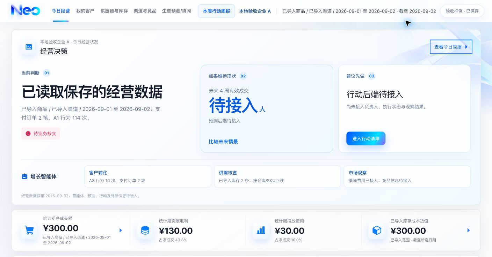

# 原 NEO 前端接入已保存数据 · 2026-10-03

本次交付把用户指定的原 `/demo` 界面接到已有 D1/R2 导入、快照与证据后端。保留原页面结构、卡片、图表类型、证据抽屉、简报弹窗、导航和视觉；没有增加企业/日期筛选控件，没有另建老板看板。41 个既有 CSS/公开资源文件与任务开始时逐字节一致。组件改动限于数据绑定、单位、作用域链接、来源读取，以及缺失/加载/错误状态。

**完成范围是基础数据接入与本地验证，不能认定整套经营看板或真实企业业务验收通过。** 本次没有获得授权企业原始数据；运行数据全部是明确标为 `demo` 的隔离样例，经过正常上传、校验、确认入库，保存在服务端，而非原型汇总 JSON。转化、供给诊断、市场判断、预测、行动、周报与智能体仍有下列后端缺口，本轮未扩展这些功能。

## 版本与运行入口

- 代码版本：`neo-ui-data-20261003-2739f098fa47`，计算版本：`ingestion-v1.2`。
- Git HEAD：`17fefe49a355552e5fa819e511d05e7463381f9d`。**已有导入实现、第一轮修复和本次改动都尚未提交**；该 HEAD 不能代表本次代码。
- 准确版本以 [source-after.json](source-after.json) 的 122 个代码/非凭证配置文件 SHA-256 为准；文档、凭证、依赖、运行数据不参与代码指纹。隔离运行与构建副本逐文件一致。
- 原页面默认读取已保存快照：`/demo?page=people|goods|market|overview|weekly`；首页 `/demo`。`/`、`/analysis/*` 与 `/reports/weekly` 复用同一套原组件。
- 旧 COCA 模拟示例仅在显式 `/demo?mode=example` 使用；其导航保持该模式。业务读取失败、无快照或缺字段时不读取模拟值补齐。
- 企业、数据性质、统计起止日、截至日、商品和渠道仍在既有 `/data/imports` 管理；原界面导航传递 `businessId`、`dataNature`、`snapshotId`，日期/商品/渠道来自该不可变快照。没有另加前端筛选 UI。

[追加后原首页](http://127.0.0.1:3102/demo?businessId=test-a&dataNature=demo&snapshotId=snap-a963bdd2df6b0548d1113bae19f6da96525ee4031261b12274c47c496e74f631) · [原客户页](http://127.0.0.1:3102/demo?page=people&businessId=test-a&dataNature=demo&snapshotId=snap-a963bdd2df6b0548d1113bae19f6da96525ee4031261b12274c47c496e74f631) · [既有导入管理](http://127.0.0.1:3102/data/imports?businessId=test-a&dataNature=demo&snapshotId=snap-a963bdd2df6b0548d1113bae19f6da96525ee4031261b12274c47c496e74f631)。这些直链依赖本机隔离服务和其存储仍存在。



## 页面、输入、计算和证据映射

下表为本轮代码的实际落点。接口均为 `/api/v1`，读取快照使用 `GET /operating-snapshot?businessId=…&dataNature=…&snapshotId=…`，来源抽屉使用 `GET /evidence/{id}`，原件使用授权 `GET /ingestion-batches/{id}/file`。所有数据仍经服务端企业授权。

| 原页面位置 | 所需原始输入 | 公式或选择规则 | 当前接入与证据 | 本地核对值及后端缺口 |
| --- | --- | --- | --- | --- |
| 今日经营：净成交额 | 订单支付/退款发生日、金额、订单与行 ID、来源 | 统计期支付额减同期退款额，人民币分转元显示 | `financial.netRevenueCents`；同名证据 | 200→300 元；退款计实际发生日，非净利润 |
| 今日经营：贡献毛利与占比；客户页金额组成 | 订单及退款成本回转、广告费用、来源覆盖期 | 净成交额−变动成本−广告费用；成本/覆盖不完整为 null，占比仅净额大于 0 时计算 | `variableCostCents`、`contributionMarginCents`；各自公式证据 | 成本100→140、毛利80→130元；缺成本不补0 |
| 今日经营：投放费用与占比 | 费用日期、渠道、广告金额、可选商品归属 | 同期广告费用和，不重复计订单费用 | `spendCents`；费用证据 | 20→30元；商品分摊不完整时毛利不足 |
| 今日经营：库存成本货值 | 仓库/SKU、快照时点、库存成本 | 每仓库/SKU截至日前最新值之和；任何参与成本缺失为 null | 新 `inventoryCostCents` 及独立聚合证据 | 200→300元；仅已导入库存，不是企业全量 |
| 今日简报与当前经营卡片 | 同一快照及其限制 | 摘要支付订单、净额、费用、毛利与 A1 行为量 | 原简报弹窗读取同一个上下文 | 订单1→2笔、A1 107→114次；没有独立诊断/可信政策/机会服务，固定判断退出业务模式 |
| 我的客户：4A 卡片 | 事件类型、时间、次数；订单事实 | A1–A3事件数量和，A4按来源及订单ID去重 | stage证据及 `paidOrders`；综合 `operatingPulse` | A1 114次、A3 10次、支付2笔；缺统一客户/线索ID与阶段关联，不计算去重客户漏斗或转化率；A5后端已有，原界面无对应卡片 |
| 我的客户：4A经营脉搏；首页历史订单图 | 各日事件、订单与退款 | 上海自然日/周及实际首尾区间，同一快照周汇总 | `weeks`，点击点读取 `week:{start}` 的证据 | 09-01–09-02点为 A1 114、A3 10、订单2；缺失点为 null；前期比较/规则异常/未来点待接入，不能保留演示人数与指数基线 |
| 供应链与库存：关键商品表 | 商品/SKU、仓库、时点、可售、在途、成本 | 截至日最新仓库/SKU事实，历史不累加 | `inventory`；每行按自己的 `factId/evidenceId` 打开 | W1零库存/在途2；W2可售4→6、在途0→1，来源精确W2；净销量按SKU聚合尚未提供；商品图片/角色/ETA/可售天数缺主数据与到货计划 |
| 供应链与库存：三类货盘卡片及达标率图 | SKU主数据、角色、目标、安全规则、连续历史库存 | 角色内达标SKU/可评价SKU，规则需版本化 | 保留原卡片/图表，缺失状态 | 当前仅库存事实，不能算角色SKU数、角色货值、达标率、缺货损失或覆盖天数；并非库存导入失败 |
| 渠道与竞品：费用构成 | 渠道订单、退款、费用 | 同期按渠道计算订单笔数、净额、费用 | `channels`；已有费用标签点击对应渠道证据 | 抖音费用30元/支付2笔/净额300元；没有渠道记录不假设0 |
| 渠道与竞品：状态矩阵、需求/竞品/效率卡片和市场事件 | 商品角色×渠道映射、阈值规则、可信外部来源与日期 | 尚无可审计计算或来源 | 原结构保留，状态待接入、事件不补模拟记录 | 不能继续显示“稳定/需核查”、竞争因果或模拟热度；待补后端主数据、规则及外部观察 |
| 生意预测/协同：经营联动步骤 | 上述同一快照财务/行为/库存/渠道 | 展示已保存事实与其限制 | 原证据入口及指标来源复用快照 | 与首页300/130/30/300元一致；联动诊断规则尚缺 |
| 生意预测/协同：预测推演及首页未来预览 | 可用历史序列、目标单位、模型、回测、预测版本、情景假设 | 本轮无预测计算 | 原图表历史段接支付订单，未来段null | 保留页面与图表，预测区间/方案收益待接入；未运行预测模型，不能把订单笔数称成交人数 |
| 智能体、行动步骤与本周行动周报 | 证据检索、解释规则、决策参数及保存版本 | 本轮不实现 | 原结构保留，业务模式禁用模拟回复和本地行动保存 | 无固定关键词回复、虚假完成数或效果；这些后端不在本轮扩展范围 |
| 全页面证据抽屉 | 指标、快照、参与事实、批次、原件、记录序号 | 固定打开时的企业/性质/快照，分页读取 | 原抽屉读取 `/evidence`；原件下载保留权限 | A1可追100+7+7三条，W2只追自己的最新记录；未知ID404，不能回退其他证据 |

为原首页库存金额补充后端 `inventoryCostCents`，并增加客户综合证据 `operatingPulse`；计算版本从1.1升至1.2。不修改旧快照：旧版无聚合库存字段时显示缺失，不现场补算改变历史。现有快照 JSON 承载新增可选字段，**未更改数据库表或迁移**；[OpenAPI](../api/openapi.json) 同步记录兼容性。

## 两组输入与页面变化

第一组为上一轮隔离服务中已提交的四模板样例及追加7次事件，共5个已提交批次、10条事实；本轮只复制该测试存储。其历史100及107快照保留。第二组输入的期望数在上传前记录于 [expected.json](group2/expected.json)，四个 CSV 为 [事件](group2/events.csv)、[订单](group2/orders.csv)、[库存](group2/inventory.csv)、[费用](group2/expenses.csv)。新来源 `NEO前端接入第二组隔离样例`，企业 `test-a`，性质 `demo`，覆盖期及统计期2026-09-01至09-02，截至09-02。

| 指标 | 第一组已保存值 | 第二组追加内容 | 追加后已保存值 |
| --- | ---: | --- | ---: |
| A1行为量 | 107次 | 新增7次 | 114次 |
| 支付订单 | 1笔 | 新订单1笔 | 2笔 |
| 净成交额 | 200元 | 支付100元 | 300元 |
| 变动成本 | 100元 | 成本40元 | 140元 |
| 投放费用 | 20元 | 广告10元 | 30元 |
| 贡献毛利 | 80元 | 100−40−10 | 130元 |
| 已导入可售量 | 4件 | W2新快照6件替代旧4件，W1仍0 | 6件 |
| 已导入库存成本 | 200元 | W2新快照300元替代旧200元 | 300元 |

四份第二组文件均通过 **Chrome真实文件选择器** 选择，页面“上传并校验”后预览 ready，再点击“确认入库并更新看板”。最终9个已提交批次、14条事实。重复上传事件返回同一个已提交批次，4个批次再次确认均回读已入库状态；没有重复累计。

| 版本 | 完整快照ID |
| --- | --- |
| 历史100，计算1.1 | `snap-aa67f4067707d090685b3f0101a48d74e86791dda86d6a281bbfc35297ed74c8` |
| 历史107，计算1.1 | `snap-99bd0287d700b3956487fe96b95a96a1a0ceaef0b581a82cd59323303cb47aea` |
| 本轮追加前107，计算1.2 | `snap-45feb84a552351cde56d2a00899df97b57dd18309a5b9b990ae1d17730021630` |
| 本轮追加后114，计算1.2 | `snap-a963bdd2df6b0548d1113bae19f6da96525ee4031261b12274c47c496e74f631` |
| 商品P1/抖音范围，计算1.2 | `snap-23cbf2d09f210ee65f8e490c149c6b28481137882ef12b2e423b54fd3cfc4835` |

最后一份商品/渠道快照 A1 为107：第二组新增事件未携带商品ID，不应计入P1；订单/费用均为P1/抖音，仍为2笔/300元/30元。库存不受销售渠道过滤。该范围检查通过既有管理页面生成，没有改造原前端筛选。当前交付Chrome标签页固定全范围114快照，避免“最新快照”恰为另一个筛选范围产生歧义。

## 浏览器实际操作证据

以下均已实际操作并保存 PNG 与包含URL的同名 `.txt` DOM读数，不以自动化单元测试代替浏览器。截图文件名相同的文本可核对金额、来源与完整URL。

| 验证事项 | 结果与截图 |
| --- | --- |
| 四模板真实文件选择→校验→确认入库 | [事件预览](events-validation.png)/[提交](events-committed.png)、[订单预览](orders-validation.png)/[提交](orders-committed.png)、[库存预览](inventory-validation.png)/[提交](inventory-committed.png)、[费用预览](expenses-validation.png)/[提交](expenses-committed.png) |
| 原首页与简报金额随输入改变 | [追加前首页](home-baseline-107.png)、[追加后首页](final-original-home.png)、[追加后简报](briefing-updated-114.png) |
| 客户读数、刷新、A1来源同步114 | [刷新114](people-updated-114-refresh.png)、[三条来源](a1-evidence-updated-114.png) |
| 原曲线点有本周期证据 | [曲线点击来源](week-evidence-updated-114.png)：114/10/2与同期金额一致 |
| 库存不累加、零值及W2精确归属 | [商品表](goods-updated.png)、[W2来源](stock-w2-evidence.png)：6件、300元库存成本，单条W2新快照 |
| 渠道金额/订单与来源 | [渠道页](market-updated.png)、[抖音来源](channel-evidence.png) |
| 原经营联动；未扩展预测、行动、周报 | [经营联动](overview-evidence.png)、[预测待接入](overview-forecast-boundary.png)、[行动待接入](overview-action-boundary.png)、[周报待接入](weekly-boundary.png)；原步骤刷新URL见 [行动刷新](overview-action-refresh.png) |
| 独立浏览器会话读同一服务端快照 | Chrome与独立IAB： [IAB刷新114](independent-iab-114-refresh.png)、[IAB三条来源](independent-iab-evidence.png)；没有依赖共享React状态或localStorage事实 |
| A→B刷新及复制链接仍为B空态 | 在既有管理页切B清除旧快照后，原界面 [Chrome刷新](business-b-refresh.png)、[链接复制到IAB](business-b-copied-link.png) |
| demo→business刷新仍为业务性质空态 | [业务性质刷新](business-nature-refresh.png)：不出现A企业demo数据 |
| 新数据不改变旧快照 | [历史100](historical-100.png)、[历史107刷新](historical-107-refresh.png) |
| 浏览器前进后退恢复对应快照 | [后退107](history-back-107.png)、[前进114](history-forward-114.png) |
| 商品/渠道范围正确 | [P1/抖音快照](product-channel-scope.png)：107而非114，费用/订单保持其范围值 |
| 重复上传不重复累计 | [重传同一批次](duplicate-upload.png)，批次 `d86f8823-ed68-4978-81a2-7961637254fb` 已入库；接口再次确认也不新增 |
| 浏览器原件下载 | [下载回读CSV](browser-downloaded-events.csv) 与第二组events.csv字节/指纹一致，SHA见 [最终核对日志](final-verification.log) |
| 原视觉及明确模拟示例仍保留 | [显式示例入口](explicit-example-original-ui.png)；业务模式不显示其固定判断及模拟值 |

环境过程也如实保留：`events-file-chooser.*` 是初次选择文件、日期尚未正确进入React状态时的记录，**不作为上传成功证据**；初次提交覆盖日期为空被422拒绝，未创建批次。工具日期fill不触发受控状态，通过字段键盘输入纠正后才完成上述四批。个别页面首次导航遇到浏览器工具3秒超时，后续DOM明确显示结果才保存通过截图；不能据此判定产品故障。同步运行副本配置曾触发开发服务重启，重新启动恢复；正式最终构建在独立目录完成，未打断后续验收。

## 检查、日志与实际覆盖

| 实际运行检查 | 结果 | 可回读日志 |
| --- | --- | --- |
| 新增缺陷回归先在旧代码运行 | 2个预期失败：缺库存聚合/证据；已有URL拼接破坏page与企业参数 | [regression-before.log](regression-before.log) |
| `npm test`，隔离Miniflare D1/R2、实际生产Hook和适配层、完整构建、SSR | 59项逻辑/接口/存储/导航测试、构建、19项SSR通过 | [npm-test.log](npm-test.log) |
| 最后几处缺失标签/示例格式调整后：导航与适配层回归 | 11项通过 | [regression-after.log](regression-after.log) |
| 最终代码 `npx tsc --noEmit --incremental false` | exit0 | [typecheck.log](typecheck.log) |
| 最终代码 scoped ESLint：neo-demo/business组件、适配层及快照契约 | 0 errors、3个既有img性能警告；没有声称全项目lint通过 | [lint.log](lint.log) |
| 最终代码 `npm run build`，随后SSR/路由检查 | 构建exit0、19项通过 | [final-build.log](final-build.log)、[final-render.log](final-render.log) |
| 活服务D1/R2写后回读与幂等/隔离 | 19次JSON检查、4个原件逐字节匹配、9个committed批次；错误ID与跨企业批次/快照/证据/原件404，no-store | [saved-results.log](saved-results.log)、[JSON回读](saved-results.json)、[复验脚本](check-saved-results.mjs) |
| 准确源代码/运行副本/资源/历史证据核对 | 122个代码文件运行与构建副本一致；41个CSS/资源、64个第一轮证据未改 | [source-before.json](source-before.json)、[source-after.json](source-after.json)、[final-verification.log](final-verification.log) |

完整npm test之后仅调整缺失提示和示例金额格式等显示绑定；最终代码已补跑受影响回归、类型、局部lint、完整构建及SSR，后端实现未再改变。没有把前一轮检查冒称最终同源的全量测试。既有D1/R2套件覆盖退款关联/超额、并发与重试、只读角色、范围权限、存储故障；新增库存成本完整性、零值/溢出、综合事件证据及适配器缺失/历史快照兼容回归。本轮两组浏览器数据只覆盖上述正常链路及隔离，并不声称浏览器逐项重演所有故障注入。

## 修改文件与影响

详单见版本清单 `changedSinceTaskStart`；现有未提交改动以任务开始的备份为基准保护，不以HEAD一概回退。

| 文件 | 为什么改、影响范围 |
| --- | --- |
| `lib/operating-demo-data.ts`、`components/neo-demo/operating-context.tsx` | 新增数据适配与原界面共享上下文；按快照生成原模型结构，不取模拟JSON补值 |
| `components/neo-demo/{prototype,shell,charts,evidence-drawer,today-briefing,weekly-report}.tsx` | 原结构内绑定实际金额/事件/库存/渠道、null曲线、正确单位、来源读取与固定快照导航；业务模式停止假回复/行动保存 |
| `components/business/use-workspace.ts`、`workspace.tsx` | 保留上一轮URL/请求序号修复；修正带page/view/hash链接参数合并；明确示例入口mode |
| `app/demo/page.tsx`、`app/page.tsx`、`app/analysis/*/page.tsx`、`app/reports/weekly/page.tsx` | 路由共用用户指定原界面，默认服务端数据，显式示例复用同套组件 |
| `server/contracts.ts`、`server/snapshots.ts`、`docs/api/openapi.json` | 可选库存成本聚合字段、精确库存/综合经营证据、计算1.2；兼容旧不可变快照 |
| `tests/{workspace-navigation,ingestion,operating-demo-data,rendered-html}.test.mjs`、`package.json` | 覆盖实际Hook链接、真实存储聚合、适配/缺失、默认页面与显式示例；新增适配器测试进入test命令 |
| `AGENTS.md`、项目README及已有验收文档 | 修正已过时的“原界面只能演示”约束，记录本次证据与缺口，历史证据保留 |

没有新增依赖、改动CSS/图片、改迁移、发布站点、写远端数据库或覆盖主目录业务存储。旧简化组件保留为未使用代码，主业务路由已消费原组件；既有导入管理页仍是管理入口。

## 隔离、回退与复验

本轮开始备份源代码（排除凭证、依赖和运行数据）至 `/private/tmp/neo-front-connect-_qg43o7z/before`。运行副本 `/private/tmp/neo-front-connect-_qg43o7z/app`，构建副本同级 `build-check`。只复制上一轮 `/private/tmp/neo-r1-repair-MnU654/app` 的隔离demo D1/R2状态，上一轮原数据和证据没有改动。运行副本自己的 `.wrangler/state/v3` 承载本轮四次新写入；主项目存储未写入。没有注册远端Git。

当前隔离服务在3102运行，日志 [dev-server.log](dev-server.log)。恢复这份验收运行环境：

```bash
cd /private/tmp/neo-front-connect-_qg43o7z/app
npm run dev:local -- --port 3102
```

复验接口脚本只访问回环服务器，重复确认是幂等回读：

```bash
node docs/frontend-integration/check-saved-results.mjs
```

该脚本从当前主项目运行，输出到自身文档目录；不要将这些测试批次ID用于其他数据库。本轮运行副本创建时未复制后续截图文档，若在副本运行需先复制脚本及group2文件。

后续回退只能按任务开始备份核对本次文件，不要`git reset`丢弃既有导入和第一轮修复。代码回退不会撤销D1/R2数据；保存整个隔离`.wrangler/state/v3`后才能停服务恢复。临时目录可能被系统清理，截图、输入、版本和日志已保存项目文档；复验若临时数据库不在，需新隔离环境正常导入重建，不把静态日志当活服务证明。

本次送回项目监督独立复验。剩余实质缺口：授权企业样本与业务口径核实、正式可信身份/成员权限环境、完整货盘/客户/市场数据与诊断服务。预测、情景、智能体和行动/周报能力没有开发；大量待接入只表示本阶段诚实暴露缺口，不代表整套产品目标完成。
