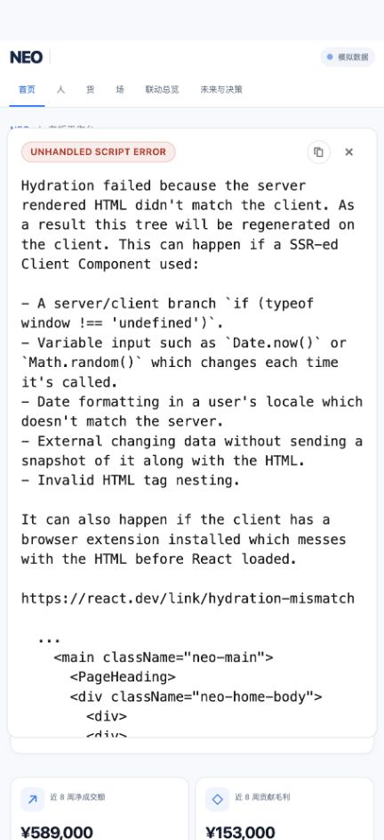
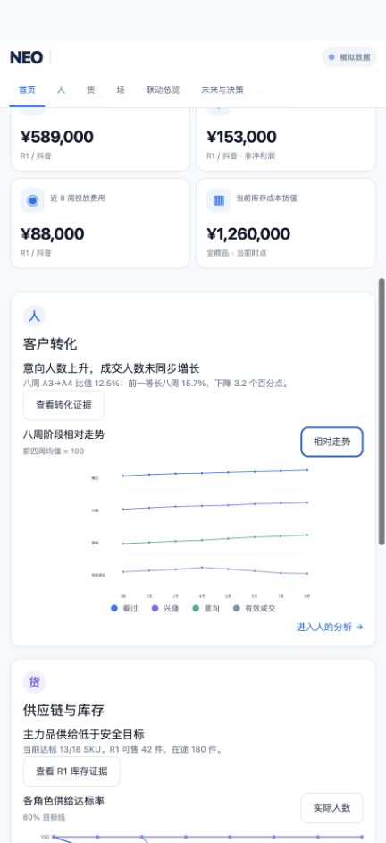

# NEO 界面检查 · 2026-09-29

## 本轮调整完成

按复核意见，首页删去重复标题和多余机会卡，把关键金额提前；全站辅助信息统一放大。原本分开的联动总览与未来决策已合并为导航中的“协同与决策”，保留 `/future` 旧地址并跳转过去。合并页按人、货、场证据、趋势图、渠道时间线、四周预测、情景选择、智能体协同、行动复盘排列。人的图表切换现在显示原始人数；供给率图移除错误的“实际人数”切换。行动状态可推进到复盘并保存到本地，截止时间更新为 2026-10-01。证据抽屉补上焦点移动、Tab 范围限制和关闭后焦点返回。

完整构建和渲染检查通过；五个主要页面均已服务端渲染，旧预测地址保留跳转。当前仍是本地模拟数据。

---

范围：当前 Codex 内置浏览器中的首页，以及从证据查看、图表切换到未来情景与行动确认的路径。浏览器截图为本次实际页面，默认窗口约 432 px 宽。结论只适用于已检查的状态，未全面审查其余四页、宽屏布局或真实业务数据。

## 1. 首页加载与首屏 — 已完成调整

首次打开出现 Hydration 错误，并发生页面内容重复。定位到图表 SVG `<title>` 使用多个 JSX 子节点；改为单个字符串后重新构建、重启并在浏览器验证，错误弹窗消失。

首页标题和诊断卡重复“意向增长，成交承接走弱”。当前窄窗口中，市场机会卡排在经营指标前，关键金额被推到首屏下方。建议压缩重复标题，让经营摘要和主决策入口更早出现。导航、蓝白卡片语言以及模拟数据标记可以保留。

## 2. 图表阅读与人数切换 — 已完成调整

“实际人数”按钮可切换图表布局，但人的图表仍使用前四周均值为 100 的相对指数：切换后首周“看过”仍是 90，而非原始人数。源代码中的两种显示模式共用同一个归一化序列。需要让实际人数模式使用原始 `stageWeekly`，同时更新说明和单位。

货的供给达标率图同样显示“实际人数”按钮，单位错误，应显示“达标率”或移除不适用切换。当前窄窗口中的图表标签与辅助说明偏小，部分图表需要横向滚动才能看到全部预测周；应增加明确滚动提示或设计窄屏版图表。

## 3. 查看关键证据 — 已完成调整

键盘打开抽屉后能看到数值、范围、来源、数据时间和说明。关闭可用。但打开后焦点仍停留在背景的“打开关键证据”按钮；按 Tab 后跳到背景市场机会卡，而非抽屉内部。

建议将焦点移入抽屉，限制 Tab 在抽屉内循环，关闭时归还触发按钮，并在打开期间禁用背景交互。不能仅凭截图宣称完整无障碍合规。

## 4. 协同与决策 — 情景与行动现已合并

选择 B 后标题更新为“方案 B · 先核查并保供”，未来周度值切换为 33、33、32、31，总量区间为 118–150 人。事实、预设情景与未回测的标注清楚。

可继续改善：将图表、情景对比和所选方案的行动草案放得更近，减少窄窗口中的往返滚动。当前页草案未清楚注明其是否对应所选方案。

## 5. 行动草案 — 已完成状态闭环

确认后状态更新为“人工确认”，按钮随即禁用；没有开始执行、记录观察和复盘的操作入口。页面列出五个阶段，但只能进入第二阶段，闭环未完成。测试后已重置演示草案并恢复首页。

草案的截止日期固定为 2026-09-26，与本次检查日期 2026-09-29 不一致；若作为冻结在 09-24 的历史演示，应清楚说明演示时钟，否则需显示逾期提示或使用演示日期生成期限。

## 本轮复核与验证

本轮已按上述问题完成界面和交互调整。最终页面截图：[简化首页](02-home-fixed.png)、[协同与决策](09-decision-start.png)、[证据抽屉](03-evidence.png)。完整 `npm test` 通过：28 项逻辑测试、完整构建、7 项渲染测试。浏览器验证包含实际人数切换、供给率图无错误切换、抽屉焦点进出、情景选择、行动从人工确认推进到复盘，以及 `/future` 旧链接跳转。

限制：浏览器自动鼠标定位结果不可靠，因此关键交互以键盘验证；未认定其为产品鼠标交互故障。未全面测试触屏、读屏器、色彩对比或所有页面的状态。当前页面仍为模拟数据，本次未部署。
