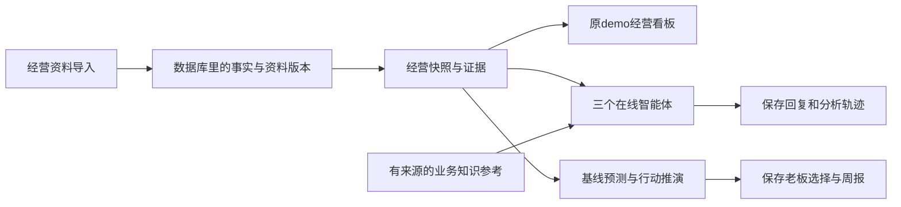

# 开发工具与业务知识接入

本轮把2026-10-06核对出的四类外部成果整合进当前主仓。原 `/demo` 是产品入口，沿用在线模型和已保存经营资料；Storybook仅供开发人员查看原组件与后端源码链路。

| 内容 | 主仓位置 | 使用方法 |
| --- | --- | --- |
| 原页面、证据、周报与后端链路预览 | `.storybook/`、`stories/` | `npm run storybook`，访问本机6006端口；`npm run build-storybook`构建预览 |
| 当前链路依据 | `scripts/backend-contract.mjs`、`scripts/generate-backend-map.mjs` | `npm run backend-map`扫描当前TS资源分支、FastAPI声明、数据库表和知识读取入口 |
| 模拟资料生成、独立计算、质量与接口校验 | `scripts/synthetic-data/` | `npm run synthetic:check`按生成→独立期望→质量校验→当前接口→字段字典依次执行 |
| 隔离构建与交付清单 | `agent-service/scripts/` | `npm run build:isolated`；`npm run tools:handoff` |
| 研究原件及可读知识包 | `docs/business-knowledge/research/`、`agent-service/neo_agent/business-knowledge.json` | 修改有来源的研究资料后运行 `npm run knowledge:build`；再验证并重启智能体 |

模拟工具生成至 `outputs/isolated-synthetic-20261004/`。接口校验每次新建独立D1/R2测试目录，不读取现有企业数据库，不调用模型，不启动巡检。生成器仅允许写入 `outputs/` 子目录，产出不能冒充真实经营资料。这里校验四模板v1事实，并通过现行v2接口录入主数据和到货计划；完整客户关联与全量资料对账另有既有验收，旧字段缺口描述不代表目前主仓仍缺少该功能。15850类计数是断言数量，不是独立测试用例数。

隔离构建复用现行稳定构建，输出 `outputs/stable-local/build/`。交付清单写入 `outputs/tool-handoff/manifest.json`，排除凭证、数据库、缓存与日志；文件清单自身不声称业务验收通过。

知识包含30条业务关系、50条成熟实践和29份来源。在线Agent实际执行 `describe_business` 时，会同时读取当前企业快照和最多6条相关规则、2条参考实践；运行轨迹保存知识版本、指纹及规则编号。跨企业通用的知识只作解释和建议核查，全部标记为“尚未经本企业确认”，不改变经营数值、身份映射、预测阈值或实际行动。来源核读日期为2026-10-04，接入不代表重新搜索或核验最新政策。酒店、画廊示例作为资料保留，没有新建行业产品模板。

研究目录中的检索索引和正文记录历史研究时点，不能当作当前源码验收；研究脚本已使用相对主仓定位。长期记忆、规则确认/撤回/过期以及真实经营结果反馈仍需另行开发与验收。

相关检查：`npm run test:development-tools`、`npm run test:python`、`npm run typecheck`；项目完整构建使用 `npm run build`。原产品在线启动沿用[稳定主版本说明](稳定主版本.md)，原有数据与会话不需要重新初始化。

当前链路：

本轮仅接入开发工具和知识读取，没有新增产品页面、数据库表或迁移，没有触发采购或投放。知识读取链路通过，不表示模型已经不会混淆客户阶段；经营回答质量修复见总控本轮验收记录。
