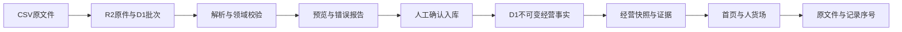

# 数据导入与经营看板 v1

本轮按 A 路线建设：TypeScript/vinext、D1、Drizzle 与 R2。在本地运行，未发布站点或写远端数据。

## 运行

在 growthos-dashboard 目录执行：

```bash
npm ci
npm run db:local
npm run dev:local
```

打开 http://127.0.0.1:3000/data/imports 。`db:local` 只应用本地迁移并初始化测试企业；不会清空数据。D1、R2 数据保存在被 Git 忽略的 `.wrangler/state/v3`。`dev:local` 只绑定回环地址，显式开启服务器测试身份 `local-owner`。

浏览器不能通过伪造身份头选择测试用户。只读/导入者验收可在服务器启动时配置 `NEO_LOCAL_USER_ID=local-reader` / `local-importer`。另有只属于 B 企业的 `local-b-only`。本地管理员有 A、B 两家测试企业权限。

普通 `npm run dev` 不启用本地身份。`npm run build` 若开启 `NEO_LOCAL_AUTH=true` 会拒绝构建，产物不包含本地身份。正式 Sites 环境需要平台可信入口、`NEO_TRUST_SITES_IDENTITY=true` 和真实用户成员关系；必须单独验收。不提供自助注册、成员管理或公共登录。

当前 `.openai/hosting.json` 保留原交接项目 ID，增加逻辑 R2 绑定 `RAW_FILES`。此修改没有创建云端资源；不能将该配置直接发布为自己的站点。

## 导入与数据口径

四类标准模板由 `/api/v1/import-templates/{type}` 提供，类型为 events、orders、inventory、expenses，版本 `1`。字段说明也显示在页面中。下载的模板只含表头；`public/import-samples/demo-*.csv` 是隔离工程验收样例，不能当真实经营数据。

离线空白模板同时保存在 `public/import-templates/v1/`，内容与接口模板一致。当前验证证据及未完成的浏览器检查见 `docs/ingestion-verification/README.md`。

- 只接受 UTF-8 CSV（允许 BOM），最多 1 MiB / 1,000 条；支持合法跨行引号字段。CSV 记录序号从表头 1 开始，不等于含嵌入换行时的物理文本行数。
- 每批选择来源名称、数据性质、覆盖日期；来源名须持续复用。覆盖只是提供者声明，未宣称业务已核实。
- 行为只接受 A1–A3、A5 事件次数。支付/退款只从订单模板提供，费用只从广告费用模板提供。
- 单个订单行只允许一条支付事实；多订单行用订单 ID 去重订单数。退款必须关联同来源、渠道和 SKU 的原支付，且不得超额退款/退货/成本回转；退款时间不能早于支付。
- 以订单支付/退款实际发生日计算净成交额；不同来源的订单 ID 分开去重。退款不减少历史支付订单数。部分退款数量须填实际整数退货数量；仅金额补偿、零数量退款暂不支持。
- 金额、数量必须是安全范围内非负整数（行为及订单数量须大于 0）；成本和库存选填数值保留 null。汇总溢出拒绝，不用浮点舍入掩盖。
- 贡献毛利要求每条订单及退款的成本有记录，并且订单/费用每个来源都覆盖统计期；缺失时显示待补数据。贡献毛利不是净利润。
- 库存来源记录 ID 可省略，服务端根据仓库/SKU/快照时点生成；其他模板必须提供来源记录 ID。库存逐仓库/SKU选择截至日前最近一次已导入时点，零库存保留；不声称实时全量。没有历史/安全库存时不生成趋势与达标率。
- 同企业、来源、模板、性质及文件指纹重传回读已有批次；同文件不同覆盖日期报冲突。重复记录跳过，内容变更禁止覆盖。不同数据性质隔离。
- 原件由 R2 持久化；D1 保存批次、标准化行及原件关联。结构校验通过不代表真实业务验证。

## 数据链路与接口



后端位于 `server/`；`app/api/v1/[...segments]` 是薄路由。`business_facts` 用 kind 区分四类强校验事实，共用企业、来源、批次、记录键和血缘结构；不是四套重复的管道。旧 `datasets/business_events` 表保留，旧 `/api/data` 返回 410，不自动迁移无企业归属的旧数据。

完整接口契约见 `docs/api/openapi.json`。列表 cursor 为非负整数偏移，limit 为 1–100。业务响应禁止共享缓存。所有路径都校验企业成员关系，跨企业资源返回 404；写入另检查角色和同源 Origin。

上传先返回校验批次（201，新建；200，幂等回读），不会发布业务事实。状态为 validating、ready、invalid、committed、failed。确认提交携带 validationVersion。存在坏行则整批阻止提交；有效行不会被静默部分导入。

使用 JSON 分块写入暂存行，减少 D1 调用和参数数目；发布事实、完成批次与审计在同一个 D1 batch 事务内完成。退款触发器与唯一索引阻止并发冲突；失败不写成功审计。写入异常先 GET 回读，再重试。failed 可重传原件恢复；validating 超过五分钟的中断批次可重传原件恢复并递增校验版本。

导入与生成快照是两个操作。快照失败仍保留已入库事实，在页面单独更新快照。当前采用有界同步处理，不提供队列、进度百分比或服务端取消。快照最多 10,000 条事实、366 天，另受证据关联和 D1 2 MB 行大小安全检查约束；超限要求按商品/渠道缩小范围。

默认统计截至日之前的八个完整自然周；可显式选日期。显式非周一起日的首/尾周按实际区间显示，其余自然周从周一到周日。库存有独立截至时点。快照保存输入批次、来源覆盖、计算版本和证据；旧快照不可变。页面间通过 URL 传递企业、性质和 snapshotId；无 localStorage 业务记录。

用户指定的原 NEO 界面现为唯一产品界面：`/demo?page=people|goods|market|overview|weekly` 默认读取已保存快照，主业务路由也复用同一套原组件；`/demo?mode=example` 显式保留旧模拟示例。业务数据缺失或读取失败不引用模拟 JSON；企业、性质、快照通过URL传递，缺失能力保留原结构并显示待接入。没有另建或用简化老板看板替换原界面。

## 验收与回退

`npm test`：旧纯计算测试、Miniflare 实际 D1/R2 集成测试、完整构建及 SSR/路由测试。`npx tsc --noEmit --incremental false`：类型检查。集成测试使用独立临时数据库与存储，不改本地浏览器验收数据。

本轮验收运行环境是 Node.js 24.14.0；集成测试直接加载 TypeScript 源码，建议复验使用同一 Node.js 主版本。

浏览器验收使用同企业四类隔离样例，核对已入库记录、两个订单行去重为 1 笔订单、退款、零库存、贡献毛利与逐条来源。此样例应得净成交额 200 元、费用 20 元、成本 100 元、贡献毛利 80 元，可售库存 4 件。证据应对应 demo-orders.csv 的第 2–4 条记录。

本地代码基线 commit 为 `17fefe4`；没有关联远端。迁移为增量且旧表保留；不要改写已应用 SQL。代码回退可参考该基线。若需要数据回退，先停本地服务并保存整个 `.wrangler/state/v3` 副本再恢复；代码回退不会自动撤销业务数据库写入。

所有演示样例标 demo；未取得授权企业样本、正式登录、远端存储和生产性能证据，因此本轮完成只认定本地工程闭环。既有 lint 历史问题不在本轮无关修复范围；依赖审计与正式部署另行核验。

## 第一轮修复补验 · 2026-10-03（历史版本）

本节及其截图/日志为当时的代码和隔离环境证据，保持原件不改。3102端口现由下节新的隔离运行副本占用；本节不能代替最新原界面接入的复验。

修复版本 `r1-url-sync-20261003-81f71e99f606`；Git HEAD 保持 `17fefe4`，原导入实现及本次修复均尚未提交。版本以 `docs/ingestion-verification/round1-repair/source-after.json` 中 121 个代码/非凭证配置文件的 SHA-256 清单为准；文档、证据、凭证与运行数据不参与该代码指纹。已核对隔离运行副本与这份清单逐文件一致。

`components/business/use-workspace.ts` 统一管理企业、数据性质、快照与当前地址。切换范围写入历史并去掉旧快照 ID；生成快照成功后写入新 ID；浏览器 popstate 从当前地址恢复。无 ID 的最新快照请求完成后固定其 ID；明确指定的历史 ID 按原版本读取，缺失时显示错误。请求序号阻止旧范围的慢响应覆盖新页面；证据抽屉绑定其打开时的快照 ID。该修复影响导入、首页与人货场的共同范围导航，没有修改事实存储、计算口径或企业权限。

新加 `tests/workspace-navigation.test.mjs` 挂载实际生产 Hook，以 React/jsdom 检查刷新、复制链接、前进后退、快照发布及慢请求竞争。4 项初始用例在旧实现下失败，最终 7 项通过。完整 `npm test` 通过 53 项逻辑/D1/R2/导航测试、生产构建和 18 项 SSR/路由测试；TypeScript 与业务组件/新增测试的 ESLint 通过。`jsdom@27.4.0` 仅用于开发测试。

浏览器验收全部使用新的 `/private/tmp/neo-r1-repair-MnU654/app` 副本、端口 3102 与其独立 `.wrangler/state/v3`。企业 A 的四类 demo 样例为起点，再用真实文件选择器选择 `repair-add-seven.csv`，校验后确认入库。A1 从 100 变 107，新快照 URL、刷新、周度趋势及两条来源记录一致；旧快照直链和后退仍为 100。企业 B 刷新及复制链接仍为空，business 性质刷新保持不变。独立 Chrome 会话和 IAB 读取同一个已保存快照，均为 107。重复上传/提交不新增批次或累计事实，跨企业快照/证据/原件返回 404，浏览器原件下载与上传 CSV 的字节和指纹一致。

可回读截图、接口结果、版本清单、源代码备份位置及复验入口见 [第一轮修复证据](ingestion-verification/round1-repair/README.md)。原监督记录保持不变。本次只交付修复与补验，等待监督独立复验；没有授权企业样本、生产身份或线上验收，不认定整体验收通过。

## 原前端数据接入补验 · 2026-10-03

代码版本 `neo-ui-data-20261003-2739f098fa47`，计算版本 `ingestion-v1.2`，Git HEAD仍为 `17fefe4`；尚未提交。当前默认 `/demo` 读取D1保存的快照，金额、行为/订单曲线、库存与渠道证据接到用户指定原界面。未改CSS、图片、原布局，未加另一套老板看板。显式 `mode=example` 才读取原COCA演示；业务模式缺失不回填模拟值。

复用第一轮隔离样例后，通过Chrome真实文件选择器正常上传第二组四类CSV、预览、确认入库。净成交额200→300元，变动成本100→140元，投放费用20→30元，贡献毛利80→130元，库存货值200→300元，A1 107→114次，支付订单1→2笔，库存4→6件。原首页、简报、客户曲线点、渠道和W2库存来源均已回读对应快照及原件；重复上传/提交未累计。独立IAB会话刷新也读到114及三条来源。旧100及107直链保持旧值，前进/后退恢复对应版本，B企业刷新及复制链接维持空态，business性质刷新保持为空。

新增可选库存成本聚合和综合经营证据，不改旧不可变快照和迁移；修正原页面带page/view/hash的范围链接。59项逻辑/D1/R2/导航/适配测试、完整构建、19项SSR通过；最后显示绑定调整后补跑11项受影响回归、TypeScript、局部ESLint（0错误、3个既有图片警告）、最终完整构建和19项SSR。活服务另完成19次JSON回读、四原件字节核对、幂等和跨企业404检查。检查范围及版本时点详见证据文档，不声称全项目lint或整体验收通过。

运行在 `/private/tmp/neo-front-connect-_qg43o7z/app` 的独立D1/R2副本，3102端口。原项目业务存储及64份第一轮证据未改，没有远端写入或发布。授权企业样本、真实客户身份贯通、SKU角色/供给规则/ETA、市场来源和经营诊断服务尚缺；预测、行动、周报与智能体本轮不开发。缺失状态是当前基础接入阶段的边界，不代表完整产品目标完成。

页面输入/公式/API/证据映射、四份追加文件、可回读截图日志、回退位置及准确版本见 [原前端接入验收](frontend-integration/README.md)。交回项目监督独立复验。

## 虚拟数据库样例实际导入 · 2026-10-03

用户随后提供 `/Users/majun/Desktop/NEO/虚拟数据库_Demo/`，授权通过后端导入。使用现有HTTP上传/校验/确认接口向此前为空的企业B、demo性质、独立来源 `NEO Demo 虚拟数据库 v1` 写入事件24、订单394、库存252、费用32，共702条。源SQLite和CSV未改；产品代码指纹仍为 `neo-ui-data-20261003-2739f098fa47`，本轮没有改前端或后端实现。

R1/抖音快照为 `snap-6a61a2b4c9e173086fe925ea0d5719a13e98d7eaaec8035c760e6684a72f1e60`：净额589,000元、成本348,000元、投放88,000元、毛利153,000元、支付310笔、库存货值58,000元。全商品库存货值1,260,000元，28个仓库/SKU最新记录。原首页、金额证据、客户刷新、商品表和导入历史均已浏览器回读；34项活后端检查通过，四份R2原件字节一致、重复不累计，A既有快照未改变。**上文B空态是历史验收状态；本轮导入后B demo有数据，不再要求它为空。** business性质仍未接样例。

实际结果、批次/快照、日志、截图及未支持的数据内容见 [虚拟数据库实际导入记录](../../../虚拟数据库_Demo/reports/live-import-2026-10-03/README.md)。运行存储仍为本地隔离副本；全部为合成demo，不算真实企业验收。SQLite里的角色/ETA/市场/预测/行动/周报/智能体预设尚无相应导入接口，未声称整库均已接入。本轮没有修改代码，因此未重复构建和全量单元测试，以活后端导入对账及实际页面读取验证本次数据操作。
