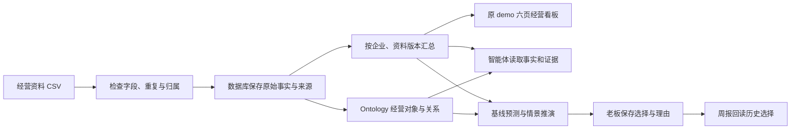

# NEO 稳定主版本 2026.10.05

本版合并已有五条优化线和 Ontology 优化，沿用原 `/demo`：今日经营、我的客户、供应链与库存、渠道与竞品、预测推演、行动决策及周报。没有新增老板前端。行动仅比较情景、保存老板选择，不采购、投放、派单。

## 经营链路



企业、资料性质和快照贯穿整条链路，防止不同企业、不同资料版本或静态演示的结果混在一起。看板展示的是数据库汇总；预测保存所用的固定输入、计算版本与证据；老板的选择单独留档，实际经营结果未录入时保持空白。

## 启动与数据位置

首次使用请先按 [README 快速开始](../README.md#快速开始本地模拟) 安装 Node.js、Python 和依赖。在当前项目目录运行：

```sh
npm run setup:local:stable
npm run build:local:stable
NEO_EXECUTION_MODE=offline npm run start:stable
```

默认 Web 为 `http://127.0.0.1:3102/demo`，Agent 为本机8138。启动日志给出已导入的企业和资料版本链接。端口占用时启动会报错，不终止其他进程。停止用当前终端 Ctrl+C。源码变化后，启动会拒绝旧构建，须重新执行本地构建。

本地稳定构建与模拟数据库都在 `outputs/stable-local/`，与原 `.wrangler` 企业库、旧 Agent 状态及正式 `dist/` 分开。`.dev.vars`、`agent-service/.env` 保持原样；内部认证令牌只在本轮启动内存里生成。`setup:local:stable` 通过正式CSV上传→校验→提交→快照接口录入合成资料，不直接灌看板数值；已存在的资料会回读并保留。

离线模式不调用真实模型；切换为默认的在线模式时，可使用 `agent-service/.env` 中已配置的真实模型，原 `/demo` 三个智能体可手动提问与追问。服务端仅授权本地隔离模拟企业的手动调查，关闭自动巡检和外部市场检索；浏览器不能扩大授权。`npm run start:stable:chat` 也可启动同一真实对话版本。对真实企业正式接入需先确认真实资料、身份和运行配置；这里不自动迁移原库或发布生产。

2026.10.06 对话修复验收：完整调查输入无损压缩后保存，Python 服务解包核对企业与资料版本；模型接收完整期间与周汇总，商品渠道明细分页读取，避免重复明细占满对话预算。完整原始记录、来源及查询轨迹仍保存在后台；数据缺失不补零，支付订单笔数与关联客户人数分开解释。真实模型对话的独立验收记录位于 `/Users/majun/Desktop/NEO/监督/agent-chat-fix-2026-10-05/`。

`/demo?mode=example` 用同一套组件保留最初静态演示。普通 `/demo` 读取数据库资料，空值和缺口如实显示。

## 开发与复验

```sh
npm run typecheck
npm run test:node
npm run test:python
npm run build
node --test tests/rendered-html.test.mjs
npm run test:materials:full24
```

固定反例保存于 `tests/fixtures/`。`examples/neo-synthetic-20261004/` 是已验收模拟包的输入摘录，包含设计、原始记录、实际导入CSV及必要坏样例；不复制三个生成的SQLite或把它们冒充真实数据库。核心源记录 SHA256 保持 `b00d1a5e683a4a9154008f3a9c5daa3d3c9fd643e60809c7d7fc075c599f13f7`，原完整包清单保留于 original-package-manifest.json。

## 合并与回退

原仓已执行的 `0007_fluffy_cerebro.sql` 保留。资料版本唯一约束为 `0008_striped_diamondback.sql`，引用事务保护为 `0009_operating_material_reference_guard.sql`。不能把另一个 checkout 的旧迁移编号或整库直接复制到原库。

源码、原Git差异、凭证及本地数据库的合并前回退副本在 `/Users/majun/Desktop/NEO/监督/main-stable-2026-10-05/rollback-before-merge/`。凭证副本仅供本地恢复，不包含在发布材料中。回退时先保存新资料并关闭本版本服务，逐文件恢复本次替换清单；如涉及数据库升级，使用匹配的整库备份，不删除迁移账本伪装回退。

完整资料的固定输入与跨服务传输采用有界无损压缩，兼容旧JSON与旧压缩输入。16MiB逻辑输入或压缩后的存储字段超限时返回413，失败版本不会替换已生效的投影；原始事实、来源与计算版本保持不变。

最终版本指纹及在线对话修复证据由 `NEO_STABLE_VERSION.json` 和 `/Users/majun/Desktop/NEO/监督/agent-chat-fix-2026-10-05/验收记录.md` 记录；此前完整合并证据保留于 `/Users/majun/Desktop/NEO/监督/main-stable-2026-10-05/`。开发对话的自验不能替代最终整合版核验。

预测使用 scenario-v1.3、asof-backtest-v2。有库存无历史销量的商品保留库存并明确需求未知；金额未知不补零。历史资料实际在预测日之后获得时，不声称无泄漏回测。合成流程通过不代表真实经营预测提升、真实LLM质量或生产可用。

## 在线对话验收范围 2026.10.06

原页面三域真实模型提问、同会话追问、刷新回读通过；195 Python、52项相关Node（两份有效日志组合）、26项渲染、类型检查与构建有独立证据。真实模型调用与模拟经营资料分开标识。个别回复仍会把重复查询的阶段限制误说成资料权限故障、误报明细缺口；这些属于待修的答案质量，本轮不签收全部经营研判正确性。历史失败与旧错误回复保留审计，不改写成成功。自动巡检与外部检索保持关闭。
